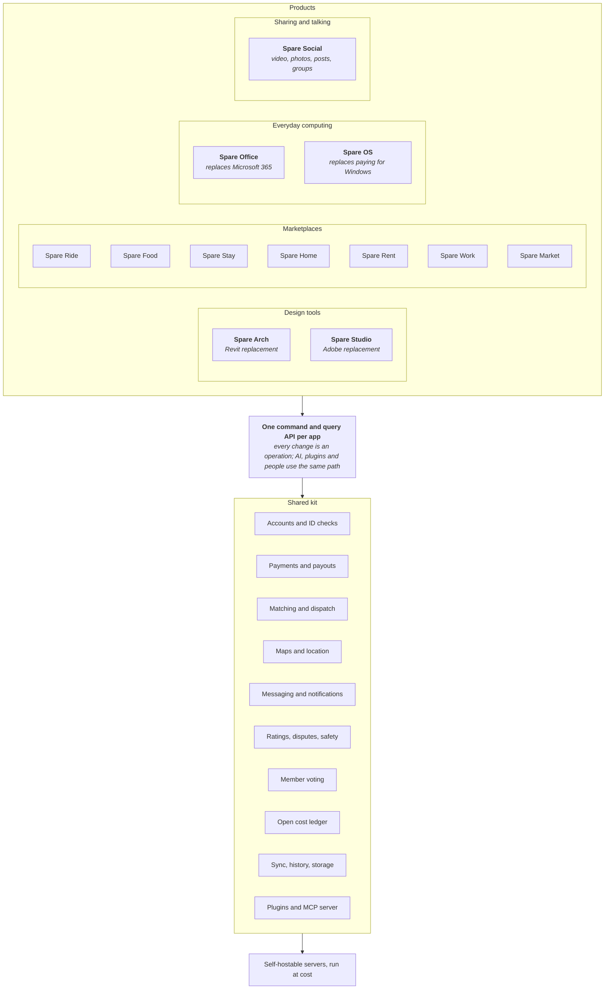
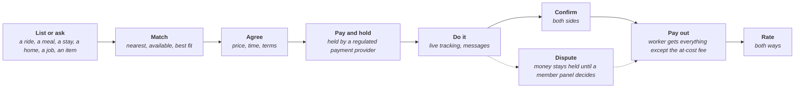

# Spareware architecture: how all the programs fit

*Stage: Mapping. Every choice below is open for discussion until an owner accepts a decision note for it.*

All Spareware programs sit on one shared kit and follow one set of rules. A product is a thin layer of its own rules on top of the kit, so every new app gets accounts, payments, AI access, sync and the open cost ledger for free, and a fix to the kit improves every app at once.



## Four families of product

| Family | Products | What they need most |
| --- | --- | --- |
| Design tools | Spare Arch; [Spare Studio](projects/spare-studio/ARCHITECTURE.md) (working name), ideally with [ArtCraft](https://github.com/storytold) under the umbrella | Heavy local computing, a geometry kernel or GPU image pipeline, desktop and browser, huge files, drawings and print |
| Marketplaces | Spare Ride, Food, Stay, Home, Rent, Work, Market | Two-sided matching, payments, trust and safety, phones, real-time location, each industry's rules |
| Everyday computing | [Spare Office](projects/spare-office/ARCHITECTURE.md), [Spare OS](projects/spare-os/ARCHITECTURE.md) | Open file formats and protocols, live co-editing, a proven Linux base, a painless move from Windows |
| Social | [Spare Social](projects/spare-social/ARCHITECTURE.md) (working name) | Video storage and delivery at cost, feeds people choose, moderation that removes only what the law requires, open social protocols |

Design tools lean on the Rust core pattern mapped in [Spare Arch's ARCHITECTURE.md](projects/spare-arch/ARCHITECTURE.md), and share its renderer, 2D drawing engine and PDF output with Spare Studio. Marketplaces lean on the shared kit. Both use the same command layer, plugins, sync and AI access.

## Rules every program follows

1. **At cost.** Each app charges only what it costs to run: servers, payment processing, and insurance or licences where the law requires them. The fee is published on the open cost ledger. The people doing the work keep the rest.
2. **Free to use** unless there is a real running cost to cover.
3. **Members own it.** Spareware Co-op is owned by its members. Workers in each app have a vote on that app's fees and rules.
4. **Headless.** Everything a person can do in an app, an AI agent or a script can do through the same commands.
5. **Open formats and open data.** Members can take their data and their history with them.
6. **Built legally, or not at all.** See the README. No exceptions.
7. **Port proven methods; measure everything.** The same ground rules as Spare Arch.

## The shared kit

| Part | What it does | Used by |
| --- | --- | --- |
| Accounts and ID checks | Sign-in, identity and licence checks (drivers, couriers, hosts, trades) | All |
| Payments and payouts | Customers pay, workers are paid out, the at-cost fee is taken and shown. Card handling goes through a regulated payment provider; Spareware never builds its own card processing | All marketplaces |
| Matching and dispatch | Pairs a request with a worker or listing: nearest driver, available courier, free dates, right trade | Ride, Food, Stay, Work |
| Maps and location | Addresses, routing, live location, areas served | Ride, Food, Stay, Home, Rent |
| Messaging and notifications | In-app chat, push, email, SMS | All |
| Ratings, disputes, safety | Two-way ratings, dispute handling, emergency and reporting tools | All marketplaces |
| Member voting | Proposals and votes on fees and rules, per app and co-op-wide | All |
| Open cost ledger | Monthly public record of what each app cost to run and what the fee paid for | All |
| Sync, history, storage | Operation log, offline work, version history, chunked storage | All; heaviest in Spare Arch |
| Plugins and MCP server | Sandboxed add-ins and AI access on every app | All |
| Marketplace engine | Listings, requests, orders, pricing rules and the at-cost fee, as one shared loop | All marketplaces |

## The marketplace pattern

Every marketplace is the same loop: someone lists or asks, the kit matches, the money is held, the job happens, both sides rate, the worker is paid, and the fee covers only the running cost. The loop is built once in the kit's marketplace engine (`kit-market`); each app adds only its own rules.



| Step | Kit part | What each app adds |
| --- | --- | --- |
| List or ask | Accounts, marketplace engine | What a listing is: a trip, a menu, a calendar, a property, a tenancy, a job, an item |
| Match | Matching and dispatch, maps | How to match: nearest driver, free courier, open dates, search, quotes |
| Agree | Marketplace engine (pricing rules) | How price is set: metered fare, menu price, nightly rate, sale offers, weekly rent, quote, fixed price or auction |
| Pay and hold | Payments | When money moves and what the law says about holding it (piece K02) |
| Do it | Maps, messaging, safety | Live tracking for rides and deliveries; check-in for stays; viewings for homes |
| Confirm and pay out | Payments, open cost ledger | When a job counts as done |
| Rate and resolve | Ratings, disputes, member voting | The industry's own safety rules |

**The at-cost fee.** Each app's fee is its last period's running cost divided by its jobs, published on the open cost ledger, and voted on by that app's members. Payment-processor charges are passed through at cost. No margin is added; any surplus lowers the next period's fee.

**Who decides.** Workers on each app are members of the co-op and vote on that app's fees and rules. Co-op-wide matters, such as the kit, the legal rules and the licence, go to every member.

## Shared technology

- **Core:** Rust libraries, compiled native and to WebAssembly, so the same code runs on servers, desktops, phones and in the browser.
- **Front ends:** HTML and TypeScript. Phone apps for the marketplaces: approach still open (see decisions).
- **Plugins:** sandboxed WebAssembly components with declared permissions.
- **AI:** an MCP server on each app's command API.
- **Hosting:** any member group can run its own servers; the co-op runs the main ones at cost.

## Each industry's hard parts

Software is the easy part. Researched on 2026-10-18 (not legal advice; each program's map has the sources and marks what is unverified):

| Product | Incumbent's cut | The hard part |
| --- | --- | --- |
| Spare Ride | Uber illustrates 28% of the fare plus a rider fee | The co-op needs a small passenger service licence; the Supreme Court found Uber drivers are employees, so drivers' status is a first decision |
| Spare Food | Uber Eats 30% (16% own staff, 8% pickup) | Courier status as for rides; enough restaurants and couriers at once |
| Spare Stay | Airbnb 15.5% for most hosts | Platform collects GST and reports hosts' income to IRD; council rules differ |
| Spare Home | Agents commonly 3-4% plus GST (*unverified*) | Never act as an agent without a licence; buyers' attention lives on the big sites |
| Spare Rent | Property managers 7-10% of rent plus a letting fee | Bonds go only to Tenancy Services; notice periods and Healthy Homes built in as rules |
| Spare Work | Builderscrack $79-149 a month for leads; Fiverr 20% | Licence checks; people going around the platform after the first job |
| Spare Market | Trade Me 2.19% to sellers plus buyer fees since March 2026 | Anti-money-laundering rules apply to marketplaces; Trade Me's network effect |

Across all of them: for ride-sharing, food delivery and short stays the platform itself must collect GST, and money should be held by a regulated payment provider (see the [kit map](projects/kit/ARCHITECTURE.md)).

## How the repo is laid out

| Path | What it holds |
| --- | --- |
| `README.md` | The intro, the legal rules, how to give spare tokens |
| `CONTRIBUTING.md` | How to request to join |
| `AGENTS.md`, `CLAUDE.md` | What a contributor's agent follows |
| `ARCHITECTURE.md` | This map: how all the programs fit |
| `STATUS.md` | Every project's stage and open work |
| `Cargo.toml` | One Rust workspace for every program |
| `projects/kit/` | The shared kit: `crates/` compiled into every app, `services/` that run once for all apps |
| `projects/engines/` | Shared engines for the design tools: renderer, 2D drawing, text, PDF, video and audio |
| `projects/spare-<name>/` | One folder per program: `README.md`, `ARCHITECTURE.md`, `STATUS.md`, `notes/`, `crates/`, `app/` |
| `projects/_template/` | The starting folder copied for each new program |

```text
spareware/
├─ Cargo.toml                 one workspace for all Rust code
├─ projects/
│  ├─ kit/
│  │  ├─ crates/              kit-core, kit-ops, kit-store, kit-sync, kit-plugin, kit-mcp, kit-market
│  │  └─ services/            accounts, payments, matching, maps, messaging, trust, voting, ledger
│  ├─ engines/crates/         engine-render, engine-draw2d, engine-text, engine-pdf, engine-media
│  ├─ spare-arch/
│  │  ├─ crates/              arch-model, arch-kernel, arch-solver, arch-regen, arch-elements,
│  │  │                       arch-families, arch-views, arch-clash, arch-versions,
│  │  │                       arch-interop, arch-api, arch-cli
│  │  ├─ app/                 interface and desktop shell
│  │  └─ notes/
│  ├─ spare-office/
│  │  └─ crates/              office-core, office-formats, office-collab, office-write,
│  │                          office-sheets, office-slides, office-notes, office-forms,
│  │                          office-drive, office-mail, office-calendar, office-chat,
│  │                          office-meet, office-automation, office-app, office-admin,
│  │                          office-migrate
│  ├─ spare-studio/           crates and app added at its Design stage
│  ├─ spare-ride/ … spare-market/
│  └─ _template/
```

**Layering rule:** a program depends on `projects/kit` and `projects/engines`, never on another program. Anything two programs both need moves down into the kit or an engine. The kit and engines never depend on a program. This is what lets the co-op add program after program without them tangling.

Every crate exists now as an empty library describing its job, the part of the map it implements, and the piece of work it waits on. Code starts in a crate only once its program reaches the Design stage.

Everything stays in one repo and one workspace, so a change to the kit is checked against every program at once. A program only moves out if it needs its own release cycle, and then uses the kit as published crates.

## Open decisions for the whole co-op

| Decision | Options | Lean |
| --- | --- | --- |
| Legal entity | NZ co-operative company; incorporated society; charitable trust | A federation: a steward society holds the code and name; NZ co-operative company runs the platforms; a local co-op per country ([K01 note](projects/kit/notes/K01-legal-entity.md), in review) |
| Licence | MPL-2.0 core with Apache-2.0 SDK; Apache-2.0 for all; MIT | MPL-2.0 core, Apache-2.0 SDK |
| Payment provider | Stripe Connect; local NZ providers | Research first (piece K02) |
| Phone apps | Web apps installed from the browser; Tauri mobile; native | Research first (piece K04) |
| First marketplace | Ride, Food, Work or another | Research first (piece K05) |
| Hosting | Co-op hosted at cost; member self-hosting; both | Both |

The shared kit's work board is [projects/kit/STATUS.md](projects/kit/STATUS.md).
