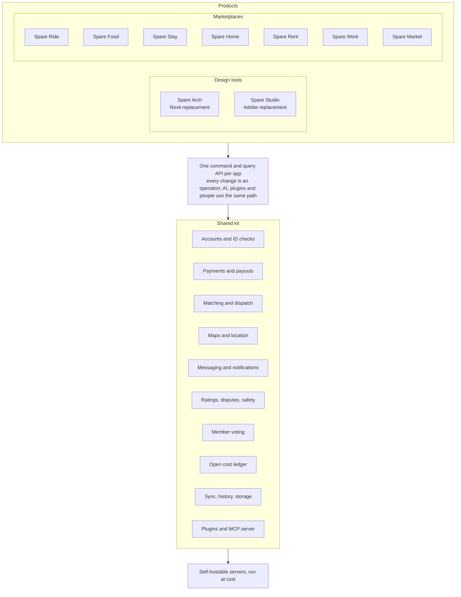

# Spareware architecture: how all the programs fit

*Stage: Mapping. Every choice below is open for discussion until an owner accepts a decision note for it.*

All Spareware programs sit on one shared kit and follow one set of rules. A product is a thin layer of its own rules on top of the kit, so every new app gets accounts, payments, AI access, sync and the open cost ledger for free, and a fix to the kit improves every app at once.

## Two families of product

| Family | Products | What they need most |
| --- | --- | --- |
| Design tools | Spare Arch; [Spare Studio](projects/spare-studio/ARCHITECTURE.md) (working name), ideally with [ArtCraft](https://github.com/storytold) under the umbrella | Heavy local computing, a geometry kernel or GPU image pipeline, desktop and browser, huge files, drawings and print |
| Marketplaces | Spare Ride, Food, Stay, Home, Rent, Work, Market | Two-sided matching, payments, trust and safety, phones, real-time location, each industry's rules |

Design tools lean on the Rust core pattern mapped in [Spare Arch's ARCHITECTURE.md](projects/spare-arch/ARCHITECTURE.md), and share its renderer, 2D drawing engine and PDF output with Spare Studio. Marketplaces lean on the shared kit. Both use the same command layer, plugins, sync and AI access.

## Rules every program follows

1. **At cost.** Each app charges only what it costs to run: servers, payment processing, and insurance or licences where the law requires them. The fee is published on the open cost ledger. The people doing the work keep the rest.
2. **Free to use** unless there is a real running cost to cover.
3. **Members own it.** Spareware Co-op is owned by its members. Workers in each app have a vote on that app's fees and rules.
4. **Headless.** Everything a person can do in an app, an AI agent or a script can do through the same commands.
5. **Open formats and open data.** Members can take their data and their history with them.
6. **Built legally, or not at all.** See the README. No exceptions.
7. **Port proven methods; measure everything.** The same ground rules as Spare Arch.

## The shared kit

| Part | What it does | Used by |
| --- | --- | --- |
| Accounts and ID checks | Sign-in, identity and licence checks (drivers, couriers, hosts, trades) | All |
| Payments and payouts | Customers pay, workers are paid out, the at-cost fee is taken and shown. Card handling goes through a regulated payment provider; Spareware never builds its own card processing | All marketplaces |
| Matching and dispatch | Pairs a request with a worker or listing: nearest driver, available courier, free dates, right trade | Ride, Food, Stay, Work |
| Maps and location | Addresses, routing, live location, areas served | Ride, Food, Stay, Home, Rent |
| Messaging and notifications | In-app chat, push, email, SMS | All |
| Ratings, disputes, safety | Two-way ratings, dispute handling, emergency and reporting tools | All marketplaces |
| Member voting | Proposals and votes on fees and rules, per app and co-op-wide | All |
| Open cost ledger | Monthly public record of what each app cost to run and what the fee paid for | All |
| Sync, history, storage | Operation log, offline work, version history, chunked storage | All; heaviest in Spare Arch |
| Plugins and MCP server | Sandboxed add-ins and AI access on every app | All |

## Shared technology

- **Core:** Rust libraries, compiled native and to WebAssembly, so the same code runs on servers, desktops, phones and in the browser.
- **Front ends:** HTML and TypeScript. Phone apps for the marketplaces: approach still open (see decisions).
- **Plugins:** sandboxed WebAssembly components with declared permissions.
- **AI:** an MCP server on each app's command API.
- **Hosting:** any member group can run its own servers; the co-op runs the main ones at cost.

## Each industry's hard parts

Software is the easy part. Each marketplace has rules that must be researched before it is mapped. The NZ laws below are starting points to check, not legal advice.

| Product | Hard part to research first |
| --- | --- |
| Spare Ride | Small passenger service licences and driver checks (Land Transport rules), passenger insurance, enough drivers and riders in one town at once |
| Spare Food | Food safety rules for restaurants, courier safety and pay, restaurant sign-up |
| Spare Stay | Council rules on short stays, guest and host insurance |
| Spare Home | Selling privately is allowed; anyone acting as an agent must be licensed (Real Estate Agents Act 2008); listing site reach |
| Spare Rent | Residential Tenancies Act duties, bond lodgement, tenant screening limits |
| Spare Work | Contractor law, holding payments until a job is done, trade licences |
| Spare Market | Consumer law (Fair Trading Act, Consumer Guarantees Act), fraud and scams |

## How the repo is laid out

| Path | What it holds |
| --- | --- |
| `README.md` | The intro, the legal rules, how to give spare tokens |
| `CONTRIBUTING.md` | How to request to join |
| `AGENTS.md`, `CLAUDE.md` | What a contributor's agent follows |
| `ARCHITECTURE.md` | This map: how all the programs fit |
| `STATUS.md` | Every project's stage and open work |
| `projects/<name>/` | Each project's `STATUS.md` (work board), `ARCHITECTURE.md` and `notes/` |

Everything lives in one repo while the projects are small. A project moves to its own repo once it reaches the Build stage and needs its own releases.

## Open decisions for the whole co-op

| Decision | Options | Lean |
| --- | --- | --- |
| Legal entity | NZ co-operative company; incorporated society; charitable trust | Research first (piece K01) |
| Licence | MPL-2.0 core with Apache-2.0 SDK; Apache-2.0 for all; MIT | MPL-2.0 core, Apache-2.0 SDK |
| Payment provider | Stripe Connect; local NZ providers | Research first (piece K02) |
| Phone apps | Web apps installed from the browser; Tauri mobile; native | Research first (piece K04) |
| First marketplace | Ride, Food, Work or another | Research first (piece K05) |
| Hosting | Co-op hosted at cost; member self-hosting; both | Both |

The shared kit's work board is [projects/kit/STATUS.md](projects/kit/STATUS.md).
