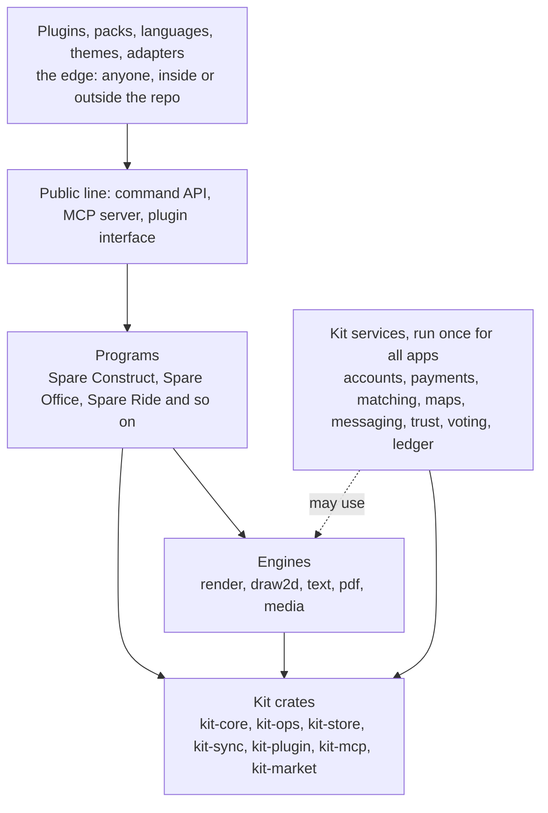

# Extending Spareware: how anyone can keep adding to it

*Stage: Mapping. Written 2026-10-19. This is a proposal. Every choice below is open until an owner accepts a decision note, and a major change also needs a vote of members (see the [README](README.md)). Anything not checked is marked unverified.*

Spareware is meant to last for decades. That only works if three things hold. The centre stays small and stable. Almost all new work happens at the edge, where anyone can add it without asking. And everything can leave: any person's files, data and account can be taken elsewhere, and any group can run the whole thing without us.

Spareware is international and free to join. There are no member shares and the only charge is running costs. Major changes go to a vote of members. This page is about the shape of the software that makes that last.

This page builds on the maps already in the repo: [ARCHITECTURE.md](ARCHITECTURE.md), the [kit map](projects/kit/ARCHITECTURE.md) and the [kit feature map](projects/kit/FEATURES.md). Part IDs such as KIT-A16-F5-P2 point into that feature map.

## The short version

| If you want to... | You do this | Who has to say yes |
| --- | --- | --- |
| Add a whole new program | Copy `projects/_template`, write its map | A vote of members (starting a program is a major change) |
| Add an action to a program | Add a command to its schema | The program's owners, after a design note |
| Add a feature without touching the code | Write a plugin | Nobody to write it; the directory reviews it before listing |
| Add a country | Write a country pack | The kit owners and a reviewer who knows that country's law |
| Add a language | Translate the message files | That language's reviewers |
| Change how it looks | Write a theme on the design tokens | An automatic contrast check |
| Read or write another file format | Write an adapter | The program's owners, and a legal check for closed formats |
| Use a different AI model | Point your agent at the MCP server | Nobody |
| Run your own server | Use the self-host package | Nobody (a signed agreement covers legal duties) |
| Remove a published extension point | Do not | A long notice and a vote of members |

## 1. The layers, and what may depend on what

**How it works.** The code sits in layers. A layer may use the layers below it and never the layers above it.

This is the layering rule already in [ARCHITECTURE.md](ARCHITECTURE.md), written out in full. A program depends on `projects/kit` and `projects/engines`, never on another program. The kit and the engines never depend on a program. Part KIT-A16-F10-P1 adds that kit services may use engines, while `kit-core` never may.

Today the workspace in [Cargo.toml](Cargo.toml) holds the kit, the engines, Spare Construct and Spare Office. Every crate is an empty library describing its job.

**Adding a brand-new program without touching any other.**

1. Starting a program is a major change, so it goes to a vote of members first.
2. Copy [projects/_template](projects/_template) to `projects/spare-<name>/`. It holds `README.md`, `ARCHITECTURE.md` and `STATUS.md`.
3. In the map, list which kit parts the program uses. Build only what is truly its own.
4. At the Design stage, add crates under `projects/spare-<name>/crates/` named `<short>-<part>`. The root `Cargo.toml` needs one line per program today. Proposed: change it once to `projects/*/crates/*` so a new program changes nothing outside its own folder. Not yet tried (*unverified*).
5. Add the program's row to [STATUS.md](STATUS.md), the README table and the root map, and its colour to [design/tokens.css](design/tokens.css). These are index lines. None of them is inside another program's folder.
6. A repository check (KIT-A16-F10-P2, not built yet) flags any dependency on another program.

**Rules.**

- Down only. Never sideways, never up.
- When a second program needs something a first program built, it moves down into the kit or an engine. Neither program keeps a copy.
- Plugins reach a program only through its command API or plugin interface, never by linking to its crates.
- `kit-core` depends on no engine and no program.

**Method followed.** The repo's own layering rule, enforced by a repository check. The inside of the kit may change freely. Only the public line is promised, the same split the Linux kernel makes between its [stable outside interface and its changeable inside](https://docs.kernel.org/process/stable-api-nonsense.html).

## 2. Extension points

Every extension point has the same four answers: who can add one, where it lives, how it is reviewed, and what it may touch.

| Extension point | Who can add one | Where it lives | How it is reviewed |
| --- | --- | --- | --- |
| Command | Invited contributors | A program's command schema | Design note, then owner review and the parity check |
| Public API and MCP server | Nobody writes these by hand | Generated from the command schemas | Reviewed once, in the generator |
| Plugin | Anyone | The author's own repo, listed in the plugin directory | Directory review and signing |
| Country pack | Anyone with local knowledge | Proposed: under `projects/kit/` | Kit owners plus a reviewer from that country |
| Language | Any member translator | Message files in the kit | That language's reviewers |
| Theme | Anyone | A tokens file, shipped as a plugin or theme package | Automatic contrast check |
| Import and export adapter | Anyone for open formats | A crate in the program, or a plugin | Owners, round-trip tests, legal check |
| AI model | Any member | Nowhere: the MCP server is model-neutral | The AI use register |

### 2.1 The command layer

**How it works.** Every action in every program is an operation, a typed command that runs in a transaction and is written to the operation log (`kit-ops`, KIT-A15-F1-P2). The screen, an AI agent, a script, a plugin, undo and sync all use that one path. Each program describes its commands once, in a schema (KIT-A15-F1-P3), and everything else is generated from that schema: the API, the TypeScript library, the command line, the MCP tools and the docs. Every command carries an idempotency key, so a retry never acts twice (KIT-A15-F1-P9).

**Rules.**

- Nothing is interface-only. A release check (KIT-A16-F1-P5, not built yet) fails if a button has no command behind it.
- A new command needs a short design note, a schema entry, permission checks and a test.
- Commands that cannot be undone, or that move money, are marked so an agent must ask a person first (KIT-A17-F2-P1).
- Only people can vote, rate, sign or accept terms. Agents cannot (KIT-A17-F9-P2).

**Method followed.** VS Code builds its extensions on named commands and declared contribution points ([extension guides](https://code.visualstudio.com/api/extension-guides/overview)). Spare Construct's map already works this way ([headless API](projects/spare-construct/ARCHITECTURE.md)).

### 2.2 The public API and the MCP server

**How it works.** Each program gets a command and query API (KIT-A16-F1-P1) and an MCP server (KIT-A17-F1-P1) generated from the same schemas. Sign-in uses Spareware logins with scopes the person picks (KIT-A1-F6-P1). The MCP side follows the MCP authorisation spec (KIT-A17-F1-P3). Limits stop bulk copying of personal data (KIT-A16-F1-P4).

**Rules.**

- Adding a command adds its API route and MCP tool. Nobody writes them separately.
- The API and MCP server declare which versions they speak, and clients negotiate. MCP does this itself: its versions are dates, and [every request names the version it uses](https://modelcontextprotocol.io/specification/versioning).
- No model is built in. Any agent can connect. See 2.8.

### 2.3 Sandboxed WebAssembly plugins

**How it works.** A plugin is a WebAssembly component that runs inside `kit-plugin`. The host is wasmtime natively and the browser's engine on the web (KIT-A16-F5-P2). Its interface is written in WIT, the component model's interface language. A plugin declares the permissions it needs, such as read, edit or network. The person sees them in plain words before installing (KIT-A16-F5-P3). A plugin can add commands, panels, element types and checks. A faulty plugin cannot corrupt the model.

**Rules.**

- Anyone can write and share a plugin. Only the repo asks for an invitation, and plugins do not live in the repo.
- A plugin gets nothing it did not declare. The sandbox starts with no access, and Wasmtime's file access is [capability based](https://docs.wasmtime.dev/security.html).
- The directory checks and signs a plugin before listing it, and can pull a bad one (KIT-A16-F6-P2).
- A published plugin may use only the stable interface. Preview interfaces are for testing and cannot be shipped (see section 4).
- Authors choose their own licence and may charge for a plugin (KIT-A16-F7-P2).
- The first-party tools Spareware ships are plugins on the same interface, so each one doubles as an example.

**Method followed.** [Blender's extension manifest](https://docs.blender.org/manual/en/latest/advanced/extensions/getting_started.html) declares permissions (files, network, clipboard, camera, microphone) with a short reason for each. VS Code lets only stable APIs into published extensions: [proposed APIs are not for the Marketplace](https://code.visualstudio.com/api/advanced-topics/using-proposed-api). Blender's directory also sends each upload through [a review queue](https://extensions.blender.org/about/). Unlike Blender's platform, which only lists GPL-compatible software, we do not force plugin authors onto our licence.

### 2.4 Country rules packs

**How it works.** A country pack is data, not code: currency, tax rates, ID providers, emergency numbers, helplines, holidays and legal rules (KIT-A19-F6-P1). The NZ pack comes first and sets the format (KIT-A19-F9-P1). Programs have their own packs too, such as Spare Construct's building code checks and civil standards. Rules use the small safe expression language (KIT-A16-F13-P1), so a pack cannot run arbitrary code.

**Rules.**

- A new country is a new pack and never a code change in a program.
- A pack states its sources and its date. A rule with no source does not merge.
- Legal content gets a lawyer's check before it is switched on. Nothing in a pack is legal advice.
- Proposed: a pack needs a reviewer from that country, so a pack for a country nobody on the team knows does not go live (*unverified* as a review rule).

**Method followed.** The [Unicode CLDR](https://cldr.unicode.org/) collects locale data from many community contributors, checked by vetters and released by a technical committee. [OpenStreetMap](https://wiki.openstreetmap.org/wiki/Elements) keeps a tiny fixed data model and lets local communities add [tagging conventions](https://wiki.openstreetmap.org/wiki/Proposal_process) without asking central permission.

### 2.5 Languages

**How it works.** Every app uses one translation framework with plural and gender rules, in an open format such as Fluent (KIT-A19-F1-P1). Dates, numbers, money and addresses follow ICU4X (KIT-A19-F1-P2). Te reo Māori and English come first. Members translate through a workflow with reviewers for each language (KIT-A19-F1-P3). Machine translation is labelled, and a language pair is switched off until fluent speakers pass it (KIT-A19-F10-P3).

**Rules.**

- A new language adds files, not code.
- No string is built by gluing words together. Every sentence is a whole message so other grammars work.
- Right-to-left layout and screen reader support are part of the framework, not an extra (KIT-A19-F7-P1).

**Method followed.** [Fluent](https://projectfluent.org/) lets a translation be richer than the English source, adding plural forms or grammatical cases only where a language needs them.

### 2.6 Themes on the design tokens

**How it works.** Every colour, font and spacing value comes from [design/tokens.css](design/tokens.css), and nothing else sets them ([design guide](design/DESIGN.md)). Each app picks its colour with `data-app`. A theme is a set of token values that replaces the defaults.

**Rules.**

- A theme changes token values only. It cannot change layout, hide labels or remove focus rings.
- Every text and background pair must meet WCAG AA (4.5:1 for body text), as the design guide already requires. The check is automatic.
- Colour is never the only signal (design guide).
- Proposed: themes are shared through the same directory as plugins (*unverified*).

### 2.7 File import and export adapters

**How it works.** An adapter turns an open or published format into a program's commands and back. Spare Construct lists IFC, DXF, glTF, LandXML, PDF and point cloud formats in its [interop table](projects/spare-construct/ARCHITECTURE.md). Spare Office reads and writes OpenDocument and Microsoft's published formats. A shared engine for office files is proposed (KIT-A27-F10).

**Rules.**

- Adapters go through commands. They never write into storage directly.
- Read a format only from its published specification, or from work an owner has cleared after legal advice. This is the README's legal rule and it has no exceptions.
- An adapter ships with sample files and a round-trip test.
- Where a format has no open specification, the answer is an export in an open format, not a guess.

### 2.8 AI model choice

**How it works.** Any member can connect any AI agent to any program through the MCP server, or bring their own model (KIT-A17-F6). The co-op can also run open models at cost (KIT-A17-F6-P2). Members choose what an agent may do, set spending and scope limits, and see and undo everything it did (KIT-A17-F3-P1, KIT-A17-F4-P1). Outside content is treated as data so hidden instructions cannot take over an agent (KIT-A17-F5-P1).

**Rules.**

- No program depends on one model or one AI company.
- A public register lists every place Spareware itself uses AI and what each model may decide (KIT-A17-F10-P1).
- A member's data trains no model unless they say yes. The default is no (KIT-A17-F11-P1).
- Anything an agent does for someone is labelled to the other side (KIT-A17-F9-P1).

**Method followed.** MCP is an open protocol with a published version history. A model-neutral protocol means the model can be swapped without touching a program.

## 3. Open formats first

**How it works.** The idea is [file over app](https://stephango.com/file-over-app): apps are short lived and files can last. So every program stores its data in a documented open format, or an existing well-settled one, that can be read with no Spareware app. The documentation, a reader library and a test corpus live in the repo.

| Program or area | Format | Status |
| --- | --- | --- |
| Spare Construct | A SQLite container with a published, versioned schema; IFC 4.3 and 2x3 for exchange | Lean, open decision |
| Spare Office | OpenDocument (ISO/IEC 26300); reads and writes Word, Excel and PowerPoint files | Lean |
| Mail and calendar | IMAP, SMTP, JMAP, CalDAV, CardDAV | Planned |
| Chat | Matrix | Research first (piece OF05) |
| Music and video | Open codecs. The Spare Social map notes AV1 is royalty free | Codec study pending (KIT-A27-F8-P1) |
| Spare Studio, Social, Music, Movies, Research | Not yet named in their maps (found by search, not read in full: *unverified*) | Chosen in each program's Design stage |
| Every member's data | Export in documented open formats (KIT-A18-F1-P1) | Core |
| The operation log | Versioned schemas with upgraders (KIT-A15-F1-P7) | Core |

**Rules.**

- No program reaches the Design stage without naming its file format in a design note: either a published standard, or a Spareware format with a written specification.
- A Spareware format has a version number in the file, a published schema, a reader library and a migration for every earlier version, tested against recorded real files (KIT-A15-F1-P7).
- We may stop writing an old format version. We never stop reading it.
- A converter to and from the open format ships with the program. Taking your work out is always one command.
- Prefer an existing standard to a new format. A new format needs a decision note that says why none will do.

**Method followed.**

- OpenDocument: one format kept through several versions by a standards body ([versions 1.0 to 1.4](https://en.wikipedia.org/wiki/OpenDocument), with 1.4 approved in December 2025).
- SQLite: it promises the [file format and API stay compatible](https://www.sqlite.org/lts.html) and plans support through 2050.
- OpenStreetMap: a data model of only nodes, ways, relations and tags, with [free-form tags](https://wiki.openstreetmap.org/wiki/Elements), and an editing API ([v0.6](https://wiki.openstreetmap.org/wiki/API_v0.6)) that has been current since 2009.
- Matrix: every object names its [rules version](https://spec.matrix.org/latest/rooms/).

## 4. Stability promises

**How it works.** Not everything is promised. Three tiers say what is.

| Tier | What is in it | Promise |
| --- | --- | --- |
| Stable | The command API, MCP tools, plugin interface, the kit SDK, file formats, country pack format, token names | Does not break. Breaking changes are a new major version running beside the old one. |
| Preview | New interfaces being tried | May change. Cannot be used by published plugins. Proposed limit: graduate or drop within 12 months. |
| Internal | Kit crates and service internals, engine internals | May change at any time. Nobody outside may depend on them. |

**Proposed numbers (not decided, for the first vote).**

- A stable interface is deprecated for at least 24 months before it can be removed, and its replacement works for that whole time.
- A file format can be retired for writing after the same notice. Reading it stays forever.
- A published extension point is never removed without that notice and a vote of members.
- An urgent security exception may shorten the notice to 90 days, only when the flaw cannot be fixed another way, and it must be announced.

**Rules.**

- Versioning follows semantic versioning. `0.x` has no promise. From `1.0`, a removed or changed public item is a major version ([Cargo's guide](https://doc.rust-lang.org/cargo/reference/semver.html)).
- Every request, plugin and file names the version it speaks. The host supports several at once.
- A deprecation has steps: announce, mark it in the schema, warn in the API and tools, publish the migration, run old and new together, publish usage counts, then vote.
- A published version is never deleted, only marked as not for new use. Existing users keep working.
- Public interfaces are checked automatically for breakage before release. The tool is not chosen yet.
- Opt-in breaking changes arrive as editions. A plugin or program picks the edition it targets and many editions run together. Nobody is forced to move.

**Method followed.**

- Linux: no [regressions](https://docs.kernel.org/admin-guide/reporting-regressions.html) for anything users depend on, while internals change freely. Its [ABI levels](https://docs.kernel.org/admin-guide/abi.html) promise stable interfaces for at least 2 years and mark obsolete ones with a removal date.
- Kubernetes: a [GA API is not removed within a major version](https://kubernetes.io/docs/reference/using-api/deprecation-policy/). Beta lasts 9 months or 3 releases. Alpha may go any time.
- MCP: [deprecated features stay at least 12 months](https://modelcontextprotocol.io/specification/versioning), or 90 days under an urgent exception.
- Rust: [editions](https://doc.rust-lang.org/edition-guide/editions/index.html) allow breaking changes without splitting the ecosystem, and crates of different editions work together. A [yanked crate version](https://doc.rust-lang.org/cargo/commands/cargo-yank.html) is hidden from new users but never deleted.
- VS Code: extensions state which versions they work with (`engines.vscode`), and the stable API is kept [on a best-effort no-break basis](https://code.visualstudio.com/api/advanced-topics/using-proposed-api).
- WebAssembly: the plugin interface is our own WIT package with its own version, not tied to WASI. WASI 0.2 shipped in January 2024. WASI 0.3 is reported released on 11 June 2026 (from the [WASI roadmap](https://wasi.dev/roadmap), page not read in full). Which one the first plugin interface targets is open.

## 5. Anyone can run it

**How it works.** No single server or person is needed.

- Desktop design apps work on your own computer with no account, and keep your settings if you sign up later (KIT-A1-F15-P1).
- Work is a log of operations with deterministic replay, so any server can hold it and rebuild the same result. A server is a replaceable host, not the owner of anything.
- A self-host package (container images, guides, upgrade paths) lets a member group run its own servers (KIT-A22-F7-P1).
- Member servers join, share and stay trusted through a method still being researched (KIT-A22-F7-P2).
- An account and its history can move between the co-op's servers and a member's server, either way (KIT-A22-F7-P3).
- Shared project spaces between firms let each firm's own server join directly, so firms can host anywhere (Spare Construct map).
- Social and chat use open protocols. Spare Social is weighing ActivityPub and the AT Protocol (piece M01). Spare Office weighs Matrix for chat (piece OF05).
- The legal duties of a group that self-hosts (tax, anti-money-laundering, privacy, safety) are set out in an agreement each group signs (KIT-A22-F7-P4).
- Domains, signing keys and developer accounts are held under two-person control, so no one person can lose or take them (KIT-A14-F18-P2, KIT-A22-F2-P3).
- Releases are signed and reproducible, with a software bill of materials (KIT-A22-F2-P3).

**Rules.**

- No feature may need Spareware's own servers unless the law makes it so. Money is the clear case: a regulated payment provider holds it.
- Every program has a full export and a way to import it elsewhere.
- Anything a Spareware-run server knows about you, you can download (KIT-A18-F1-P1).
- If an app or the co-op closes, there is notice, an export window, and code and data pass to members (KIT-A14-F19-P1).

**Method followed.**

- Matrix: independent servers federate. Changes to the protocol go through a [public proposal process](http://spec.matrix.org/proposals/) that needs a working implementation.
- ActivityPub: a [W3C Recommendation (January 2018)](https://www.w3.org/TR/activitypub/) with a client-to-server and a server-to-server layer.

## 6. Staying open forever

**The promise.** Plainly:

- The code licence will never be changed to a closed or subscription licence.
- Contributors keep the copyright to their own work.
- Contributors sign off with the [Developer Certificate of Origin](https://developercertificate.org/) only. There is no contributor licence agreement.
- Because no one is given extra rights over other people's work, no one can relicense what the community builds. Not the steward, not an owner, not a company that later buys or hosts the project.

**The licence is decided (2026-10-19).** MPL-2.0 for the core ([LICENSE](LICENSE)) and Apache-2.0 for the SDK, examples and plugin templates ([LICENSE-APACHE](LICENSE-APACHE)). See the [README](README.md#licence) and the [K07 note](projects/kit/notes/K07-licence.md).

**What the DCO does.** A sign-off on each commit says the author wrote it, or has the right to pass it on, under the licence named in the file. It does not hand over copyright and does not give the project any licence beyond the open one. The [Linux kernel asks for the same sign-off](https://docs.kernel.org/process/submitting-patches.html), and its submission guide does not mention a copyright assignment. A contributor agreement usually adds extra rights for the project. That is exactly what we are choosing not to have.

**What MPL-2.0 allows, so nobody is surprised.** It is copyleft per file. Changes to a covered file must be shared back. New files that hold none of our code can be kept closed, so a program may be built on top of an MPL library as part of a larger closed product ([MPL 2.0 FAQ](https://www.mozilla.org/en-US/MPL/2.0/FAQ/)). That is why the plugin API and SDK lean towards Apache-2.0, so anyone can build on them, free or paid. The promise is about Spareware's own code. Our code stays open. What others build on top is theirs.

**Rules.**

- A repository check refuses a pull request with a commit that has no sign-off (KIT-A14-F16-P2, not built yet).
- Work done on an employer's time needs the employer's agreement first (already in [CONTRIBUTING.md](CONTRIBUTING.md)).
- No GPL or AGPL code in the core (already in the README and AGENTS.md).
- Anyone may fork the code. A fork may not use the Spareware name, which the steward is meant to hold so no one person can take it (KIT-A14-F18, planned). Being forkable is the last defence against a takeover.

**Method followed.** The DCO as used by the Linux kernel and many other projects. Not a lawyer's advice: the wording of the promise needs a lawyer's check (*unverified*).

## 7. Splitting the repo later

**How it works.** Today there is one repo and one Cargo workspace. A change to the kit is checked against every program at once, and nothing drifts. This is the choice already stated in [ARCHITECTURE.md](ARCHITECTURE.md).

**When a program moves to its own repo.** Only when all of these are true. Proposed:

1. It needs its own release cycle that the shared one cannot give.
2. It already follows the layering rule. A program that depends only on the kit and engines can lift out without surgery.
3. The kit crates it uses are published with real version numbers and the stability promise in section 4. Today the workspace sets `publish = false` and uses path dependencies. A dependency with both a path and a version uses the path locally and the published version on release ([Cargo docs](https://doc.rust-lang.org/cargo/reference/specifying-dependencies.html)).
4. It has its own owners, at least two, and its own required checks.
5. The move is put to members as a major change.

**What moves, what stays.**

- Its history moves with it. The tool is not chosen (*unverified*).
- It keeps the same organisation, licence, sign-off rule, design tokens and review rules.
- It depends on the kit as published crates, never on a copy.
- The check-out system (`tools/piece.py`, the Pieces workflow) needs to work in each repo. Whether it does without changes is *unverified*.

**For people who want only one program.** Git can check out just some folders. For example, a blobless sparse clone for Spare Office would be `git clone --filter=blob:none --sparse <repo>` then `git sparse-checkout set design projects/kit projects/engines projects/spare-office`. The program needs the kit and engines beside it because of the path dependencies. Git marks `sparse-checkout` as [experimental](https://git-scm.com/docs/git-sparse-checkout). This has not been tried on the repo (*unverified*).

## 8. Review at scale

**How it works.** The aim is that no one person is a bottleneck, and that most growth needs no central review at all.

- **Most growth is at the edge.** Plugins, packs, languages, themes and adapters need no repo access. They face automatic checks and directory review, not a core owner's time.
- **Owners per area.** Each program, and each of the kit's sensitive areas (the file format, the API, the plugin interface), has named owners. GitHub's [CODEOWNERS](https://docs.github.com/en/repositories/managing-your-repositorys-settings-and-features/customizing-your-repository/about-code-owners) can ask them to review a change and block merging without them. The repo has no CODEOWNERS file yet, and the branch protection settings were not checked (*unverified*).
- **Design notes before code.** A new part gets a short note naming the proven method to follow, as in [AGENTS.md](AGENTS.md). Code follows only once the note is accepted.
- **Required checks.** Tests and benchmarks (a slower change does not merge), the piece check-out check (already running), and the planned checks in this page: layering (KIT-A16-F10-P2), headless parity (KIT-A16-F1-P5), sign-off (KIT-A14-F16-P2), licence and vulnerability checks on every dependency (KIT-A22-F5-P2), performance budgets (KIT-A22-F2-P5) and name and interface review (KIT-A22-F2-P6).
- **No bot merges.** An agent can write and review, but never merges or approves. A person reviews every merge (AGENTS.md).

**Four sizes of decision.**

| Size | Example | Who decides |
| --- | --- | --- |
| Inside a piece | A fix, a new command inside one program | The program's owner, in the pull request |
| A program's design | A new part, a format, a method | A decision note accepted by that program's owners |
| Across programs or a public line | The kit, the plugin interface, an API tier | A decision note, a public comment period (proposed 10 days), the kit owners |
| Major change | Starting or dropping a program, changing these rules, fees, removing a published extension point | A vote of members, as in the README |

**Rules (proposed).**

- Nobody approves their own change.
- Each area has at least two owners, so one person leaving or being away does not stop it.
- Owner lists are public. An area with no active owner for a set time is open for new owners (a similar rule already releases idle pieces after 7 days).
- A change to this page's rules is a major change.

**Method followed.**

- [Rust RFCs](https://github.com/rust-lang/rfcs/blob/master/README.md): a sub-team decides, after a 10 day final comment period.
- [Matrix proposals](http://spec.matrix.org/proposals/): a proposal needs a working implementation and a 5 day final comment period.
- [Linux MAINTAINERS](https://docs.kernel.org/process/maintainers.html): every path has named maintainers and reviewers, with a status such as Supported or Orphan.
- [OpenStreetMap proposals](https://wiki.openstreetmap.org/wiki/Proposal_process): an approved proposal is documentation and not binding. That fits the edge, where we want to document good practice without gating people.

## Open questions

1. **Locking the promise.** Should the constitution say that no vote can change the open licence promise? This page proposes yes but the owner has not decided it.
2. **The steward.** Who holds the name, the code and the domains is being reworked, because there are now no member shares. This page says "the steward" and nothing more until that note is accepted.
3. **The numbers.** 24 months, 12 months, 90 days and 10 days are proposals. They come from the projects above, not from Spareware's own experience.
4. **Where packs live.** Country packs, themes and the plugin directory have no home yet. Who reviews them as they grow is open.
5. **Plugin interface.** The WIT package design, and which WASI version to target, are open (piece A08).
6. **Federation of marketplaces.** Self-hosting the apps people work in is clear. Federating marketplaces, where money and licences are involved, needs a legal study (KIT-A22-F7-P2, KIT-A22-F7-P4).
7. **Formats still to name.** Spare Studio, Social, Music, Movies and Research.
8. **Workspace glob.** Whether `projects/*/crates/*` works well in a workspace with this layout is untested.
9. **Review tooling.** CODEOWNERS, branch protection and the planned checks are not yet set up in the repo. Whether the idle-owner rule is wanted is open.
10. **Splitting tools.** Which tool keeps history when a program moves out is not chosen.

## Sources

Fetched or searched on 2026-10-19. Pages that were long were read in part, and anything resting on an unread part is marked *unverified*.

| Topic | Source |
| --- | --- |
| Stable outside, changeable inside | [Linux: stable API nonsense](https://docs.kernel.org/process/stable-api-nonsense.html), [no regressions](https://docs.kernel.org/admin-guide/reporting-regressions.html), [ABI levels](https://docs.kernel.org/admin-guide/abi.html) |
| Deprecation lengths | [Kubernetes deprecation policy](https://kubernetes.io/docs/reference/using-api/deprecation-policy/), [MCP versioning](https://modelcontextprotocol.io/specification/versioning) |
| Editions, semver, yanking | [Rust edition guide](https://doc.rust-lang.org/edition-guide/editions/index.html), [Cargo semver](https://doc.rust-lang.org/cargo/reference/semver.html), [cargo yank](https://doc.rust-lang.org/cargo/commands/cargo-yank.html) |
| Plugins and permissions | [Blender extensions](https://docs.blender.org/manual/en/latest/advanced/extensions/getting_started.html), [extensions platform](https://extensions.blender.org/about/), [VS Code proposed APIs](https://code.visualstudio.com/api/advanced-topics/using-proposed-api), [VS Code manifest](https://code.visualstudio.com/api/references/extension-manifest), [Wasmtime security](https://docs.wasmtime.dev/security.html), [component model](https://component-model.bytecodealliance.org/design/why-component-model.html), [WASI roadmap](https://wasi.dev/roadmap) |
| Data and formats | [OpenStreetMap elements](https://wiki.openstreetmap.org/wiki/Elements), [API v0.6](https://wiki.openstreetmap.org/wiki/API_v0.6), [OpenDocument](https://en.wikipedia.org/wiki/OpenDocument), [SQLite long-term support](https://www.sqlite.org/lts.html), [file over app](https://stephango.com/file-over-app) |
| Locale and language | [Unicode CLDR](https://cldr.unicode.org/), [Fluent](https://projectfluent.org/) |
| Federation | [Matrix proposals](http://spec.matrix.org/proposals/), [Matrix room versions](https://spec.matrix.org/latest/rooms/), [ActivityPub](https://www.w3.org/TR/activitypub/) |
| Licence and sign-off | [Developer Certificate of Origin](https://developercertificate.org/), [kernel submitting patches](https://docs.kernel.org/process/submitting-patches.html), [MPL 2.0 FAQ](https://www.mozilla.org/en-US/MPL/2.0/FAQ/) |
| Review and repo | [GitHub CODEOWNERS](https://docs.github.com/en/repositories/managing-your-repositorys-settings-and-features/customizing-your-repository/about-code-owners), [Rust RFCs](https://github.com/rust-lang/rfcs/blob/master/README.md), [Linux MAINTAINERS](https://docs.kernel.org/process/maintainers.html), [OSM proposals](https://wiki.openstreetmap.org/wiki/Proposal_process), [git sparse-checkout](https://git-scm.com/docs/git-sparse-checkout), [Cargo dependencies](https://doc.rust-lang.org/cargo/reference/specifying-dependencies.html) |
