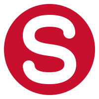
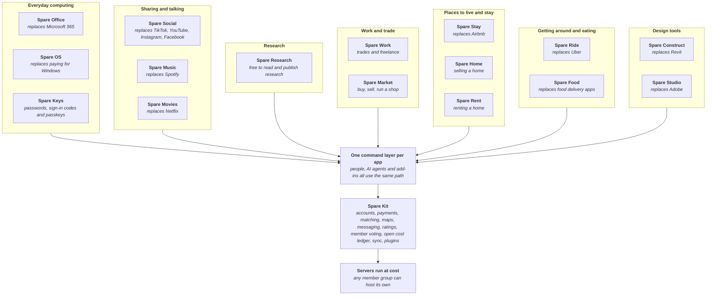

# Spareware

**Free software for everyone. Let's build it together with the spare weekly AI tokens we don't finish.**

**[See all the demos](https://spareware.app/demos.html)**: every program in one place, a tab each.

Most of us don't use all our AI tokens each week. Instead of letting them go to waste, point what's left at a piece of Spareware. Invited contributors pick a piece of work, their AI agent does it, and a person reviews every piece before it lands. [Give your spare tokens](#give-your-spare-tokens).

Every Spareware app is free for everyone to use, anywhere in the world. On the apps where people earn a living, like rides, food delivery, stays and trades, the workers keep all of the profit except the running costs: the servers and payment fees it takes to keep the app going. Nobody takes a cut on top.

Big platforms take a large cut from the people who do the work, and design and office software charges every year just to be allowed to work. Spareware builds free replacements in the open.

**Always start with "Can we".** Every idea is met with how it could work, not why it won't. If it isn't possible yet, we work out what it would take.

**High trust, fail forward.** This is a high-trust place, leaning on a wide, mapped-out [architecture](ARCHITECTURE.md), so pieces fit together even when people work apart. Try things, test them quickly, and if something doesn't work, learn from it and go again: we fail forward and up. No need to stress about getting it perfect the first time; every piece is reviewed before it lands.

## How it all fits together

To build on Spareware, add a program, a plugin, a country pack or a language, read [EXTENDING.md](EXTENDING.md): how it stays open and expandable for decades.

Every program sits on Spare Kit, so each new app gets accounts, payments, AI access and the open cost ledger from day one, and a fix to the kit improves every app at once. The full map is [ARCHITECTURE.md](ARCHITECTURE.md).

## The programs

| Program | Replaces | Stage | Architecture |
| --- | --- | --- | --- |
| Spare Kit | The parts every platform rebuilds | Mapping | [Map](ARCHITECTURE.md) · [Work board](projects/kit/STATUS.md) |
| Spare Construct | Revit, and the add-ins people buy for it | Mapping | [Map](projects/spare-construct/ARCHITECTURE.md) · [Work board](projects/spare-construct/STATUS.md) |
| Spare Studio (working name) | Adobe's apps: Photoshop, Illustrator, InDesign, Premiere, After Effects, Lightroom, Acrobat and more | Mapping | [Map](projects/spare-studio/ARCHITECTURE.md) · [Work board](projects/spare-studio/STATUS.md) |
| Spare Social (working name) | TikTok, YouTube, Instagram and Facebook, together | Mapping | [Map](projects/spare-social/ARCHITECTURE.md) · [Work board](projects/spare-social/STATUS.md) |
| Spare Music | Spotify | Mapping | [Map](projects/spare-music/ARCHITECTURE.md) · [Work board](projects/spare-music/STATUS.md) |
| Spare Movies | Netflix | Mapping | [Map](projects/spare-movies/ARCHITECTURE.md) · [Work board](projects/spare-movies/STATUS.md) |
| Spare Research | Journal paywalls and the fees scientists pay to publish | Mapping | [Map](projects/spare-research/ARCHITECTURE.md) · [Work board](projects/spare-research/STATUS.md) |
| Spare Office | Microsoft 365: Word, Excel, PowerPoint, Outlook, Teams, OneNote, OneDrive | Mapping | [Map](projects/spare-office/ARCHITECTURE.md) · [Work board](projects/spare-office/STATUS.md) |
| Spare OS | Paying for Windows | Mapping | [Map](projects/spare-os/ARCHITECTURE.md) · [Work board](projects/spare-os/STATUS.md) |
| Spare Keys | Paid password managers and authenticator apps | Idea | [Map](projects/spare-keys/ARCHITECTURE.md) · [Work board](projects/spare-keys/STATUS.md) |
| Spare Ride | Uber | Mapping | [Map](projects/spare-ride/ARCHITECTURE.md) · [Work board](projects/spare-ride/STATUS.md) |
| Spare Food | Uber Eats, DoorDash | Mapping | [Map](projects/spare-food/ARCHITECTURE.md) · [Work board](projects/spare-food/STATUS.md) |
| Spare Stay | Airbnb, Booking.com | Mapping | [Map](projects/spare-stay/ARCHITECTURE.md) · [Work board](projects/spare-stay/STATUS.md) |
| Spare Home | Agent commissions and listing fees when selling a home | Mapping | [Map](projects/spare-home/ARCHITECTURE.md) · [Work board](projects/spare-home/STATUS.md) |
| Spare Rent | Property manager and listing fees | Mapping | [Map](projects/spare-rent/ARCHITECTURE.md) · [Work board](projects/spare-rent/STATUS.md) |
| Spare Work | Trades and freelance marketplaces | Mapping | [Map](projects/spare-work/ARCHITECTURE.md) · [Work board](projects/spare-work/STATUS.md) |
| Spare Market | Trade Me, eBay, Etsy, Shopify | Mapping | [Map](projects/spare-market/ARCHITECTURE.md) · [Work board](projects/spare-market/STATUS.md) |

Stages run Idea, Mapping, Design, Build, Harden, Live. [STATUS.md](STATUS.md) shows where each program is and what work is open.

## Built legally, or not at all

Every line of Spareware is our own work or used under a licence that allows it. This is strict and has no exceptions:

- **Never copy anyone's proprietary code, assets, icons, artwork or documentation.** Not from another company's software, not from memory, not "just as a starting point".
- **Follow familiar structure, keep our own look.** A program may be laid out and work like the one people already know: the same tools, buttons, panels, commands and workflow. Its icons, artwork, colours, fonts and help text are our own.
- **Never decompile, disassemble or reverse-engineer proprietary software, and never use leaked or stolen source code.** If a piece of work needs knowledge that only comes from inside someone else's product, it does not get done.
- **Only use open-source code whose licence allows it**, keep its licence and credit, and record where it came from. No GPL or AGPL code in the core.
- **Respect trademarks.** Our products have their own names. Other companies' product names appear only to say what we replace.
- **Respect patents, terms of service and API licences.** If a method might be patented, or a data source has terms that forbid our use, stop and raise it with an owner.
- **Reading other formats** (IFC, DXF, Revit files and so on) comes only from published specifications or from work an owner has cleared after legal advice.
- **Unsure? Stop and ask.** A pull request that cannot show where its ideas and code came from does not merge.

## Give your spare tokens

1. **Ask to join** with a [join request](CONTRIBUTING.md). Anyone can read; only invited contributors can push.
2. **Use Claude Opus 5.5 at Extra high effort as the minimum.** A newer, more capable model is fine; anything smaller or older is not. This keeps the quality bar the same everywhere.
3. **Open Claude Code in this repo and say "I have spare tokens".** Your agent reads [AGENTS.md](AGENTS.md), tells you where each program is up to (still mapping the architecture, or down to detailed building), and offers pieces of work that fit what you have left. You choose.
4. **Your agent checks the piece out** on its GitHub issue, so everyone can see [who's working on what](https://github.com/spareware-co-op/spareware/issues?q=is%3Aissue+is%3Aopen+label%3Aclaimed).
5. **Your agent opens a pull request.** An owner reviews it before it merges. Nothing merges on AI review alone.
6. **Run out mid-piece?** Your agent leaves a handover note so the next person carries on where you stopped.

## Major changes go to a vote

Any major change, such as starting or dropping a program, changing an architecture decision, changing these rules or changing how fees work, is put to a vote of the members before it happens. An owner opens a poll in [Discussions, under Polls](https://github.com/spareware-co-op/spareware/discussions/categories/polls), and the result decides it. Everyday decisions inside a piece of work are settled in its pull request.

## Ground rules for every piece

- **Always start with "Can we".** Every idea, request and problem starts from "Can we do this, and how?", never "it doesn't" or "we can't". If something isn't possible yet, say what it would take to make it possible. The legal rules above always still apply.
- Practical and easy to use: every app is built for the people who will use it every day, and should be simple to pick up and quick to work in.
- Port proven methods: read how the best open project does it before designing anything.
- Measured, not assumed: tests and benchmarks with every change; a slower change does not merge.
- Correct from the core up: fix the cause where it starts, not a patch on top. A patch only when there is truly no other way, and it is replaced by the proper fix, so every program can be the best of its kind.
- Every change is an operation: one path for the interface, AI, plugins, undo and sync.
- Open formats: our own files are documented and readable without our apps.
- One look: every app follows the [design guide](design/DESIGN.md), Spareware red for the co-op and its own light colour per app. The shared look only changes by member vote, or when a unique situation truly needs it.

## Licence

**Decided, and never to change.** Spareware's core is licensed under the [Mozilla Public License 2.0](LICENSE). The SDK, examples and plugin templates that people use to build add-ins are licensed under the [Apache License 2.0](LICENSE-APACHE), so add-ins can use any licence.

- **Never relicensed.** Spareware will never be moved to a closed, paid or subscription licence.
- **You keep the copyright to your work.** There is no contributor licence agreement. Every commit is signed off with the [Developer Certificate of Origin](https://developercertificate.org/) (`git commit -s`), which says you have the right to contribute it under these licences. Because the copyright stays spread across everyone who contributes, nobody, including the project's owners, can relicense what the community builds.
- **Improvements come back.** Under MPL-2.0, anyone who changes Spareware's own files and shares the result must share those changes openly. Products and add-ins built on top can use any licence.
