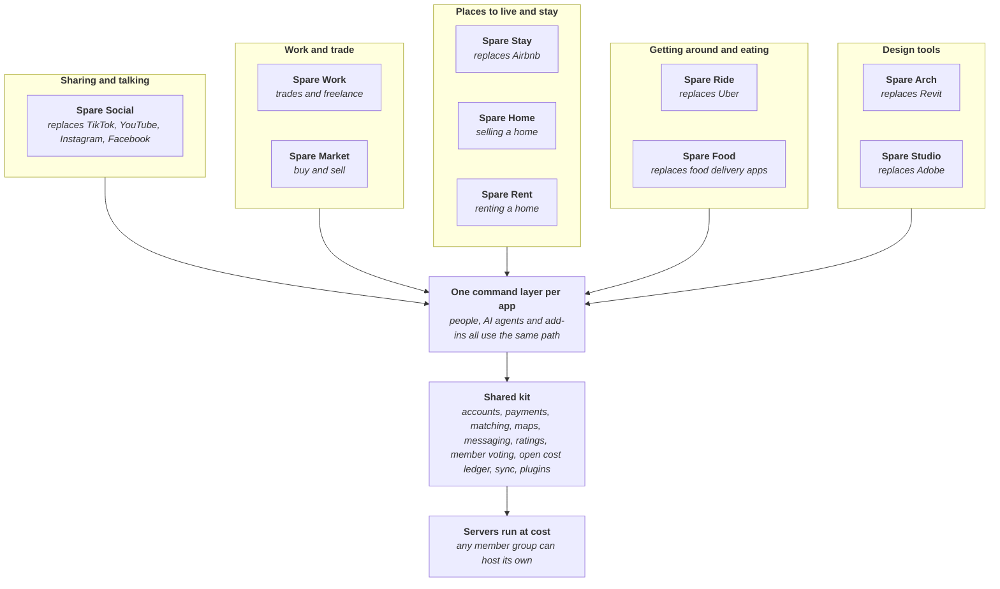

# Spareware

Free software for working people, built from spare AI tokens. Owned by its members.

Big platforms take a large cut from the people who do the work, and design software charges thousands a year just to be allowed to work. Spareware builds the replacements in the open. Each app takes only what it costs to run (servers, payments) and the people doing the work keep the rest. The software is free to use unless there is a real server cost to cover.

It is built from spare tokens. Invited contributors point their leftover weekly AI tokens at a piece of work here, and a person reviews every piece before it lands.

## How it all fits together

Every program sits on one shared kit, so each new app gets accounts, payments, AI access and the open cost ledger from day one, and a fix to the kit improves every app at once. The full map is [ARCHITECTURE.md](ARCHITECTURE.md).

## The programs

| Program | Replaces | Stage | Architecture |
| --- | --- | --- | --- |
| Shared kit | The parts every platform rebuilds | Mapping | [Map](ARCHITECTURE.md) · [Work board](projects/kit/STATUS.md) |
| Spare Arch | Revit, and the add-ins people buy for it | Mapping | [Map](projects/spare-arch/ARCHITECTURE.md) · [Work board](projects/spare-arch/STATUS.md) |
| Spare Studio (working name) | Adobe's apps: Photoshop, Illustrator, InDesign, Premiere, After Effects, Lightroom, Acrobat and more | Mapping | [Map](projects/spare-studio/ARCHITECTURE.md) · [Work board](projects/spare-studio/STATUS.md) |
| Spare Social (working name) | TikTok, YouTube, Instagram and Facebook, together | Mapping | [Map](projects/spare-social/ARCHITECTURE.md) · [Work board](projects/spare-social/STATUS.md) |
| Spare Ride | Uber | Mapping | [Map](projects/spare-ride/ARCHITECTURE.md) · [Work board](projects/spare-ride/STATUS.md) |
| Spare Food | Uber Eats, DoorDash | Mapping | [Map](projects/spare-food/ARCHITECTURE.md) · [Work board](projects/spare-food/STATUS.md) |
| Spare Stay | Airbnb, Booking.com | Mapping | [Map](projects/spare-stay/ARCHITECTURE.md) · [Work board](projects/spare-stay/STATUS.md) |
| Spare Home | Agent commissions and listing fees when selling a home | Mapping | [Map](projects/spare-home/ARCHITECTURE.md) · [Work board](projects/spare-home/STATUS.md) |
| Spare Rent | Property manager and listing fees | Mapping | [Map](projects/spare-rent/ARCHITECTURE.md) · [Work board](projects/spare-rent/STATUS.md) |
| Spare Work | Trades and freelance marketplaces | Mapping | [Map](projects/spare-work/ARCHITECTURE.md) · [Work board](projects/spare-work/STATUS.md) |
| Spare Market | Trade Me, eBay, Etsy | Mapping | [Map](projects/spare-market/ARCHITECTURE.md) · [Work board](projects/spare-market/STATUS.md) |

Stages run Idea, Mapping, Design, Build, Harden, Live. [STATUS.md](STATUS.md) shows where each program is and what work is open.

## Built legally, or not at all

Every line of Spareware is our own work or used under a licence that allows it. This is strict and has no exceptions:

- **Never copy anyone's proprietary code, assets, icons, artwork, documentation or interface designs.** Not from another company's software, not from memory, not "just as a starting point".
- **Never decompile, disassemble or reverse-engineer proprietary software, and never use leaked or stolen source code.** If a piece of work needs knowledge that only comes from inside someone else's product, it does not get done.
- **Only use open-source code whose licence allows it**, keep its licence and credit, and record where it came from. No GPL or AGPL code in the core.
- **Respect trademarks.** Our products have their own names. Other companies' product names appear only to say what we replace.
- **Respect patents, terms of service and API licences.** If a method might be patented, or a data source has terms that forbid our use, stop and raise it with an owner.
- **Reading other formats** (IFC, DXF, Revit files and so on) comes only from published specifications or from work an owner has cleared after legal advice.
- **Unsure? Stop and ask.** A pull request that cannot show where its ideas and code came from does not merge.

## Give your spare tokens

1. **Ask to join** with a [join request](CONTRIBUTING.md). Anyone can read; only invited contributors can push.
2. **Use Claude Opus 5.5 at Extra high effort as the minimum.** A newer, more capable model is fine; anything smaller or older is not. This keeps the quality bar the same everywhere.
3. **Open Claude Code in this repo and say "I have spare tokens".** Your agent reads [AGENTS.md](AGENTS.md), tells you where each program is up to (still mapping the architecture, or down to detailed building), and offers pieces of work that fit what you have left. You choose.
4. **Your agent checks the piece out** on its GitHub issue, so everyone can see [who's working on what](https://github.com/spareware-co-op/spareware/issues?q=is%3Aissue+is%3Aopen+label%3Aclaimed).
5. **Your agent opens a pull request.** An owner reviews it before it merges. Nothing merges on AI review alone.
6. **Run out mid-piece?** Your agent leaves a handover note so the next person carries on where you stopped.

## Ground rules for every piece

- Port proven methods: read how the best open project does it before designing anything.
- Measured, not assumed: tests and benchmarks with every change; a slower change does not merge.
- Every change is an operation: one path for the interface, AI, plugins, undo and sync.
- Open formats: our own files are documented and readable without our apps.
- One look: every app follows the [design guide](design/DESIGN.md), Spareware red for the co-op and its own light colour per app.

## Licence

Being decided before the first public release.
