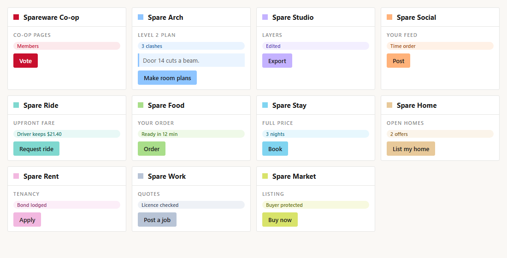

# Spareware design guide

Every Spareware app looks like part of one family: calm, plain and fast to read. Agents building any interface follow this guide and use [tokens.css](tokens.css); nothing else sets colours, type or spacing.

## Keep the one look

The shared look is settled. Do not change it: this guide, `tokens.css`, the shared colours, type, spacing and components stay as they are unless a **member vote** agrees a change, or a **unique situation truly needs it** (for example an accessibility need or a legal requirement). In that case, say why in the pull request and keep the change as small as possible. Things only one app needs stay inside that app and still use the tokens.

## The look in one line

Warm off-white page, white panels, ink text, hairline rules, square-ish corners, small uppercase section labels, and colour used sparingly where it means something.

## Colour

- **Spareware red** (`--spare-red`, #C8102E) belongs to the co-op: the logo, co-op pages (membership, voting, the cost ledger) and the shared kit's screens.
- **Each app has its own light colour** (`--app`), set by `data-app` on the page. It fills the app's mark, primary buttons, active tabs and selected items. Its deeper shade (`--app-strong`) is only for thin borders and icons; its tint (`--app-tint`) is for quiet backgrounds such as notes and highlighted cards.

| App | Light colour | Deeper shade | Tint |
| --- | --- | --- | --- |
| Spare Construct | #8EC5FF blue | #1F5FA8 | #EAF4FF |
| Spare Studio | #C4B2FF violet | #5B3FB8 | #F3EFFF |
| Spare Social | #FFB27A orange | #9E4A14 | #FFF1E6 |
| Spare Ride | #7FD8CF teal | #13756B | #E8F8F6 |
| Spare Food | #A9DE8A green | #3E7C1F | #EFF9E8 |
| Spare Stay | #80D4F0 sky | #11708F | #E7F7FD |
| Spare Home | #E8C99A sand | #8A5A1C | #FBF4EA |
| Spare Rent | #F2B8E0 pink | #94306F | #FCEEF8 |
| Spare Work | #B8C4D6 steel | #3D4F6B | #EEF1F6 |
| Spare Market | #D8E36A lime | #66700F | #F7F9DF |
| Spare Office | #A9B6FF indigo | #3A47A8 | #EEF0FF |
| Spare OS | #CDD1D6 grey | #4A525C | #F2F3F5 |
| Spare Music | #EB8EEB orchid | #B82EB8 | #FBE9FB |
| Spare Movies | #EB8E8E coral | #B82E2E | #FBE9E9 |
| Spare Research | #C2DBB3 sage | #458321 | #F0FBE9 |
| Spare Keys | #70EB70 green | #228722 | #E9FBE9 |

Rules:

1. **Text is ink on light colours.** White text appears only on Spareware red (the logo and co-op primary buttons). Never white text on black or dark grey, anywhere.
2. **Colour means something.** Use the app colour for the one primary action, the current tab and the selection; everything else stays neutral.
3. **States are separate from app colours:** danger red-brown, success green and info blue, always as a strong line plus a tint, never as a large fill.

## Type

- System fonts only (`--font-ui`), so nothing needs licensing or downloading. 13px base; headings by weight, not size jumps.
- Section labels: 11px, uppercase, letter-spaced, `--ink-3`.
- Numbers, IDs and code: `--font-mono`.
- Plain words. Short sentences. No jargon on screen.

## Layout

- Page `--page`, panels `--panel`, separated by 1px `--hairline` rules rather than shadows or cards.
- App header: a small square of `--app` beside the app's name, then what's open, then actions on the right.
- Corners `--radius` (3px). Spacing in steps of `--space` (8px).
- Phones first for the marketplaces; panels stack in one column under 640px.

## Components

| Component | Look |
| --- | --- |
| Primary button | `--app` fill, ink text, no border (Spareware red with white text on co-op pages) |
| Secondary button | White fill, 1px ink border, ink text |
| Quiet button | White fill, 1px `--rule` border, `--ink-2` text |
| Badge | Pill; `--app-tint` fill with `--app-strong` text, or neutral `--sink` with `--ink-2` |
| Note | `--app-tint` background with a 3px `--app` left edge |
| Selected row | `--app-tint` background, `--app` left edge |
| Tooltip | Instant on hover; white, 1px ink border |
| Empty state | Centred, `--ink-3`, one line saying what to do next |

## Accessibility

- Every text and background pair meets WCAG AA (4.5:1 for body text). Ink on every app colour passes; check any new pair before using it.
- Everything works by keyboard with a visible focus ring in `--app-strong`.
- Colour is never the only signal: pair it with a label or icon.

## Why it looks like this

It starts from the calm, editorial look of the tools this project began alongside, but in Spareware's own colours, so every app feels like one family while each is still easy to tell apart.
