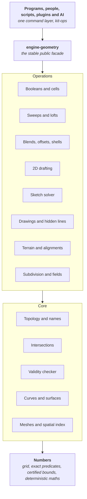

# Spare Kit geometry kernel: architecture

*Status: proposed in decision note [G01](../../kit/notes/G01-geometry-kernel.md); it becomes the kernel's agreed map when an owner accepts G01. No code yet. This page and the chapters in [architecture/](architecture/) are the living map: every later change to a decision links its own decision note here.*

One geometry kernel, written in Rust, that every Spareware program builds on, for everything anyone needs to model: AutoCAD-class 2D drafting, Revit-class buildings in every discipline, survey and civil, mechanical parts and assemblies, Class-A car surfaces and manufacturing, circuit boards, free-form and subdivision surfaces, implicit fields, meshes, terrain, alignments and point clouds. It lives in Spare Kit's engines layer, so programs that do not need geometry never build it. New here? Read [README.md](README.md) first.

## Principles

These hold for every crate, every operation and every pull request. A change that breaks one does not merge.

1. **Exact where it decides topology.** Whether things touch, cross or contain each other is decided by exact predicates on exact data wherever the mathematics allows ([6](architecture/06-numbers.md)).
2. **Certified where exact is impossible.** Curved constructions carry a proven error bound, never a guess. Bounds come from interval or Bernstein arithmetic, not from sampling.
3. **Every result states its exactness.** Each body carries its exactness class: Exact, Certified with a bound, or Approximate with a measured deviation ([9](architecture/09-representations.md)). An operation never makes a result less exact without saying so, and never without being asked.
4. **Never an invalid result.** Every operation returns a model that passes the validity checker, or an error. Inputs are never modified. A failed operation leaves the model exactly as it was.
5. **Deterministic.** The same inputs give bit-identical outputs on every supported target and thread count ([21](architecture/21-determinism.md)).
6. **Names never break silently.** Every topological entity has a name derived from the operation that made it. A reference resolves exactly, follows a recorded split or merge, or fails with a reason. It never picks a different face by guessing ([20](architecture/20-naming-history.md)).
7. **Pure, immutable and headless.** Operations are pure functions over immutable data. No global state, no session singletons, no screen. Anything a person can do, an AI or a script can do through the same call.
8. **One kernel for 2D and 3D.** The same numbers, the same curve family and the same naming serve drafting, modelling, survey and drawings.
9. **Built to last.** The native file format is documented, versioned and readable forever. The public facade is stable; the inside may change freely ([25](architecture/25-public-interface.md)).
10. **Readable by people and AI.** Small modules with one job. Every module states its invariants and checks them in code. Every algorithm names the published method it follows. No unexplained constant.
11. **Proven methods, our code, raised to our bar.** We port published methods. We take permissive code only where it meets every principle here, and keep its licence and credit. No GPL or AGPL code; LGPL code is studied for method only ([29](architecture/29-sources-licences.md)). **Nothing enters as it is.** Every method or piece of code we take is rebuilt to these principles before it merges: our types, exact predicates where topology is decided, certified bounds elsewhere, deterministic maths, our error model, names and history, and the same tests, fuzzing and benchmarks as code we wrote ourselves. Where a source has a known weakness (a fixed tolerance, a silent fallback, a sampled check), the port fixes it, and the pull request says what changed and why. If it cannot be raised to the bar, it is not taken.
12. **Measured.** Every operation ships with unit, property and fuzz tests and a benchmark. Correctness and determinism regressions block a merge; speed regressions over 5% block a merge.
13. **Safe Rust.** No `unsafe`; no panics in kernel paths; bounded recursion (WebAssembly stacks have no guard page); cooperative cancellation.

## Layers

| Layer | What it holds | Depends on |
| --- | --- | --- |
| Numbers | The coordinate grid, wide integers, exact predicates, interval bounds, deterministic maths functions, the tolerance ladder | Nothing in the kernel |
| Geometry | Points, vectors, transforms and frames; every curve and surface kind; NURBS algorithms | Numbers |
| Topology | Bodies, regions, shells, faces, loops, fins, edges, vertices in arenas; the builder; persistent names and history | Numbers, geometry |
| Intersections | Curve with curve, curve with surface, surface with surface, all certified | Numbers, geometry |
| Validity checker | `geom-check`: the checks every result passes before it is returned ([8.3](architecture/08-topology.md#83-the-validity-checker)); its self-intersection checks use the same intersections the operations do | Numbers, geometry, topology, intersections |
| Meshes and spatial | Exact meshes, watertight tessellation, the bounding-volume hierarchy, distance and clash | The layers above it in this table |
| Operations | Everything that makes or changes shapes, each a pure function with a typed result | The core |
| Facade | `engine-geometry`: the one stable interface programs and bindings use | Operations and core |

Dependencies go down only. Programs depend only on the facade. The kernel knows nothing about walls, doors or programs: each program turns its own elements into kernel calls.

## The chapters

Section numbers match the decision note [G01](../../kit/notes/G01-geometry-kernel.md), so "section 11" means the same thing everywhere.

| Chapter | What it settles |
| --- | --- |
| [6. Numbers](architecture/06-numbers.md) | The grid ladder (156.25 nm, 6.25 nm, 0.25 nm), exact sign-returning predicates in fixed-size integers, implicit constructions, certified curved evaluation, the tolerance ladder |
| [7. Geometry types](architecture/07-geometry-types.md) | Every curve and surface kind, stored exactly as itself, and how kinds are written in code |
| [8. Topology](architecture/08-topology.md) | Body, region, shell, face, loop, fin, edge, vertex; immutable arenas with typed indices; the validity checker |
| [9. Representations](architecture/09-representations.md) | B-rep, exact meshes, subdivision, fields and point clouds in one model; exactness classes; one boolean across them |
| [10. Operations](architecture/10-operations.md) | The contract every operation keeps, and the full catalogue |
| [11. Booleans](architecture/11-booleans.md) | The arrangement engine: exact plane-based polyhedra, certified curved solids, coplanar faces, batch cutting, cells and rooms |
| [12. Intersections](architecture/12-intersections.md) | Certified curve and surface intersection, projection, tangent and coincident cases |
| [13. Sweeps, blends, offsets](architecture/13-sweeps-blends-offsets.md) | Extrude, revolve, sweep, loft, network surfaces, fillets and blends, offsets, shells, drafts, roofs, sheet metal |
| [14. 2D drafting](architecture/14-2d-drafting.md) | The AutoCAD-class 2D layer with exact arcs: entities, arrangements, hatches, edits, snaps, dimensions |
| [15. Sketches](architecture/15-sketches.md) | The constraint solver: decomposition, solving, degrees of freedom, conflict diagnosis |
| [16. Free-form](architecture/16-free-form.md) | Subdivision surfaces, implicit fields, conversions, panelisation, surface quality |
| [17. Survey, terrain, civil](architecture/17-survey-terrain-civil.md) | Frames and map projections, survey linework, TINs, terrain solids, alignments, corridors, point clouds |
| [18. Drawings](architecture/18-drawings.md) | Sections, projections, silhouettes and hidden lines, with provenance |
| [19. Meshes, spatial, clash](architecture/19-meshes-spatial-clash.md) | Exact meshes, watertight tessellation, volume meshes, the spatial index, distance and clash |
| [20. Naming and history](architecture/20-naming-history.md) | Persistent names, roles, history, and how references resolve |
| [21. Determinism](architecture/21-determinism.md) | What Rust guarantees, what the kernel polices, and how CI proves it |
| [22. Errors, queries and AI](architecture/22-errors-queries-ai.md) | Structured errors with remedies, queries for everything, operations described as data |
| [23. Performance](architecture/23-performance.md) | Meeting Spare Construct's targets without breaking determinism |
| [24. File format and exchange](architecture/24-file-format-exchange.md) | The native format, its versions, and IFC, STEP, DXF, 3dm, mesh and point-cloud exchange |
| [25. Public interface](architecture/25-public-interface.md) | Stability tiers, the facade, and geometry moving between programs with nothing lost |
| [26. How it grows](architecture/26-how-it-grows.md) | What can be added and how, versions and editions, and the map for people and AI |
| [27. Crates and folders](architecture/27-crates-folders.md) | Every crate, its one job, its dependencies, and the rules for readable code |
| [28. Testing](architecture/28-testing.md) | Unit, property and fuzz tests, proofs, oracles, corpora, determinism hashes, benchmarks |
| [29. Sources and licences](architecture/29-sources-licences.md) | What we may take from each source, under what conditions, and the patents to avoid |
| [30. Build order](architecture/30-build-order.md) | Every build piece, in order, with what done means, and the gate closing each phase |
| [31. Risks](architecture/31-risks.md) | What could go wrong, what we do about it, and every open technical question |
| [32. Decisions for the owner](architecture/32-decisions.md) | The twelve choices the chapters raise for an owner to settle |
| 33. Sources | The evidence reports in [G01-evidence](../../kit/notes/G01-evidence/README.md); each links the exact source files it read |

## Where to start reading

- **Anyone new:** the principles above, then chapters 6, 8, 9 and 10. Those four are the foundation every other chapter assumes.
- **An agent or person adding to the kernel:** chapter 26 (how it grows), then the chapter for the area you are changing, then chapter 28 (what your change must pass).
- **A program author using the kernel:** chapters 10, 20, 22 and 25: what you can call, how names and references work, what errors look like, and what is stable.
