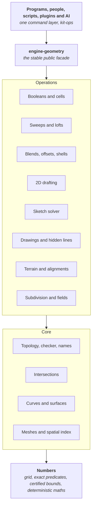

# G01: The Spare Kit geometry kernel, 3D and 2D

*Piece G01, Spare Kit. Decision note. Written 2026-10-21 by Claude Opus 5.5 for the owner. Proposed: an owner accepts it by merging the pull request that carries it. Evidence: ten research reports and three vetting reports in [G01-evidence](G01-evidence/README.md), each reading the actual source of the projects it cites.*

*What merging accepts: this note together with the kernel's [architecture front page](../../engines/geometry/ARCHITECTURE.md) and its chapters in [architecture/](../../engines/geometry/architecture/), one file for each of sections 6 to 32, numbered as here. A chapter holds its section in full. Anything a chapter marks as proposed, pending or an open question, including a change it proposes to a section of this note, stays open until an owner settles it in section 32 or in a later decision note.*

## The answer in plain words

Spareware writes its own geometry kernel in Rust, as part of Spare Kit, and every program uses it: Spare Construct for every discipline and survey, Spare Studio's 3D app, the simulation engine, and programs still to come, such as mechanical design, car design and manufacturing, a Spare Electronics for circuit boards, and 3D content creation, movie and game tools (which use its meshes, subdivision, booleans, fields and collision queries, while animation, physics and rendering live in their own engines on top). One kernel covers all geometry anyone needs to model: AutoCAD-class 2D drafting, Revit-class building solids, mechanical parts and assemblies, car body surfaces, manufacturing (machining, moulds, 3D printing), circuit boards, free-form surfaces, subdivision surfaces, implicit fields, meshes, terrain, road alignments and point clouds.

It is built from proven, published methods, in our own code, to these rules:

- **Exact where it decides the shape.** Every coordinate sits on a fixed grid: 156.25 nanometres (1/6400 mm) for buildings, sites and roads, and 6.25 nanometres for mechanical parts and circuit boards, so millimetres, inches, microns and mils are all exact. Every "which side is this on" question is answered with exact integer arithmetic. Flat-faced solids, which are most of a building, are cut and joined exactly, with no tolerance at all, however many times they are cut.
- **Certified where exact is not possible.** Curved geometry (cylinders, NURBS, blends) is computed to a proven error bound, at most 0.01 mm for buildings and 0.4 µm for parts and boards, and the result says so.
- **Never a broken result.** Every operation returns a valid model or a clear, structured error that names what failed and where. Nothing is half-done, and nothing is silently made less exact.
- **The same answer everywhere.** The same operations give bit-identical results on every computer, in the browser, on any number of cores.
- **Names that do not break.** Every face, edge and corner is named by the operation that made it, so a dimension, a hosted door or an AI's reference finds the same thing after the model changes, or says plainly that it cannot.
- **Headless and readable.** The kernel is a library of pure functions with no screen. People, scripts, plugins and AI agents reach it through the same commands. Its code is small modules, each stating what it does, what it guarantees and which published method it follows.
- **Built to grow.** A closed, guarded core and an open edge that grows along written contracts: new operations, geometry kinds, formats and domain toolkits (sheet metal, circuit boards, stairs) each have a playbook. Versioned operations and stored geometry mean an old model never changes meaning, and a generated map of the code means no future person or AI gets lost (section 26).

This replaces three choices in Spare Construct's map: the kernel is no longer flat-faced first with curves later, it is not a port of Manifold's float booleans, and the model tolerance is the grid and tolerance ladder in section 6, not a single 0.01 mm value. Everything is mapped now, at full scale. It is built in the order in section 30, each layer proven before the next, the way the owner asked: no shortcuts, done properly from the start.

## Contents

1. [The question](#1-the-question)
2. [What best means here](#2-what-best-means-here)
3. [Principles](#3-principles)
4. [Options considered](#4-options-considered)
5. [The architecture at a glance](#5-the-architecture-at-a-glance)
6. [Numbers: the grid, exact predicates and tolerances](#6-numbers-the-grid-exact-predicates-and-tolerances)
7. [Geometry types](#7-geometry-types)
8. [Topology: how shapes are stored](#8-topology-how-shapes-are-stored)
9. [Representations and exactness](#9-representations-and-exactness)
10. [Operations: the contract and the catalogue](#10-operations-the-contract-and-the-catalogue)
11. [Booleans and the arrangement engine](#11-booleans-and-the-arrangement-engine)
12. [Intersections](#12-intersections)
13. [Sweeps, lofts, blends, offsets and shells](#13-sweeps-lofts-blends-offsets-and-shells)
14. [2D drafting](#14-2d-drafting)
15. [Sketches and constraint solving](#15-sketches-and-constraint-solving)
16. [Free-form: subdivision surfaces and fields](#16-free-form-subdivision-surfaces-and-fields)
17. [Survey, terrain and civil](#17-survey-terrain-and-civil)
18. [Drawings: sections, projections and hidden lines](#18-drawings-sections-projections-and-hidden-lines)
19. [Meshes, tessellation, spatial index and clash](#19-meshes-tessellation-spatial-index-and-clash)
20. [Persistent naming and history](#20-persistent-naming-and-history)
21. [Determinism](#21-determinism)
22. [Errors, queries and what AI agents see](#22-errors-queries-and-what-ai-agents-see)
23. [Performance and parallel work](#23-performance-and-parallel-work)
24. [File format, versions and exchange](#24-file-format-versions-and-exchange)
25. [Public interface and stability](#25-public-interface-and-stability)
26. [How the kernel grows](#26-how-the-kernel-grows)
27. [Crates and folders](#27-crates-and-folders)
28. [Testing and verification](#28-testing-and-verification)
29. [What we may take from each source](#29-what-we-may-take-from-each-source)
30. [Build order](#30-build-order)
31. [Open risks](#31-open-risks)
32. [Decisions for the owner](#32-decisions-for-the-owner)
33. [Sources](#33-sources)

## 1. The question

What should the one geometry kernel that every Spareware program builds on be, so that it is more capable and more reliable than the kernels behind Revit and AutoCAD, lasts for decades, and can be read and extended by people and AI agents?

The owner's requirements, in their words: the best-architected kernel possible for all geometry situations, like Revit's but better, and the AutoCAD parts too; iron-clad; no shortcuts anywhere; the most complex geometry people ever want, created reliably; headless for AI and people alike; surveyors working CAD-style on the same geometry the designers model on; architected to expand; purposed for absolutely everything anyone could need to model in the world, from walls and stairs to mechanical parts and circuit boards.

## 2. What best means here

| Measure | What it means for the kernel |
| --- | --- |
| Capability | Every kind of geometry a building, a site, a road, a machine, a car, a product or a circuit board needs, in one model: 2D drafting, solids, free-form, Class-A surfaces with curvature-continuous blends, subdivision, fields, meshes, terrain, alignments, point clouds, sheet metal, threads, huge assemblies, layered boards, and what manufacturing needs from geometry (offsets and swept tool volumes for machining, draft and parting lines for moulds, slices and lattices for 3D printing, volume meshes for simulation) |
| Reliability | No operation ever returns an invalid shape. Hard cases either succeed correctly or fail with a reason a person or an AI can act on |
| Exactness | Topology (what touches, what crosses, what is inside) is decided exactly wherever the mathematics allows, and with a proven bound everywhere else |
| Determinism | Bit-identical results on every machine, in the browser, and for any thread count, so a shared model replayed from its operation log is the same model everywhere |
| Scale | A 230,000-element building opens in seconds and a door moves in one frame (Spare Construct's targets); a 50 km road corridor keeps survey precision |
| Permanence | Files written today open in fifty years; references in them still find the right faces |
| Readability | Anyone, person or AI, can find where a thing is done, what it guarantees and why |
| Headless | Every capability is a function call with data in and data out. No dialog, no hidden state |
| Owned by nobody | Open licence (MPL-2.0), permissive dependencies only, no method we are not free to use |

Where the incumbents fall short, from the evidence:

- **Parasolid and ACIS**, the commercial kernels behind most CAD, are exact by default and tolerant only where needed. That is the right model and we follow it, but they are closed, paid, single-threaded in places, and not deterministic across platforms by contract. Revit itself refuses curves under about 0.8 mm and keeps geometry within 16 km of its origin ([05](G01-evidence/05-exact-arithmetic-determinism.md), section 6).
- **OpenCascade**, the only complete open exact B-rep kernel, lets every vertex, edge and face carry its own tolerance that only ever grows, edits shared shapes in place, decides loops with rounded angles, and can return a shape with a hole in it after a failed fillet. Its own documentation lists booleans it "cannot solve in general" ([02](G01-evidence/02-occt-parasolid-acis.md), sections 2, 3 and 7).
- **Manifold**, the strongest open mesh boolean, is not exact: its tie rules changed three times in ten months, and its results are not bit-identical across machines by contract ([01](G01-evidence/01-manifold-mesh-booleans.md), sections 1 and 3).
- **Truck and Fornjot**, the two Rust B-rep kernels, use pointer identity (so results depend on memory addresses), one global tolerance, mesh-seeded booleans or approximation-first designs, and panics in library code. Fornjot shut down in 2026 with its goals not reached ([03](G01-evidence/03-rust-kernels-crates.md), sections 1 and 2).

No open kernel is exact, deterministic, persistently named and complete. That is the gap Spare Kit fills.

## 3. Principles

These hold for every crate, every operation and every pull request. A change that breaks one does not merge.

1. **Exact where it decides topology.** Whether things touch, cross or contain each other is decided by exact predicates on exact data wherever the mathematics allows (section 6).
2. **Certified where exact is impossible.** Curved constructions carry a proven error bound, never a guess. Bounds come from interval or Bernstein arithmetic, not from sampling.
3. **Every result states its exactness.** Each body carries its exactness class: Exact, Certified with a bound, or Approximate with a measured deviation (section 9). An operation never makes a result less exact without saying so, and never without being asked.
4. **Never an invalid result.** Every operation returns a model that passes the validity checker, or an error. Inputs are never modified. A failed operation leaves the model exactly as it was.
5. **Deterministic.** The same inputs give bit-identical outputs on every supported target and thread count (section 21).
6. **Names never break silently.** Every topological entity has a name derived from the operation that made it. A reference resolves exactly, follows a recorded split or merge, or fails with a reason. It never picks a different face by guessing (section 20).
7. **Pure, immutable and headless.** Operations are pure functions over immutable data. No global state, no session singletons, no screen. Anything a person can do, an AI or a script can do through the same call.
8. **One kernel for 2D and 3D.** The same numbers, the same curve family and the same naming serve drafting, modelling, survey and drawings.
9. **Built to last.** The native file format is documented, versioned and readable forever. The public facade is stable; the inside may change freely (section 25).
10. **Readable by people and AI.** Small modules with one job. Every module states its invariants and checks them in code. Every algorithm names the published method it follows. No unexplained constant.
11. **Proven methods, our code, raised to our bar.** We port published methods. We take permissive code only where it meets every principle here, and keep its licence and credit. No GPL or AGPL code; LGPL code is studied for method only (section 29). **Nothing enters as it is.** Every method or piece of code we take is rebuilt to these principles before it merges: our types, exact predicates where topology is decided, certified bounds elsewhere, deterministic maths, our error model, names and history, and the same tests, fuzzing and benchmarks as code we wrote ourselves. Where a source has a known weakness (a fixed tolerance, a silent fallback, a sampled check), the port fixes it, and the pull request says what changed and why. If it cannot be raised to the bar, it is not taken.
12. **Measured.** Every operation ships with unit, property and fuzz tests and a benchmark. Correctness and determinism regressions block a merge; speed regressions over 5% block a merge.
13. **Safe Rust.** No `unsafe`; no panics in kernel paths; bounded recursion (WebAssembly stacks have no guard page); cooperative cancellation.

## 4. Options considered

| Option | What it would mean | Evidence | Verdict |
| --- | --- | --- | --- |
| A. Wrap OpenCascade | Bind the C++ kernel, write Rust on top | LGPL-2.1 with exception; mutable shared shapes; tolerance growth by design; pointer hashing; decisions by floating-point angles; not deterministic across platforms ([02](G01-evidence/02-occt-parasolid-acis.md)) | **No.** Its failure modes are architectural, not bugs. Studied for method; used only as an outside test oracle |
| B. Port Manifold | Rust port of the C++ mesh boolean, as the old map planned | Apache-2.0, fast and well tested, but float-based with position-dependent tolerance, not exact, not cross-platform deterministic, meshes only ([01](G01-evidence/01-manifold-mesh-booleans.md)) | **No, as the core.** We take its mesh data model, provenance scheme and test corpus, and use it as an oracle |
| C. Adopt Truck | Build on the Apache-2.0 Rust B-rep kernel | Booleans decide topology from triangle meshes; pointer identity; one global absolute tolerance that panics; no geometric validity checks ([03](G01-evidence/03-rust-kernels-crates.md); [vetting](G01-evidence/11-vetting-suggested-projects.md)) | **No.** Its trait vocabulary is a useful naming reference |
| D. Build on SMLib or solidcore | NVIDIA's newly open NURBS B-rep kernel (Apache-2.0, October 2026, about 970,000 lines of C++ from the 1998 SMLib lineage), or solidcore, the young Rust port of it | Mutable pointer topology behind a global context, per-entity tolerances, no exact predicates, integer status codes, booleans that fail silently on live code paths, surface intersection that misses loops; NVIDIA's own known-issues list includes operations that report success when they failed. solidcore keeps the same architecture in Rust ([13](G01-evidence/13-vetting-smlib.md)) | **No, as a foundation.** Its NURBS algorithms (NLib, Piegl and Tiller's production versions of The NURBS Book) are the best permissive method source and are ported as methods, with notices kept and the Numerical-Recipes-derived routines avoided. solidcore and SMLib serve as differential-test oracles |
| E. Our own kernel on proven methods | Write the kernel in Rust to the principles above, porting published methods and permissive code that fits | Every report points here: no open kernel meets principles 1 to 6 together | **Yes.** This note maps it |

Option E is more work than A to D. It is the only one that ends with a kernel that is exact, deterministic, persistently named and owned by nobody, which is what lasts.

## 5. The architecture at a glance

| Layer | What it holds | Depends on |
| --- | --- | --- |
| Numbers | The coordinate grid, wide integers, exact predicates, interval bounds, deterministic maths functions, the tolerance ladder | Nothing in the kernel |
| Geometry | Points, vectors, transforms and frames; every curve and surface kind; NURBS algorithms | Numbers |
| Topology | Bodies, regions, shells, faces, loops, fins, edges, vertices in arenas; the builder; the validity checker; persistent names and history | Numbers, geometry |
| Intersections | Curve with curve, curve with surface, surface with surface, all certified | Numbers, geometry |
| Meshes and spatial | Exact meshes, watertight tessellation, the bounding-volume hierarchy, distance and clash | The layers above it in this table |
| Operations | Everything that makes or changes shapes, each a pure function with a typed result | The core |
| Facade | `engine-geometry`: the one stable interface programs and bindings use | Operations and core |

Rules that keep the layers honest:

- Dependencies go down only. An operation never depends on another operation's internals; shared needs move into the core.
- The facade is the only crate programs may depend on. Everything below it is internal and may change (section 25).
- The kernel depends on no other Spare Kit crate except, at the facade, `kit-core` for permanent IDs and units. It knows nothing about walls, doors or programs. Spare Construct's elements turn into kernel calls in Spare Construct's own crates.

## 6. Numbers: the grid, exact predicates and tolerances

Every coordinate is a whole number of grid steps in a 64-bit integer: 156.25 nm for buildings, sites and roads (±171.8 km per frame), 6.25 nm for parts and circuit boards, and 0.25 nm in reserve, each step 25 times finer than the one above, so moving to a finer step loses nothing. Every decision about topology is the exact sign of an integer expression whose width is proven in advance, and constructed points stay implicit until an operation commits them to the grid, moving each coordinate by at most half a step. Curved work is certified, and a tolerance ladder names every bound: a fit bound of 64 steps (0.01 mm for buildings, 0.4 µm for parts), an angular bound of 2^-34 radians, and import healing of 640 steps by default, capped at 6,400. Tolerant bodies exist only as an import state.

The full chapter: [06-numbers.md](../../engines/geometry/architecture/06-numbers.md).

## 7. Geometry types

One curve family serves 2D and 3D: lines, arcs, conics, helices, road and rail spirals, splines and NURBS, with the matching surfaces. Each kind is stored as itself, exactly, never converted to NURBS behind the user's back, so dimensions, snaps, offsets and file exchange stay exact. Conversion to NURBS is on demand and returns the NURBS, whether it is exact, and its maximum error.

The full chapter: [07-geometry-types.md](../../engines/geometry/architecture/07-geometry-types.md).

## 8. Topology: how shapes are stored

Shapes are boundary representations in the structure Parasolid documents publicly: body, region, shell, face, loop, fin, edge and vertex, with explicit fins and regions. Entities live in immutable arenas with typed 32-bit indices, so an edit shares everything it does not change. Every result passes the validity checker before it is returned, and attributes travel with entities through operations.

The full chapter: [08-topology.md](../../engines/geometry/architecture/08-topology.md).

## 9. Representations and exactness

Five ways to represent shape live in one model, each first-class: B-rep, exact meshes, subdivision surfaces, implicit fields and point clouds. Every body carries its exactness class: Exact, Certified with a bound, or Approximate with a measured deviation. A result is as exact as its least exact input, bounds add up, and an operation that would make a result less exact without being asked returns an error offering the explicit alternative.

The full chapter: [09-representations.md](../../engines/geometry/architecture/09-representations.md).

## 10. Operations: the contract and the catalogue

Every operation, from making a box to filleting forty edges, has one shape: a pure function from a context and inputs to new immutable bodies with their history, names, exactness and diagnostics, or a typed error naming what failed and what would make it succeed. Operations are transactional (nothing is published until the checker passes), budgeted, cancellable, batch first and versioned. The catalogue lists every operation the kernel offers, area by area.

The full chapter: [10-operations.md](../../engines/geometry/architecture/10-operations.md).

## 11. Booleans and the arrangement engine

Every boolean, imprint, split, batch cut and room is a selection from one arrangement: all the inputs are cut against each other once, and the space between them falls into cells, each labelled by winding numbers with the inputs it lies inside. Flat-faced solids use an exact plane-based builder (the EMBER method) that adds no error however often a wall is cut; curved, subdivision and Tolerant operands use a certified builder in the style of OpenCascade's General Fuse.

The full chapter: [11-booleans.md](../../engines/geometry/architecture/11-booleans.md).

## 12. Intersections

`geom-intersect` answers where two curves meet, where a curve pierces a surface and where two surfaces cross, for every pair of geometry kinds; projection to the nearest point runs on the same machinery. Every point it returns is an enclosure proven to hold the true value, touching and coincidence are claimed only from exact arithmetic, and any part it cannot prove comes back as a flagged region with a reason, never dropped or guessed.

The full chapter: [12-intersections.md](../../engines/geometry/architecture/12-intersections.md).

## 13. Sweeps, lofts, blends, offsets and shells

Every operation that makes a solid from profiles or edits one locally: extrude, revolve, sweeps, lofts, network surfaces, the IFC sweeps, fillets and Class-A blends, offsets, shells, draft, face edits, straight-skeleton roofs, sheet metal and the swept volumes of moving tools. Each runs as plan, carriers, arrangement, select, name and check on section 11's engine, chooses every new face's kind by exact predicates as it builds it, and reports every change of topology it makes.

The full chapter: [13-sweeps-blends-offsets.md](../../engines/geometry/architecture/13-sweeps-blends-offsets.md).

## 14. 2D drafting

`geom-2d` is the AutoCAD-class drafting kernel under every flat drawing, on the same grid, predicates, curve kinds and names as the 3D kernel: DXF-class entities, an exact arrangement, regions, hatches, booleans, offsets, edits, snaps, blocks and dimensions. Lines, arcs and ellipses are never approximated, and every "does this cross, touch or contain that" question about them is answered exactly; splines and spirals carry a certified bound and say so.

The full chapter: [14-2d-drafting.md](../../engines/geometry/architecture/14-2d-drafting.md).

## 15. Sketches and constraint solving

`geom-sketch` is Spare Kit's own constraint solver, for family profiles, part sketches, board outlines and drafting constraints. It splits a sketch into rigid clusters, solves each by the least-change step, counts the freedoms left, and when rules cannot all hold it fails with the conflicting group and the values that would work, changing nothing.

The full chapter: [15-sketches.md](../../engines/geometry/architecture/15-sketches.md).

## 16. Free-form: subdivision surfaces and fields

Subdivision surfaces use Catmull-Clark with creases on an exact control net and a certified limit surface; fields are shapes given by a function, certified by interval bounds when turned into a mesh or a B-rep. The chapter also sets the conversion graph between all five representations, panelisation and unrolling, and how Class-A surface quality is measured, and no shape changes representation or loses exactness unless the caller asked.

The full chapter: [16-free-form.md](../../engines/geometry/architecture/16-free-form.md).

## 17. Survey, terrain and civil

Surveyors and designers work on one geometry: frames tied to map projections, survey points and linework, COGO, TINs, contours, volumes, terrain solids, alignments, corridors, and point clouds as reference. The kernel supplies the geometry and Spare Construct keeps survey practice (code libraries, adjustment, design rules); PROJ runs outside the kernel, once, at import or export, and every transformation is recorded.

The full chapter: [17-survey-terrain-civil.md](../../engines/geometry/architecture/17-survey-terrain-civil.md).

## 18. Drawings: sections, projections and hidden lines

A drawing is a pure query that turns the 3D model into the linework people build from: sections, projections, silhouettes and hidden lines, each line classed and traced back to the face or edge it came from. Nothing is rounded to make a drawing, hidden lines follow Appel's quantitative invisibility with a fixed rule for every degenerate case, and how lines look stays program data.

The full chapter: [18-drawings.md](../../engines/geometry/architecture/18-drawings.md).

## 19. Meshes, tessellation, spatial index and clash

A Spare Kit mesh is exact plane-based data on the grid, decided by the same exact predicates as the rest of the kernel, with a proven bound on how far it is from the shape it stands for; only the copy sent to the screen is approximate, and no operation accepts it. `geom-mesh` makes watertight tessellations, levels of detail, mesh booleans and volume meshes, and `geom-spatial` holds the bounding-volume hierarchy, distance, clearance, clash, contact over time and instancing for huge assemblies.

The full chapter: [19-meshes-spatial-clash.md](../../engines/geometry/architecture/19-meshes-spatial-clash.md).

## 20. Persistent naming and history

Every face, edge and vertex is named by the operation that made it and its role there, never by its position in a list, a random number or how its geometry looks. Every operation emits its history (unchanged, modified, generated, split, merged, deleted), and a stored reference resolves exactly, follows a recorded split or merge, or fails with a reason. Names are identical on every machine.

The full chapter: [20-naming-history.md](../../engines/geometry/architecture/20-naming-history.md).

## 21. Determinism

The same inputs give bit-identical outputs on every supported target and thread count. The chapter separates what Rust already guarantees from what the kernel polices: maths functions only from the kernel's own maths module (correctly rounded CORE-MATH ports for the proven functions, the pure-Rust `libm` crate for the rest), no NaN returned by any public function or made from finite inputs, one rule for the sign of zero, randomness only from one seeded generator, no iteration over hash maps, one ordered parallel helper, and a test matrix, WebAssembly included, that compares golden hashes on every change.

The full chapter: [21-determinism.md](../../engines/geometry/architecture/21-determinism.md).

## 22. Errors, queries and what AI agents see

The kernel is headless, so everything a person, a script or an AI agent needs is data: structured errors with a kind from a closed set, the entities involved and a remedy; queries for everything; and every operation described by a schema from which the command layer generates its API, MCP tools and documentation. For reviewing an AI's proposed change, the kernel supplies previews (operations never touch the model they read) and a model diff by persistent names.

The full chapter: [22-errors-queries-ai.md](../../engines/geometry/architecture/22-errors-queries-ai.md).

## 23. Performance and parallel work

The kernel is fast for the same reasons it is exact, and every fast path must return the same bits as the plain path it replaces. The chapter proposes the kernel's share of each of Spare Construct's ten targets, and saves time through stored geometry and caches keyed by content, incremental and batch work, cheap filters before exact arithmetic, and one parallel helper that cannot change a bit.

The full chapter: [23-performance.md](../../engines/geometry/architecture/23-performance.md).

## 24. File format, versions and exchange

SKG, the native format (its name is proposed), is deterministic CBOR with machine-checkable schemas: the same model gives the same bytes on every machine, loses nothing, keeps names and history, and opens without replaying anything. Exchange with IFC, STEP, DXF, 3dm and mesh formats follows one rule: nothing exact is made less exact without saying so, and nothing is left out without a typed reason in the report.

The full chapter: [24-file-format-exchange.md](../../engines/geometry/architecture/24-file-format-exchange.md).

## 25. Public interface and stability

Programs and bindings use one facade, `engine-geometry`, with stability tiers: what is marked stable keeps its meaning across releases, while the inside may change freely. Geometry moves between Spareware programs with nothing lost: exact data, names and history travel together.

The full chapter: [25-public-interface.md](../../engines/geometry/architecture/25-public-interface.md).

## 26. How the kernel grows

A closed, guarded core (numbers, geometry kinds, topology, naming and the file format), which changes only through a decision note, and an open edge that grows along written contracts. Each kind of addition (an operation, a geometry kind, a format, a domain toolkit such as sheet metal or circuit boards) has a playbook. Versioned operations and kernel editions mean an old model never changes meaning, and a generated map of the code and a glossary keep future people and AI from getting lost.

The full chapter: [26-how-it-grows.md](../../engines/geometry/architecture/26-how-it-grows.md).

## 27. Crates and folders

The kernel lives in its own folder in Spare Kit's engines layer, so programs that do not use 3D never build it. The chapter lists every crate, its one job and what it may depend on, and the rules that keep the code readable: small modules, stated and checked invariants, and the published method named in every algorithm.

The owner accepted the chapter's amended crate table, its thirteen layers and its rules on 2026-10-28 (owner action G08, section 32.13); section 5's three layers are now the summary of those thirteen.

The full chapter: [27-crates-folders.md](../../engines/geometry/architecture/27-crates-folders.md).

## 28. Testing and verification

Every promise in section 3 has a named check, every check runs by itself in continuous integration, and a failing check blocks the merge. The chapter sets the full checker after every operation in every test build, contract and history laws for every operation, fuzzing, machine-checked proofs of predicate bounds, independent oracles, test corpora filtered by licence, golden determinism hashes and benchmark gates.

The full chapter: [28-testing.md](../../engines/geometry/architecture/28-testing.md).

## 29. What we may take from each source

The ledger behind principle 11: for every project, paper, document and dataset the evidence examined, its exact licence, how far that licence lets us go, what the kernel plans to take (depend, port, port the method only, run as an oracle, study or reject) and on what conditions. It also keeps GPL, AGPL and LGPL code out of the kernel, lists the patents to avoid and the areas no report has vetted, and sets the rules every contributor follows when taking anything.

The full chapter: [29-sources-licences.md](../../engines/geometry/architecture/29-sources-licences.md).

## 30. Build order

476 pieces in thirteen phases, from the ground and the numbers layer up to scale, truth tests and bindings, each with what done means, what it depends on and its crate, and a gate closing every phase: each layer is proven before the next leans on it. G02 to G06 started before the board was numbered, so the board starts at G07; G09, G11, G12, G15, G21, G25, G27 and G32 are also built or under way, and 30.0 says what each covers in full or in part. The tables are generated from `30-build-order.json`.

The full chapter: [30-build-order.md](../../engines/geometry/architecture/30-build-order.md).

## 31. Open risks

Twenty-seven risks, technical, legal and to people and process, each with how likely and how bad it is, what the plan already does, and an early warning that would show it coming true while there is still time to act. The chapter ends with every open technical question, chapter by chapter, and the piece that settles it, with the questions the first pieces built have answered (31.7).

The full chapter: [31-risks.md](../../engines/geometry/architecture/31-risks.md).

## 32. Decisions for the owner

Twelve choices need the owner, because each fixes a promise to users, spends money, carries legal weight or decides who decides; kernel owners settle the technical questions in the pieces listed in 31.7. Accepting G01 replaces three choices in Spare Construct's map, so 32.5 recommends one member vote covering G01, these decisions and one note of spine amendments. No agent acts on any of these. The owner decides.

| | Decision | Recommendation | Chapters | Needed before |
| --- | --- | --- | --- | --- |
| 32.1 | The grid ladder (decision 1) | Three steps, as written | 6, 14, 17, 19, 24 | G02, under way and built to option A |
| 32.2 | Exact arcs in 2D from the start | Yes, gated by an early benchmark, with named fallbacks; never grid-rounded centres | 6, 7, 9, 14, 15, 17, 18, 24 | G192, the first geom-2d piece |
| 32.3 | The tolerance numbers, how errors add up, and what "certified" means | Numbers as written; results re-proven, fits still add; interim states only when labelled | 6, 9, 11, 12, 13, 15, 16, 19, 28 | The first curved piece in phase 5 |
| 32.4 | The same-answer guarantee: which computers, what it covers, who pays | Chapter 21's list, and Windows on Arm once its CI leg merges; valid results only; co-op-funded test machines | 21, 23, 26, 28 | G10, the CI matrix |
| 32.5 | Who decides: kernel owners, and how spine changes are accepted | At least two named people; one member vote, then delegation | 23, 26, 27, 28, 29 | The first kernel merge (G02) |
| 32.6 | Licence lines for code and tools | Run copyleft tools as separate programs; never compile Numerical Recipes code; keep CC0, take the Unlicense only beside another licence | 28, 29 | G113, the oracle runner |
| 32.7 | Patent searches: who, when, and who pays | A funded patent lawyer, booleans first, with a named fallback | 11, 13, 16, 17, 19, 29 | G123, the first geom-poly piece |
| 32.8 | How closely we follow NLib | Methods from the books; NLib for failure cases only | 4, 12, 13, 16, 29 | G56, the first NURBS piece |
| 32.9 | Who we write to | EMBER, Schmidt and McNeel now; the rest in a stated order | 11, 14, 16, 17, 24, 29 | Varies |
| 32.10 | Revit truth data, and watching proprietary programs | Co-op models only; watching only checks our results against our own rules | 14, 28, 29 | G460, the Revit harness |
| 32.11 | The licence of our test cases | CC0 if the vote confirms test cases are not "core", otherwise MPL-2.0; strict rules for outside data | 28, 29 | G97, the fixture format |
| 32.12 | Pieces built ahead of the board: merge order, cost rises for correctness, goldens before the first edition | Merge in the board's order; accept a recorded rise; kernel owners approve goldens until the first Stable release | 23, 28, 30 | The next merge after G02 |

The board's owner actions are decided in their own sections from 32.13 on, beginning with the crate table and layers (G08, 32.13).

Each decision, with its options, reasons and the chapters it changes: [32-decisions.md](../../engines/geometry/architecture/32-decisions.md).

## 33. Sources

Every claim in this note and its chapters links to an evidence report in [G01-evidence](G01-evidence/README.md), and each report links to the exact source files, at pinned commits, that it read.
