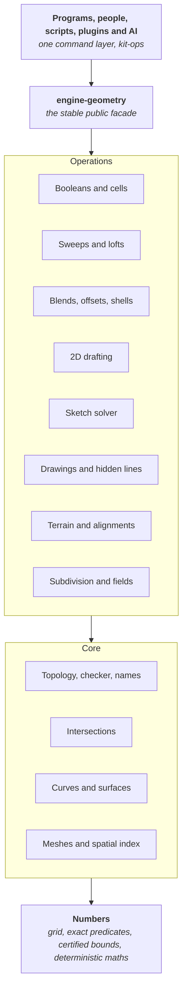

# G01: The Spare Kit geometry kernel, 3D and 2D

*Piece G01, Spare Kit. Decision note. Written 2026-10-21 by Claude Opus 5.5 for the owner. Proposed: an owner accepts it by merging the pull request that carries it. Evidence: ten research reports and three vetting reports in [G01-evidence](G01-evidence/README.md), each reading the actual source of the projects it cites.*

## The answer in plain words

Spareware writes its own geometry kernel in Rust, as part of Spare Kit, and every program uses it: Spare Construct for every discipline and survey, Spare Studio's 3D app, the simulation engine, and programs still to come, such as mechanical design, car design and manufacturing, a Spare Electronics for circuit boards, and 3D content creation, movie and game tools (which use its meshes, subdivision, booleans, fields and collision queries, while animation, physics and rendering live in their own engines on top). One kernel covers all geometry anyone needs to model: AutoCAD-class 2D drafting, Revit-class building solids, mechanical parts and assemblies, car body surfaces, manufacturing (machining, moulds, 3D printing), circuit boards, free-form surfaces, subdivision surfaces, implicit fields, meshes, terrain, road alignments and point clouds.

It is built from proven, published methods, in our own code, to these rules:

- **Exact where it decides the shape.** Every coordinate sits on a fixed grid: 156.25 nanometres (1/6400 mm) for buildings, sites and roads, and 6.25 nanometres for mechanical parts and circuit boards, so millimetres, inches, microns and mils are all exact. Every "which side is this on" question is answered with exact integer arithmetic. Flat-faced solids, which are most of a building, are cut and joined exactly, with no tolerance at all, however many times they are cut.
- **Certified where exact is not possible.** Curved geometry (cylinders, NURBS, blends) is computed to a proven error bound, at most 0.01 mm for buildings and 0.4 µm for parts and boards, and the result says so.
- **Never a broken result.** Every operation returns a valid model or a clear, structured error that names what failed and where. Nothing is half-done, and nothing is silently made less exact.
- **The same answer everywhere.** The same operations give bit-identical results on every computer, in the browser, on any number of cores.
- **Names that do not break.** Every face, edge and corner is named by the operation that made it, so a dimension, a hosted door or an AI's reference finds the same thing after the model changes, or says plainly that it cannot.
- **Headless and readable.** The kernel is a library of pure functions with no screen. People, scripts, plugins and AI agents reach it through the same commands. Its code is small modules, each stating what it does, what it guarantees and which published method it follows.
- **Built to grow.** A closed, guarded core and an open edge that grows along written contracts: new operations, geometry kinds, formats and domain toolkits (sheet metal, circuit boards, stairs) each have a playbook. Versioned operations and stored geometry mean an old model never changes meaning, and a generated map of the code means no future person or AI gets lost (section 26).

This replaces three choices in Spare Construct's map: the kernel is no longer flat-faced first with curves later, it is not a port of Manifold's float booleans, and the model tolerance is the grid and tolerance ladder in section 6, not a single 0.01 mm value. Everything is mapped now, at full scale. It is built in the order in section 30, each layer proven before the next, the way the owner asked: no shortcuts, done properly from the start.

## Contents

1. [The question](#1-the-question)
2. [What best means here](#2-what-best-means-here)
3. [Principles](#3-principles)
4. [Options considered](#4-options-considered)
5. [The architecture at a glance](#5-the-architecture-at-a-glance)
6. [Numbers: the grid, exact predicates and tolerances](#6-numbers-the-grid-exact-predicates-and-tolerances)
7. [Geometry types](#7-geometry-types)
8. [Topology: how shapes are stored](#8-topology-how-shapes-are-stored)
9. [Representations and exactness](#9-representations-and-exactness)
10. [Operations: the contract and the catalogue](#10-operations-the-contract-and-the-catalogue)
11. [Booleans and the arrangement engine](#11-booleans-and-the-arrangement-engine)
12. [Intersections](#12-intersections)
13. [Sweeps, lofts, blends, offsets and shells](#13-sweeps-lofts-blends-offsets-and-shells)
14. [2D drafting](#14-2d-drafting)
15. [Sketches and constraint solving](#15-sketches-and-constraint-solving)
16. [Free-form: subdivision surfaces and fields](#16-free-form-subdivision-surfaces-and-fields)
17. [Survey, terrain and civil](#17-survey-terrain-and-civil)
18. [Drawings: sections, projections and hidden lines](#18-drawings-sections-projections-and-hidden-lines)
19. [Meshes, tessellation, spatial index and clash](#19-meshes-tessellation-spatial-index-and-clash)
20. [Persistent naming and history](#20-persistent-naming-and-history)
21. [Determinism](#21-determinism)
22. [Errors, queries and what AI agents see](#22-errors-queries-and-what-ai-agents-see)
23. [Performance and parallel work](#23-performance-and-parallel-work)
24. [File format, versions and exchange](#24-file-format-versions-and-exchange)
25. [Public interface and stability](#25-public-interface-and-stability)
26. [How the kernel grows](#26-how-the-kernel-grows)
27. [Crates and folders](#27-crates-and-folders)
28. [Testing and verification](#28-testing-and-verification)
29. [What we may take from each source](#29-what-we-may-take-from-each-source)
30. [Build order](#30-build-order)
31. [Open risks](#31-open-risks)
32. [Decisions for the owner](#32-decisions-for-the-owner)
33. [Sources](#33-sources)

## 1. The question

What should the one geometry kernel that every Spareware program builds on be, so that it is more capable and more reliable than the kernels behind Revit and AutoCAD, lasts for decades, and can be read and extended by people and AI agents?

The owner's requirements, in their words: the best-architected kernel possible for all geometry situations, like Revit's but better, and the AutoCAD parts too; iron-clad; no shortcuts anywhere; the most complex geometry people ever want, created reliably; headless for AI and people alike; surveyors working CAD-style on the same geometry the designers model on; architected to expand; purposed for absolutely everything anyone could need to model in the world, from walls and stairs to mechanical parts and circuit boards.

## 2. What best means here

| Measure | What it means for the kernel |
| --- | --- |
| Capability | Every kind of geometry a building, a site, a road, a machine, a car, a product or a circuit board needs, in one model: 2D drafting, solids, free-form, Class-A surfaces with curvature-continuous blends, subdivision, fields, meshes, terrain, alignments, point clouds, sheet metal, threads, huge assemblies, layered boards, and what manufacturing needs from geometry (offsets and swept tool volumes for machining, draft and parting lines for moulds, slices and lattices for 3D printing, volume meshes for simulation) |
| Reliability | No operation ever returns an invalid shape. Hard cases either succeed correctly or fail with a reason a person or an AI can act on |
| Exactness | Topology (what touches, what crosses, what is inside) is decided exactly wherever the mathematics allows, and with a proven bound everywhere else |
| Determinism | Bit-identical results on every machine, in the browser, and for any thread count, so a shared model replayed from its operation log is the same model everywhere |
| Scale | A 230,000-element building opens in seconds and a door moves in one frame (Spare Construct's targets); a 50 km road corridor keeps survey precision |
| Permanence | Files written today open in fifty years; references in them still find the right faces |
| Readability | Anyone, person or AI, can find where a thing is done, what it guarantees and why |
| Headless | Every capability is a function call with data in and data out. No dialog, no hidden state |
| Owned by nobody | Open licence (MPL-2.0), permissive dependencies only, no method we are not free to use |

Where the incumbents fall short, from the evidence:

- **Parasolid and ACIS**, the commercial kernels behind most CAD, are exact by default and tolerant only where needed. That is the right model and we follow it, but they are closed, paid, single-threaded in places, and not deterministic across platforms by contract. Revit itself refuses curves under about 0.8 mm and keeps geometry within 16 km of its origin ([05](G01-evidence/05-exact-arithmetic-determinism.md), section 6).
- **OpenCascade**, the only complete open exact B-rep kernel, lets every vertex, edge and face carry its own tolerance that only ever grows, edits shared shapes in place, decides loops with rounded angles, and can return a shape with a hole in it after a failed fillet. Its own documentation lists booleans it "cannot solve in general" ([02](G01-evidence/02-occt-parasolid-acis.md), sections 2, 3 and 7).
- **Manifold**, the strongest open mesh boolean, is not exact: its tie rules changed three times in ten months, and its results are not bit-identical across machines by contract ([01](G01-evidence/01-manifold-mesh-booleans.md), sections 1 and 3).
- **Truck and Fornjot**, the two Rust B-rep kernels, use pointer identity (so results depend on memory addresses), one global tolerance, mesh-seeded booleans or approximation-first designs, and panics in library code. Fornjot shut down in 2026 with its goals not reached ([03](G01-evidence/03-rust-kernels-crates.md), sections 1 and 2).

No open kernel is exact, deterministic, persistently named and complete. That is the gap Spare Kit fills.

## 3. Principles

These hold for every crate, every operation and every pull request. A change that breaks one does not merge.

1. **Exact where it decides topology.** Whether things touch, cross or contain each other is decided by exact predicates on exact data wherever the mathematics allows (section 6).
2. **Certified where exact is impossible.** Curved constructions carry a proven error bound, never a guess. Bounds come from interval or Bernstein arithmetic, not from sampling.
3. **Every result states its exactness.** Each body carries its exactness class: Exact, Certified with a bound, or Approximate with a measured deviation (section 9). An operation never makes a result less exact without saying so, and never without being asked.
4. **Never an invalid result.** Every operation returns a model that passes the validity checker, or an error. Inputs are never modified. A failed operation leaves the model exactly as it was.
5. **Deterministic.** The same inputs give bit-identical outputs on every supported target and thread count (section 21).
6. **Names never break silently.** Every topological entity has a name derived from the operation that made it. A reference resolves exactly, follows a recorded split or merge, or fails with a reason. It never picks a different face by guessing (section 20).
7. **Pure, immutable and headless.** Operations are pure functions over immutable data. No global state, no session singletons, no screen. Anything a person can do, an AI or a script can do through the same call.
8. **One kernel for 2D and 3D.** The same numbers, the same curve family and the same naming serve drafting, modelling, survey and drawings.
9. **Built to last.** The native file format is documented, versioned and readable forever. The public facade is stable; the inside may change freely (section 25).
10. **Readable by people and AI.** Small modules with one job. Every module states its invariants and checks them in code. Every algorithm names the published method it follows. No unexplained constant.
11. **Proven methods, our code, raised to our bar.** We port published methods. We take permissive code only where it meets every principle here, and keep its licence and credit. No GPL or AGPL code; LGPL code is studied for method only (section 29). **Nothing enters as it is.** Every method or piece of code we take is rebuilt to these principles before it merges: our types, exact predicates where topology is decided, certified bounds elsewhere, deterministic maths, our error model, names and history, and the same tests, fuzzing and benchmarks as code we wrote ourselves. Where a source has a known weakness (a fixed tolerance, a silent fallback, a sampled check), the port fixes it, and the pull request says what changed and why. If it cannot be raised to the bar, it is not taken.
12. **Measured.** Every operation ships with unit, property and fuzz tests and a benchmark. Correctness and determinism regressions block a merge; speed regressions over 5% block a merge.
13. **Safe Rust.** No `unsafe`; no panics in kernel paths; bounded recursion (WebAssembly stacks have no guard page); cooperative cancellation.

## 4. Options considered

| Option | What it would mean | Evidence | Verdict |
| --- | --- | --- | --- |
| A. Wrap OpenCascade | Bind the C++ kernel, write Rust on top | LGPL-2.1 with exception; mutable shared shapes; tolerance growth by design; pointer hashing; decisions by floating-point angles; not deterministic across platforms ([02](G01-evidence/02-occt-parasolid-acis.md)) | **No.** Its failure modes are architectural, not bugs. Studied for method; used only as an outside test oracle |
| B. Port Manifold | Rust port of the C++ mesh boolean, as the old map planned | Apache-2.0, fast and well tested, but float-based with position-dependent tolerance, not exact, not cross-platform deterministic, meshes only ([01](G01-evidence/01-manifold-mesh-booleans.md)) | **No, as the core.** We take its mesh data model, provenance scheme and test corpus, and use it as an oracle |
| C. Adopt Truck | Build on the Apache-2.0 Rust B-rep kernel | Booleans decide topology from triangle meshes; pointer identity; one global absolute tolerance that panics; no geometric validity checks ([03](G01-evidence/03-rust-kernels-crates.md); [vetting](G01-evidence/11-vetting-suggested-projects.md)) | **No.** Its trait vocabulary is a useful naming reference |
| D. Build on SMLib or solidcore | NVIDIA's newly open NURBS B-rep kernel (Apache-2.0, October 2026, about 970,000 lines of C++ from the 1998 SMLib lineage), or solidcore, the young Rust port of it | Mutable pointer topology behind a global context, per-entity tolerances, no exact predicates, integer status codes, booleans that fail silently on live code paths, surface intersection that misses loops; NVIDIA's own known-issues list includes operations that report success when they failed. solidcore keeps the same architecture in Rust ([13](G01-evidence/13-vetting-smlib.md)) | **No, as a foundation.** Its NURBS algorithms (NLib, Piegl and Tiller's production versions of The NURBS Book) are the best permissive method source and are ported as methods, with notices kept and the Numerical-Recipes-derived routines avoided. solidcore and SMLib serve as differential-test oracles |
| E. Our own kernel on proven methods | Write the kernel in Rust to the principles above, porting published methods and permissive code that fits | Every report points here: no open kernel meets principles 1 to 6 together | **Yes.** This note maps it |

Option E is more work than A to D. It is the only one that ends with a kernel that is exact, deterministic, persistently named and owned by nobody, which is what lasts.

## 5. The architecture at a glance



| Layer | What it holds | Depends on |
| --- | --- | --- |
| Numbers | The coordinate grid, wide integers, exact predicates, interval bounds, deterministic maths functions, the tolerance ladder | Nothing in the kernel |
| Geometry | Points, vectors, transforms and frames; every curve and surface kind; NURBS algorithms | Numbers |
| Topology | Bodies, regions, shells, faces, loops, fins, edges, vertices in arenas; the builder; the validity checker; persistent names and history | Numbers, geometry |
| Intersections | Curve with curve, curve with surface, surface with surface, all certified | Numbers, geometry |
| Meshes and spatial | Exact meshes, watertight tessellation, the bounding-volume hierarchy, distance and clash | The layers above it in this table |
| Operations | Everything that makes or changes shapes, each a pure function with a typed result | The core |
| Facade | `engine-geometry`: the one stable interface programs and bindings use | Operations and core |

Rules that keep the layers honest:

- Dependencies go down only. An operation never depends on another operation's internals; shared needs move into the core.
- The facade is the only crate programs may depend on. Everything below it is internal and may change (section 25).
- The kernel depends on no other Spare Kit crate except, at the facade, `kit-core` for permanent IDs and units. It knows nothing about walls, doors or programs. Spare Construct's elements turn into kernel calls in Spare Construct's own crates.

## 6. Numbers: the grid, exact predicates and tolerances

This section decides the foundation everything else stands on. Evidence: [05](G01-evidence/05-exact-arithmetic-determinism.md), with [01](G01-evidence/01-manifold-mesh-booleans.md) for plane-based booleans and [02](G01-evidence/02-occt-parasolid-acis.md) for tolerant modelling.

### 6.1 The grid

Every coordinate the kernel stores is a whole number of grid steps.

- **The standard grid step, q0, is 156.25 nanometres: 1/6400 of a millimetre.** It is the largest step that makes both 0.01 mm (64 steps) and 1/256 inch (635 steps) exact whole numbers, so metric and imperial models both round-trip exactly. One millimetre is 6,400 steps and one inch is 162,560.
- **Coordinates are `i64` in a local frame, kept within 2^40 steps of its origin: ±171.8 km at q0.** That covers any building, any site and a 50 km road corridor in one frame. Keeping within 40 bits is what lets every predicate below run in fixed-size integers, whatever the step.
- **Frames hold the real world.** Each model has a project frame. Its link to a map projection (for example NZTM2000) is a frame record: the coordinate system's ID, the origin in grid steps (an NZTM northing is about 2^45 steps), a rotation and a scale factor. Survey and map data are converted into the frame once, in double-double arithmetic, and rounded to the grid. Networks wider than ±171.8 km, such as a regional road model, use several frames on a shared lattice, so moving between neighbouring frames is an exact integer shift.
- **A ladder of grid steps, each exactly 25 times finer than the one above.** Every frame picks one:

  | Step | Size | Exact units | Range per frame | For |
  | --- | --- | --- | --- | --- |
  | q0 | 156.25 nm | 0.01 mm, 1 mm, 1/256 inch | ±171.8 km | Buildings, sites, roads, survey |
  | q1 | 6.25 nm | 1 µm, 0.01 mm, 1 mil (1/1000 inch), 1/256 inch | ±6.87 km | Mechanical parts, products, circuit boards |
  | q2 | 0.25 nm | 1 nm, and everything above | ±275 m | Reserved, for example chip layout |

  A finer step divides every coarser one exactly, so a building's coordinates convert into a part's fine frame by multiplying by 25, with nothing lost. A precision part or a circuit board placed in a building keeps its own fine frame, and a boolean between the two converts the building's geometry into the fine frame and stays exact. Converting fine to coarse rounds, and the result says so. Why 25: 156.25 nm is the largest step making 0.01 mm and 1/256 inch exact, and 6.25 nm, which is 156.25 nm divided by 25, is the largest step that also makes 1 µm and 1 mil exact (it is the greatest common divisor of 1 µm, 1 mil, 0.01 mm and 1/256 inch). This is decision 1 in section 32.

Why a grid and not floating point: Revit and OpenCascade store doubles and pay for it with tolerances that leak into every decision. On a grid, the data the kernel decides from is exact, and the only rounding happens at known points: when a new point is committed (at most half a step, 78 nm) and when curved geometry is fitted (at most the certified bound below).

### 6.2 Exact predicates

A predicate is a yes, no or "exactly on it" question: which side of this plane is this point, does this point lie inside this circle. Topology is decided only by predicates, and every predicate in the kernel is exact.

- **They return a sign, never a number:** `Negative`, `Zero` or `Positive`.
- **They are computed in fixed-size integers.** With coordinates under 2^40, orientation in 2D and 3D fits in `i128`; circle and sphere tests in 256 bits; the deepest plane-based test (a point made by three planes, tested against a fourth plane) in 384 bits. Each predicate's module carries the written derivation of its bit budget and a test at the extreme values (every coordinate at ±(2^40 − 1)). Evidence: the bit-budget table in [05](G01-evidence/05-exact-arithmetic-determinism.md), section 4, matching EMBER's published 256-bit bound at 26-bit inputs.
- **A cheap filter goes first.** Each predicate first runs in `f64` with a semi-static error bound (the method of Meyer and Pion's generator, as used in Geogram's PCK, BSD-3) and returns at once when the sign is certain. Only uncertain cases fall through to the exact integer path. There is no interval stage and no change of rounding mode, which Rust forbids and WebAssembly cannot do.
- **Filter constants are generated, not hand-typed**, from a small description of each predicate, the way Geogram's PCK generator does it. Hand-typed error bounds are where predicate libraries go wrong.
- **Degenerate ties are handled on purpose.** Where an algorithm needs every sign to be non-zero (Delaunay triangulation, ray parity), it uses symbolic perturbation (Simulation of Simplicity, Edelsbrunner and Mücke 1990), ordered by persistent names, never by memory address as Geogram's default does. Where a tie means something real (two walls sharing a face), booleans handle it explicitly, because a perturbation would turn a shared face into an arbitrary tiny gap or overlap.

### 6.3 Constructions stay implicit until committed

A construction makes a new point or plane: where three planes meet, where a line hits a plane. Rounding a constructed point and then deciding things about the rounded point is the classic way kernels lose consistency (CGAL's own manual warns of it; [05](G01-evidence/05-exact-arithmetic-determinism.md), section 3).

- Inside an operation, constructed points stay implicit: a point is stored as "the meeting of these three planes" in homogeneous integer coordinates, and predicates act on that definition exactly (the method of Attene's indirect predicates and EMBER's plane-based arithmetic, re-derived in our own code because Attene's library is LGPL and changes the rounding mode).
- **Flat-faced solids stay plane-based for good.** A polyhedral solid is stored as its planes, and every vertex is a meeting of planes. Booleans make new solids out of the same input planes, so cutting a wall 300 times never rounds anything and never drifts (section 11).
- A point is rounded to the grid only when it must become explicit (export, a 2D drawing, a curved construction). The rounded result is re-checked with exact predicates. If rounding would flip anything, the implicit form is kept instead.

### 6.4 Curved geometry: deterministic and certified

Curves and surfaces other than lines and planes are evaluated in `f64` arithmetic in grid units, which Rust computes exactly to IEEE rules on every target. The maths functions (`sin`, `cos`, `atan2`, `exp` and so on) come only from one pure-Rust library, never the platform's, because the standard ones differ by platform (section 21). Every curved computation that feeds a decision carries a certified bound from interval or Bernstein arithmetic, rounded outward with `next_up` and `next_down` (stable in Rust since 1.86).

### 6.5 The tolerance ladder

There is no per-entity tolerance that grows. There is one fixed ladder, derived from the frame's grid step q, so it scales with the step: a circuit board's fit bound is 25 times tighter than a building's.

| Name | In steps | At q0 (buildings) | At q1 (parts, boards) | Used for |
| --- | --- | --- | --- | --- |
| Commit rounding | at most q/2 | 78 nm | 3.1 nm | Making an implicit point explicit |
| Fit bound, ε_fit | 64q | 0.01 mm | 0.4 µm | The largest certified error of any curved construction (intersection curves, fitted surfaces, offsets of NURBS) that feeds topology |
| Angular bound, ε_ang | 2^-34 rad | about 5.8 × 10^-11 rad | the same | Angles in curved code only. It equals ε_fit over the frame's range (64q over 2^40 q), so it is the same at every step; the same construction as Parasolid's 1e-11 |
| Import healing, ε_heal | 640q by default, capped at 6,400q | 0.1 mm, capped at 1 mm | 4 µm, capped at 40 µm | Closing gaps in imported data, once, at import, recorded in the operation log |
| Short-edge warning | 3,200q | 0.5 mm | 20 µm | A warning only. There is no hard minimum edge length; the true minimum is one grid step |

- The exact polyhedral core uses no tolerance at all.
- **Tolerant bodies exist only as an import state.** An imported body whose edges do not quite meet carries per-edge tolerances up to ε_heal, marked Tolerant. No operation ever raises a tolerance. Operations either work within the existing ones or refuse with `ToleranceExceeded`, and healing turns a Tolerant body into a Certified or Exact one. This is Parasolid's published model ("exact by default, tolerant only where needed") with OpenCascade's monotone growth removed.
- Every operation has a tolerance ceiling. Exceeding it is an error that rolls back, never silent growth (Parasolid's `max_tol`, made mandatory).

## 7. Geometry types

One curve family serves 2D and 3D. Each kind is stored as itself, exactly, never converted to NURBS behind the user's back: arcs stay arcs, so dimensioning, snapping, offsets and file exchange stay exact. Conversion to NURBS is on demand and returns the NURBS, whether it is exact, and its maximum error. Evidence: [04](G01-evidence/04-nurbs-surfaces.md), sections 2 and 7.

**Curves (2D and 3D)**

- Line, ray, infinite line
- Circle and arc; ellipse and elliptical arc (by parameter, not polar angle); parabola; hyperbola
- Helix (exact; neither STEP nor IFC has one)
- Clothoid, and IFC 4.3's cosine, sine and second-, third- and seventh-order polynomial spirals, for road and rail alignments
- Polynomial curve; circular involute
- NURBS, rational or not, periodic or clamped
- Bulge polyline (lines and arcs with optional widths, as in DXF), composite curve, trimmed curve
- Offset curve (2D, 3D, and IFC's offset by distances); curve on surface (pcurve)
- Intersection curve: procedural, defined by its two surfaces, with a cached fitted curve and its certified error

**Surfaces**

- Plane; cylinder; cone; sphere; torus, including the degenerate "lemon" and "apple" forms
- Surface of revolution; linear extrusion; ruled surface
- Sweep (profile, path and frame rule); fixed-reference and directrix sweeps as IFC defines them
- Offset surface
- Rolling-ball blend: procedural, with a cached NURBS and its error
- NURBS
- Subdivision limit surface (section 16)

**How they are written in code.** Storage uses closed enums, one variant per kind: exhaustive matching, stable serialisation, and easy to read for people and AI. Behaviour uses traits: a curve can evaluate, give derivatives, give a conservative bound over any parameter interval, give derivative bounds, convert to NURBS with an error, split, reverse and transform. Procedural kinds carry their definition plus an optional cached approximation and its error. Trimming belongs to the topology's loops, not to a surface kind. Every algorithm's doc comment names its source: a NURBS Book algorithm number or a paper's DOI.

**Transforms can change a kind.** A non-uniform scale turns a circle into an ellipse, and a mirror reverses an arc. Transforms are typed so that this is explicit. Translations by whole grid steps, rotations by multiples of 90 degrees and mirrors stay exact; other rotations round to the grid and the result says so.

## 8. Topology: how shapes are stored

Evidence: [02](G01-evidence/02-occt-parasolid-acis.md) sections 1, 5, 8 and 9; [03](G01-evidence/03-rust-kernels-crates.md) section 5; [07](G01-evidence/07-persistent-naming.md).

### 8.1 Entities

The kernel uses the boundary-representation structure that Parasolid documents publicly, with explicit fins and regions. It is richer than OpenCascade's, which has no fin entity and keys curves on faces by pointer.

| Entity | What it is |
| --- | --- |
| Body | One shape. Its kind is Solid, Sheet (open surfaces), Wire (curves), Acorn (points) or General (mixed and non-manifold) |
| Region | A connected volume of a body, solid or void. Every body has one infinite void region outside it. Regions make cellular models: rooms and spaces are regions bounded by shared faces |
| Shell | A connected set of faces bounding a region |
| Face | A bounded piece of one surface, with a sense (which side is material) |
| Loop | A closed boundary of a face: one outer loop and any number of holes |
| Fin | The use of an edge by a loop, in one direction. In non-manifold models fins around an edge are kept in radial order |
| Edge | A bounded piece of one curve, between two vertices (or closed) |
| Vertex | A point |

Geometry attaches by index into the body's geometry pools: a face to a surface, an edge to a 3D curve, and a fin on a curved face to a curve in that face's parameter space (a pcurve). Each edge has one primary geometry: its 3D curve, exact or certified. Pcurves are derived and checked against it. An imported Tolerant edge has its pcurves as primary and its 3D curve derived, as Parasolid and ACIS do. The two are never kept in loose agreement by a growing tolerance.

### 8.2 Storage

- **Arenas with typed indices.** Each body stores each entity kind in a vector, addressed by a 32-bit typed index (`FaceIx`, `EdgeIx` and so on), assigned in operation order. No pointers, no reference counting between entities, no identity by memory address. Truck, Fornjot and OpenCascade all used address identity and all lost determinism through it; Fornjot ended on exactly this arena design ([03](G01-evidence/03-rust-kernels-crates.md), section 2).
- **Immutable after building.** A body is made through a builder and is never changed afterwards. An edit makes a new version. Large bodies are split into shared chunks so a new version copies only what changed. Undo, multi-user replay and "try and see" come free; OpenCascade's optional safe mode becomes the only mode.
- **Ordered containers only.** Maps that can be iterated are ordered by stable keys. Hash maps are used only where they are never iterated.
- **Indices are not names.** An index is valid inside one body version. Persistent names (section 20) are what references and files hold.

### 8.3 The validity checker

Every operation's result passes the checker before it is returned. The checker runs in groups, like Parasolid's published body check:

1. **Combinatorial:** every loop closes, every fin has a partner or is a recorded boundary, shells are closed and consistently oriented, regions nest correctly, and Euler's formula holds.
2. **Geometric consistency:** vertices lie on their edges' curves and their faces' surfaces, edges lie on their faces, and pcurves match their 3D curves. These are certified with bounds, not sampled. OpenCascade samples 23 points, and its own documentation shows edges that pass and are still invalid.
3. **Self-intersection:** no face crosses itself; no two faces cross except along shared edges.
4. **Exactness record:** every body's exactness class and bounds are consistent with its geometry.

The cheap groups run after every operation in every build. The full set runs in debug builds, in continuous integration, on every import, and on request.

## 9. Representations and exactness

"The most complex geometry people want, reliably" needs more than one way to represent shape. Spare Kit has five, in one model, each first-class. Evidence: [09](G01-evidence/09-freeform-subd-implicit.md), [01](G01-evidence/01-manifold-mesh-booleans.md), [04](G01-evidence/04-nurbs-surfaces.md).

| Representation | What it is for | Exactness |
| --- | --- | --- |
| B-rep (sections 7 and 8) | Everything editable and drawable: walls, slabs, roofs, families, free-form NURBS surfaces | Exact for flat faces and 2D lines and arcs; Certified for curved |
| Exact mesh | Imported meshes (IFC triangle sets, scans), fast clash, display, the universal fallback | Exact (plane-based, on the grid) |
| Subdivision surface | Organic and sculpted forms, Catmull-Clark with creases | Exact cage; limit surface certified; conversion to NURBS exact on regular regions and approximate with a stored deviation at extraordinary points |
| Field (implicit) | Lattices, variable-thickness shells, smooth blends of many shapes, forms that are simplest as "distance from" | Certified by interval bounds when turned into a mesh or B-rep |
| Point cloud | Scans as reference: snapping, fitting, comparison | Reference only. Never part of a solid |

**Every body carries an exactness class:**

- **Exact:** decided entirely by exact predicates on exact data.
- **Certified(ε):** within a proven bound ε of the true shape, with ε ≤ ε_fit unless the caller asked for more.
- **Approximate(ε):** within a measured, not proven, deviation ε. For example, a subdivision surface's extraordinary points converted to NURBS, or a mesh fitted to a scan.

The class of a result is the least exact of its inputs, and bounds add up. An operation that would lower the class without being asked returns an error offering the explicit alternative instead.

**One boolean across representations.** If all operands are B-rep, the B-rep boolean runs. If any is a mesh, the exact mesh boolean runs on certified tessellations. If any is a field, the field boolean runs (B-rep operands enter as exact distance plus winding number). The result's class follows the rule above. A B-rep boolean that cannot be certified returns an error that offers the mesh or field path explicitly. It never falls back silently.

**The conversion graph.** Every conversion between representations is an operation whose edge is labelled exact, certified or approximate, and which returns its bound. The full graph is in section 16.

## 10. Operations: the contract and the catalogue

### 10.1 The contract

Every operation, from "make a box" to "fillet these 40 edges", has the same shape:

```rust
fn operation(ctx: &OpContext, input: &OpInput) -> Result<OpOutput, OpError>
```

- **`OpContext`** carries the operation's permanent ID from the operation log, its budgets (work units, memory, time), a cancellation token, and the precision level (final, or a coarser preview the caller asked for). It holds no randomness and no clock that can affect the result.
- **`OpOutput`** carries:
  - the new bodies, immutable;
  - the **history**: for every output face, edge and vertex, whether it is unchanged, modified, generated, split from, or merged from which inputs, and which inputs were deleted (section 20);
  - the new **names**;
  - each body's **exactness class** and bounds;
  - **diagnostics**: warnings with the entities they concern (a short edge, a near-tangency handled).
- **`OpError`** is typed per operation, on a shared base (section 22). It names the entities involved, the parameter values and points, and what would make it succeed.
- **Transactional.** Nothing is published until the result passes the checker. A failed or cancelled operation changes nothing.
- **Budgeted and cancellable.** Long operations check their budget and the cancellation token at bounded steps and stop cleanly. They never unwind a panic, which WebAssembly builds cannot catch.
- **Batch first.** Operations take many inputs where that is natural: 300 openings cut from a wall in one call; a thousand panels evaluated in one call with one result per item, so one failure does not fail the list.

### 10.2 The catalogue

Each family below is a section of this note or of its build order.

| Family | Operations |
| --- | --- |
| Make | Points, curves and surfaces of every kind; primitives (box, cylinder, cone, sphere, torus, prism); bodies from faces (sew) |
| 2D | Drafting entities, regions, hatches, 2D booleans and offsets, trim, extend, fillet, chamfer, break, join, stretch, arrays, divide and measure, snaps (section 14) |
| Sketch | Constrained profiles for families, walls and floors (section 15) |
| Sweep | Extrude (with taper), revolve, sweep along a path with frame rules, swept blend, loft through sections with guides, network (Gordon) surfaces, IFC's sectioned solids along alignments (section 13) |
| Combine | Unite, subtract, intersect; general fuse and imprint; split; cells and regions; batch cutting (section 11) |
| Blend | Fillet and chamfer, constant and variable; vertex blends; blends with chosen continuity (G1, G2, G3) for Class-A surfaces (section 13) |
| Offset | Offset faces and bodies, shell, thicken, draft; face move, replace and delete with healing (section 13) |
| Transform | Move, rotate, mirror, scale (uniform and not), patterns |
| Repair | Import healing within ε_heal, sewing, small-feature removal |
| Query | Classify a point, measure, distance and clearance, time of first contact between moving bodies (continuous collision detection that never misses a contact, the Tight Inclusion method, MIT; used by door swings, crane and machine-tool paths, construction sequencing, games and the simulation engine), mass properties (exact for flat solids: twice-area and six-times-volume in integers), bounding boxes; surface quality: curvature, continuity across edges, zebra and highlight lines, draft angle against a pull direction |
| Draw | Section cuts, projections, hidden lines, silhouettes (section 18). Line patterns laid out along curves by exact arc length (certified on ellipses and splines); hatch and fill pattern lines clipped exactly to their regions, arcs and islands included; surface patterns (brick coursing, tiles) mapped onto faces. The kernel makes this geometry, with provenance. Which pattern, weight and colour each category uses is the program's view rules; weights, colours and drawing to screen, print and PDF are `engine-draw2d`'s |
| Mesh | Watertight tessellation with a proven bound, levels of detail, mesh booleans, repair, volume (tetrahedral) meshes for simulation (section 19) |
| Manufacture | Swept volumes of moving tools, slicing into layers, parting lines from silhouettes; the strategies themselves (toolpaths, nesting) belong to a manufacturing program or domain toolkit built on these (section 26) |
| Free-form | Subdivision surfaces, fields, conversions, panelisation, surface division, unrolling (section 16) |
| Ground | Terrain from points and breaklines, contours, cut and fill, alignments, corridors, straight skeletons for roofs (sections 13 and 17) |

## 11. Booleans and the arrangement engine

*Drafted from the evidence in the next stage.*

## 12. Intersections

*Drafted from the evidence in the next stage.*

## 13. Sweeps, lofts, blends, offsets and shells

*Drafted from the evidence in the next stage.*

## 14. 2D drafting

*Drafted from the evidence in the next stage.*

## 15. Sketches and constraint solving

*Drafted from the evidence in the next stage.*

## 16. Free-form: subdivision surfaces and fields

*Drafted from the evidence in the next stage.*

## 17. Survey, terrain and civil

*Drafted from the evidence in the next stage.*

## 18. Drawings: sections, projections and hidden lines

*Drafted from the evidence in the next stage.*

## 19. Meshes, tessellation, spatial index and clash

*Drafted from the evidence in the next stage.*

## 20. Persistent naming and history

Evidence: [07](G01-evidence/07-persistent-naming.md), with OpenCascade's history contract in [02](G01-evidence/02-occt-parasolid-acis.md).

The problem: a reference such as "fillet this edge", "dimension to this face" or "this door is hosted on that wall face" is stored against something that regeneration rebuilds. Kernels that name faces by their position in a list (Face1, Face2) silently point at the wrong face after an upstream change. FreeCAD fought this for fifteen years; its 2024 fix still draws a random number for duplicate names, starts each document's counter at a random offset, and, when a name is lost, picks the nearest-looking face by geometry. All three make names differ between machines.

### 20.1 Three kinds of identity

| Identity | What it is | Lives |
| --- | --- | --- |
| `OpId` | The permanent ID of one operation, set when the operation is authored and stored in the operation log. An `OpPath` adds sub-step labels | In the log and in files, forever |
| `NameId` | A persistent name: a 128-bit hash of a canonical encoding of how the entity was made. Names are hash-consed, so a name is a node in a shared graph that refers to its parents by their `NameId` | In files, forever. The hash function and encoding are versioned (`NameScheme v1`) |
| Index | A typed index into a body version's arena | In memory only, never persisted |

### 20.2 How each operation names what it makes

```rust
enum TopoName {
    Created { op: OpPath, role: Role, from: SortedVec<NameId> },  // made new by this step
    Split   { op: OpPath, of: NameId, piece: PieceKey },           // one input became several
    Merged  { op: OpPath, of: SortedSet<NameId> },                 // several inputs became one
    Bounded { kind: EdgeOrVertex, by: SortedSet<NameId>, ord: u8 },// named by the faces it bounds
}
enum PieceKey {
    ByTools { tools: SortedSet<NameId>, side: Side }, // which cutting faces, which side
    Ordinal { n: u16, of: u16 },                      // last resort, ordered in parameter space; marked weak
}
```

- An unchanged entity keeps its name. **An entity modified one-to-one keeps its name too**; the change is recorded in the history, not in the name.
- **Roles are part of every operation's contract.** An extrusion names its faces `cap.start`, `cap.end` and `side(source edge)`; a wall's layer faces are `exterior`, `interior`, `top`, `base`, `end0`, `end1`; a fillet names `roll(edge)`. This is how Revit's stable door references (left, right, centre, top) work, made general.
- A split is named by the faces that cut it and the side. Only when two pieces still collide is an ordinal used, ordered in the parent surface's parameter space, and marked weak.
- Everything is sorted by name, never by the order a kernel happened to report it or by memory address.
- A duplicate name is a bug caught by tests. In production it gets a weak ordinal, never a random suffix.

### 20.3 History every operation must emit

For every output entity: unchanged, modified from, generated from (with role), split from (with tools and side), or merged from; and the list of deleted inputs. The rules, checked by property tests on every operation: a deleted input has no modified outputs; an input's generated and modified sets do not overlap; every output traces to an input or is generated; histories compose across operations. This is OpenCascade's `BRepTools_History` contract, adopted as a tested invariant.

### 20.4 How a reference resolves

A reference is `{ element, name, kind, want, signature }`, where `want` is `One`, `AllPieces` or `Carrier`.

1. If the name exists in the element's current body, that is the answer.
2. Otherwise the resolver walks forward through the recorded splits, merges and modifications. One descendant resolves with a note that it followed history. Several resolve if the reference wants all pieces, and otherwise return `Ambiguous` with the candidates. None returns `Deleted` with the operation that deleted it.
3. **Carrier references**, the default for dimensions and hosting, resolve to the underlying plane, axis or surface. When a door opening splits a wall face, every piece shares its carrier, so a dimension to "the exterior face of the wall" does not break.
4. **There is no geometric guessing.** The stored signature is used only to suggest a repair in the interface. An accepted repair is a new operation in the log, so every copy of the model applies the same fix.
5. An unresolved reference is model state, the same on every machine: the feature shows `UnresolvedRef` with the reason.

## 21. Determinism

Evidence: [05](G01-evidence/05-exact-arithmetic-determinism.md) section 7 and [03](G01-evidence/03-rust-kernels-crates.md) section 5.

**What Rust already guarantees.** Addition, subtraction, multiplication, division, remainder, square root, fused multiply-add (only when written as `mul_add`), casts and comparisons follow IEEE 754 exactly on every supported target, and Rust never fuses a multiply and an add on its own (RFC 3514).

**What the kernel must police, and how:**

| Hazard | Rule | Enforced by |
| --- | --- | --- |
| Maths functions (`sin`, `cos`, `atan2`, `exp`, `powi` and so on) differ by platform | Only from the kernel's own deterministic maths module: the pure-Rust `libm` crate now, moving to correctly rounded CORE-MATH ports, which are identical by specification | Kernel crates are `no_std` (the standard ones are not even available); `clippy` disallowed-methods |
| NaN sign and payload are not deterministic, even in WebAssembly | The kernel never produces NaN. Scalars are checked at construction | A NaN-free scalar type; fuzzing; tripwires in debug builds |
| `max` and `min` may return either zero sign | Use the kernel's own total-order helpers | `clippy` disallowed-methods |
| Relaxed and "algebraic" operations, relaxed SIMD | Forbidden | `clippy` disallowed-methods; no relaxed SIMD feature |
| Parallel float reductions change order | Fixed chunk sizes independent of thread count, results collected in order, no float reduction across chunks | One shared parallel helper; a thread-count test (1, 2, 3 and 8 threads) |
| Hash map iteration order is random | No iteration over hash maps | `clippy` disallowed-types for `HashMap` and `HashSet` in kernel crates |
| Tie-breaks by memory address | Never. Ties break by persistent name | Code review rule; tests that shuffle allocation |
| Targets that break IEEE (i586 x87, 32-bit ARM NEON flushing denormals) | Excluded from the guarantee | Documented platform list |

**Checked on every pull request:** an operation-log replay corpus runs on x86-64 Linux, Windows and macOS, aarch64 Linux and macOS, and wasm32 under wasmtime and Node, in debug and release, with `-C target-cpu=native`, and with 1, 2, 3 and 8 threads. The SHA-256 of each canonical output must match the golden value. This is the method Rapier and Box2D use to keep their physics deterministic ([05](G01-evidence/05-exact-arithmetic-determinism.md) section 7).

## 22. Errors, queries and what AI agents see

The kernel is headless by design. An AI agent cannot look at the screen, so everything it needs to know is data.

**Errors explain themselves.** Every error is structured, in the same shape for people and AI:

```rust
struct OpError {
    kind: ErrorKind,            // e.g. SelfIntersection, ToleranceExceeded, RadiusTooLarge, Ambiguous, NoSolution, Cancelled
    op: OpPath,                 // which operation, which step
    entities: Vec<NameId>,      // the faces, edges and vertices involved
    at: Vec<Evidence>,          // points, parameters, distances, the bound that was exceeded
    message: Text,              // plain words, translatable
    remedies: Vec<Remedy>,      // what would make it succeed: "radius at most 4.2 mm here", "use the mesh boolean", "heal with ε_heal 0.3 mm"
}
```

Compare "Can't create form element" in Revit with "fillet radius 6 mm exceeds the 4.2 mm available between faces exterior and top of wall W-12 at station 3.40 m; largest radius that fits: 4.2 mm".

**Everything can be asked.** Queries are first-class operations: classify a point, list a body's faces with their names and roles, measure, find the distance or clearance between two things, area and volume, exactness class and bounds, validity report, curvature, section a body to get a plan. An AI can check its own work the way a person looks at the screen.

**Every operation is described as data.** Each operation has a schema: inputs with types and units, outputs, roles it names, errors it can return, its exactness, and an example. Spare Kit's command layer generates the API, the MCP tools and the documentation from these schemas (EXTENDING.md, section 2.1), so AI tools are never written by hand and never drift from the kernel.

**Determinism makes AI work safe.** An agent can try an operation, inspect the result, and replay or undo it, and get exactly the same answer every time.

## 23. Performance and parallel work

*Drafted from the evidence in the next stage.*

## 24. File format, versions and exchange

*Drafted from the evidence in the next stage.*

## 25. Public interface and stability

The kernel follows Spareware's three stability tiers (EXTENDING.md, section 4).

| Tier | What | Promise |
| --- | --- | --- |
| Stable | `engine-geometry`: the operation schemas, the value types (grid points, curves, surfaces, bodies, names, errors), the native file format | Semantic versioning. A breaking change is a new major version that runs beside the old one; formats are read forever |
| Preview | New operations and types being tried | May change. Not usable by published plugins. Graduate or drop within 12 months |
| Internal | Every `geom-*` crate | May change at any time. Nothing outside the kernel depends on them |

- Programs, the C interface, the WebAssembly bindings and the Python bindings all go through `engine-geometry`.
- **Geometry moves between programs with nothing lost.** Every Spareware program reads and writes the same native geometry through the same kernel. A building modelled in Spare Construct opens in a rendering or 3D studio program as the same bodies, with the same names and the same exactness, and can stay linked so edits flow through. There is no export and re-import between our own programs, and so no translation loss.
- `cargo-semver-checks` runs on `engine-geometry` before every release.
- Plugins reach geometry only through Spare Construct's or Spare Studio's command API, never by linking kernel crates (EXTENDING.md, section 1).

## 26. How the kernel grows

The kernel will be extended for decades, by people and AI agents who were not here when it was written, for programs nobody has thought of yet. Growth is part of the design, not an afterthought. The rule underneath it all: **a closed, carefully guarded core, and an open edge that grows along written contracts.**

### 26.1 What can be added, and how

| To add | Where it goes | What it must come with | Who says yes |
| --- | --- | --- | --- |
| An operation | A module in the operation crate it belongs to | Its schema (inputs with units, outputs, the roles it names, the errors it returns, its exactness), the history contract, the checker postcondition, unit, property and fuzz tests, a benchmark, and a doc comment naming the published method | Kernel owners, after a short design note |
| A query | `engine-geometry` and the crate that owns the data | Its schema, tests, and a cost bound | Kernel owners |
| A curve or surface kind | A new enum variant in `geom-curve` or `geom-surface` | Evaluation, derivatives, conservative bounds, conversion to NURBS with an error, transforms, intersection with every existing kind (directly, or through an explicit and certified NURBS route), a file-format tag and reader, and tests | Kernel owners, with a decision note: kinds are part of the file format forever |
| A representation | A new crate, and new edges in the conversion graph | Its exactness rules, conversions both ways with bounds, and how it takes part in the one boolean | A decision note an owner accepts |
| An exchange format | A `geom-<format>` crate | Round-trip tests against real files, and a legal check for any closed format | Kernel owners |
| A domain toolkit | A `geom-<domain>` crate when two programs need it, otherwise inside the program | Built only from existing operations and geometry kinds, adding its own roles, schemas and checks. Examples: sheet metal (bends, unfolding), threads, gears, layered circuit boards (traces with widths, pads, vias, copper pours with clearance), roofs, stairs, moulds (draft, parting lines, shrinkage), machining (toolpath strategies), 3D-printing preparation | Kernel owners for kernel crates; the program's owners otherwise |
| A plugin's own shapes | The plugin, through the command API, in its sandbox | The plugin composes kernel operations. The result is stored as the plugin's recipe plus the evaluated geometry in native kinds, so the file opens and draws correctly even where the plugin is not installed | The plugin directory's review |

The core (the numbers layer, the geometry kinds, the topology, naming and the file format) changes only through a decision note. Everything else grows freely along the contracts above. If two programs need the same thing, it moves down into the kernel; neither keeps a copy (the root layering rule).

### 26.2 Versions, so old models never change meaning

- **Every operation is versioned.** The operation log records each operation's name and version. Fixing a bug or improving a result makes a new version. The old version's behaviour is kept.
- **Kernel editions.** A document records the kernel edition it was built with. Within an edition, results never change, so replaying a log gives the same model, bit for bit. A new edition may change results. A document moves to it only by an explicit upgrade operation that reports every difference, element by element. This is how Rust's editions let the language change without breaking old code.
- **Evaluated geometry is stored, not only recipes.** A document opens from its stored geometry without replaying anything, so a model saved in 2027 opens in 2077 exactly as it was, even if the operations that made it have long since been improved.
- **Names and formats are never reinterpreted.** A new naming scheme or format version is a new version number, and readers for every old one are kept (section 24).
- **Multi-user sessions agree first.** Everyone editing one model at once uses the same kernel edition, agreed when they join.

### 26.3 Finding your way, for people and AI

A newcomer, human or AI, should be able to find where anything is done, what it guarantees and why, without asking anyone.

| File | What it holds |
| --- | --- |
| `geometry/README.md` | Start here: what the kernel is, the ten-minute tour, where everything lives |
| `geometry/ARCHITECTURE.md` | The decisions in this note, kept current. Every later change links its decision note |
| `geometry/AGENTS.md` | Playbooks for agents and people: how to add an operation, a geometry kind, a format, a domain toolkit; the checklist each pull request must pass; the principles in section 3 |
| `geometry/GLOSSARY.md` | Every term defined once in plain words: fin, pcurve, pave block, region, ε_fit, Certified, role, carrier |
| `geometry/MAP.json` | A machine-readable map of every crate, module, operation, geometry kind, invariant and error kind, with links. Generated from annotations in the code and checked in CI, so it can never drift from the code |
| Each crate's `lib.rs` | Its one job, the invariants it keeps, and the sections of this note it implements |
| Each module's header | What it does, what it guarantees, the published method it follows with a link, and its cost |
| The invariant and error catalogues | Every invariant the checker enforces and every error the kernel can return, with an example of each, generated from the code |

Agents get the same map people do. An AI asked to "add a fillet option" reads `AGENTS.md`, finds blends in `MAP.json`, reads the module header and the invariants it must keep, and finds the playbook's checklist. The checklist is enforced by CI, not by memory.

## 27. Crates and folders

The kernel lives in Spare Kit's engines layer, in its own folder, so that programs that do not use 3D (Spare Ride, Spare Food) never build it.

```text
projects/engines/
├─ crates/engine-geometry/        the stable public facade (exists today, empty)
└─ geometry/
   ├─ README.md                   start here: what the kernel is, how to find anything
   ├─ ARCHITECTURE.md             this note's decisions, kept current after acceptance
   ├─ AGENTS.md                   playbooks for adding operations, kinds, formats, toolkits
   ├─ GLOSSARY.md                 every term, defined once
   ├─ MAP.json                    generated map of crates, modules, operations, invariants, errors
   └─ crates/                     one folder per crate, folder name = crate name
```

The root `Cargo.toml` gains one member line, `projects/engines/geometry/crates/*`.

| Crate | One job | Depends on |
| --- | --- | --- |
| `geom-num` | Grid coordinates, wide integers, exact predicates and filters, intervals rounded outward, deterministic maths, the tolerance ladder | — |
| `geom-math` | Points, vectors, frames, exact and general transforms, boxes | num |
| `geom-nurbs` | NURBS algorithms: basis, evaluation, knot operations, degree change, fitting | num, math |
| `geom-curve` | Every curve kind in 2D and 3D: evaluation, bounds, projection, conversion | num, math, nurbs |
| `geom-surface` | Every surface kind: evaluation, bounds, projection, conversion | num, math, nurbs, curve |
| `geom-intersect` | Certified curve-curve, curve-surface and surface-surface intersection | num, math, curve, surface |
| `geom-topo` | Bodies to vertices in arenas; the builder; attributes; regions and cells | num, math, curve, surface |
| `geom-name` | Persistent names, history, reference resolution | num, topo |
| `geom-check` | The validity checker | topo, intersect |
| `geom-poly` | Exact plane-based polyhedra and their arrangements | num, math, topo |
| `geom-bool` | The arrangement engine: booleans, imprint, split, cells, batch cuts | poly, intersect, topo, name, check |
| `geom-sweep` | Extrude, revolve, sweep, loft, network surfaces, sectioned solids | topo, surface, name, check |
| `geom-blend` | Fillets, chamfers, vertex blends | bool, intersect, surface |
| `geom-offset` | Offsets, shells, thickening, drafts, face edits | bool, intersect, surface |
| `geom-2d` | Drafting entities, the 2D arrangement, regions, hatches, 2D booleans and offsets, edits, snaps | num, math, curve |
| `geom-sketch` | The constraint solver | num, math, curve |
| `geom-mesh` | Exact meshes, watertight tessellation, mesh booleans, levels of detail, repair | num, math, topo, poly |
| `geom-spatial` | Bounding-volume hierarchy, spatial queries, distance, clearance, clash | num, math, mesh |
| `geom-subd` | Catmull-Clark subdivision surfaces | num, math, nurbs, surface |
| `geom-field` | Implicit fields: expression graph, evaluation, interval bounds, meshing | num, math, mesh |
| `geom-cloud` | Point clouds as reference: index, snapping, fitting | num, math, spatial |
| `geom-terrain` | TINs from points and breaklines, contours, volumes, terrain solids | num, math, 2d, mesh, topo |
| `geom-align` | Alignments, spirals, stationing, corridors | num, math, curve, sweep |
| `geom-skeleton` | Straight skeletons and roof generation | num, math, 2d, topo |
| `geom-draw` | Sections, projections, hidden lines, drawing curves with provenance | topo, name, 2d, intersect, spatial |
| `geom-convert` | The conversion graph between representations | topo, mesh, subd, field, nurbs |
| `geom-format` | The native file format and its versions | everything stored |
| `geom-ifc`, `geom-step`, `geom-dxf`, `geom-3dm`, `geom-meshio` | Geometry mapping to and from each exchange format | format and the kinds they map |
| Domain toolkits, added when two programs need them: `geom-sheet` (sheet metal), `geom-thread`, `geom-board` (layered circuit boards), `geom-stair` and others | One domain each, built only from existing operations and kinds (section 26) | the operation crates they compose |
| `geom-test`, `geom-fuzz`, `geom-bench` | The shared test corpus and generators, fuzz targets, benchmarks (development only) | as needed |
| `engine-geometry` | The stable facade, its schemas and bindings | all of the above |

Rules for every crate, so the kernel stays readable at millions of lines:

- One job per crate, stated in the first lines of its `lib.rs`, with the invariants it keeps and the sections of this note it implements.
- One concept per module. A module starts with what it does, what it guarantees, the published method it follows (with a link), and its cost.
- Concrete types across crate boundaries; generics stay inside a crate, so compile times stay short.
- `#![forbid(unsafe_code)]`, and `clippy` denies `unwrap`, `expect`, `panic` and unchecked indexing in kernel code.
- Every tolerance and threshold comes from the ladder in `geom-num`, named and justified. No magic numbers.
- Files stay small enough to read whole. OpenCascade's 5,000-line files are the warning.

## 28. Testing and verification

*Drafted from the evidence in the next stage.*

## 29. What we may take from each source

*Drafted from the evidence in the next stage.*

## 30. Build order

*Drafted from the evidence in the next stage.*

## 31. Open risks

*Drafted from the evidence in the next stage.*

## 32. Decisions for the owner

*Drafted from the evidence in the next stage.*

## 33. Sources

Every claim in this note links to an evidence report in [G01-evidence](G01-evidence/README.md), and each report links to the exact source files, at pinned commits, that it read.
