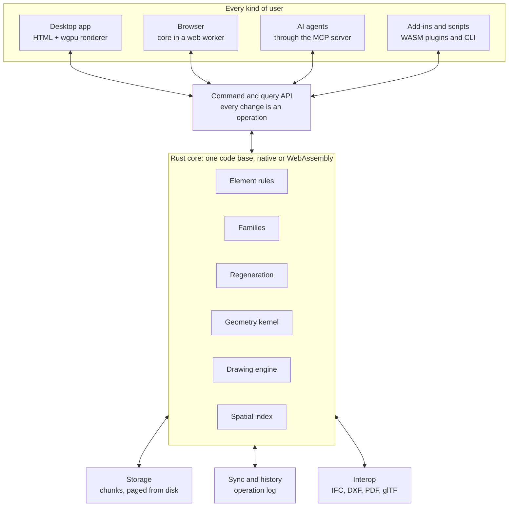

# Spare Construct: architecture map

*Working copy for contributors. Copied from the project map on 2026-10-18; change it only through an accepted decision note.*

Oct 18, 2026

Build it from scratch in Rust, kernel included. One core runs headless, on the desktop and in the browser. It is sized for a whole multi-discipline building at better than Revit speed, and designed so a city works too. Every section is open for discussion; the decisions table near the end collects the choices.

## At a glance

The desktop app, browser, AI and add-ins reach the core only through the command layer, so they can never drift apart. The core sends a screen only what is in view, never the whole model.

## Goals and ground rules

Best means three things: faster than Revit on the largest single model, fully usable with no screen, and owned by nobody. Every part below is judged against these.

**Goals**

- One model holds every discipline (architecture, structure, MEP and civil), not a stack of linked files.
- Opening, moving around and editing a large model stays fast. A city of buildings works by the same design.
- Everything a person can do in the app, an AI or a script can do headless, through the same commands.
- Anyone can build their own add-in on the main version without forking it.
- Routine production (door and window families, room plans, sheets, schedules) is automated, not drawn by hand.

**Ground rules**

1. From scratch where it decides speed or ownership: data model, kernel, regeneration, drawing engine, file format.
2. Port proven methods, never invent first. Before a part is designed, read how the best open project does it and name the method we follow.
3. Permissive dependencies only. No GPL or AGPL code anywhere in the core.
4. Every change is an operation. One path for the interface, AI, plugins, undo and multi-user sync.
5. Measured, not assumed. Every part ships with a benchmark and truth tests; a slower change does not merge.
6. Deterministic. The same operations give the same model on every machine, native or browser.
7. Open format. The file format is documented and readable without the app.

**Not goals for now**

- Saving back to .rvt. Revit models come in; they do not go back out as .rvt.

## Runtime shape

One Rust core, compiled two ways: a native program for desktop, server and headless use, and WebAssembly for the browser. It is the same code, so a fix lands everywhere at once.

**High level**

- **Native core** holds the full model, runs the kernel and regeneration on every CPU core, and owns storage. It runs inside the desktop app, as a headless service for AIs and scripts, or on a server for multi-user.
- **Browser core** is the same code as WebAssembly in a web worker. It holds what the user has open (one building, one level) and can work offline on small models.
- **Client** is the HTML interface plus the renderer. It never holds the whole model; it asks the core for what is in view.
- Core and client talk through one message protocol (commands in, changes and geometry chunks out), whether in one process, across a worker, or across the network.

**Low level**

- A workspace of Rust crates, each built and tested alone: `model`, `kernel` (the shared `engine-geometry`), `regen`, `solver`, `draw` (2D drawings), `store`, `sync`, `api`, `render`, `cli`, `mcp`.
- Threads: native uses a work-stealing pool (the rayon crate) for regeneration and tessellation. Browser threads need SharedArrayBuffer, which needs the page served with cross-origin isolation headers (COOP and COEP).
- Memory: a browser tab has a hard ceiling. In one test a 1.33 GB model grew to 8.4 GB in memory, so a large model is never loaded whole into a tab.
- Protocol: binary and versioned, with geometry sent as ready-to-upload GPU buffers so the client does no parsing.

**Discuss**

- Is browser-only mode (no native core) a real use case beyond small models and demos?
- Server-hosted core for multi-user from day one, or desktop first?

## Data model

The model is a database of elements stored column by column, the way game engines hold millions of objects, not a tree of objects. That layout keeps millions of elements in memory and lets the core scan them in milliseconds.

**High level**

- **Element**: anything in the model (wall, door, level, view, sheet, room, tag). It has a stable ID, a category, a type, parameters and relationships.
- **Type**: the shared definition (wall layers, door size), stored once. Instances store only what differs.
- **Instance**: a placement (a transform, or a host plus offset) and its overridden parameters. A building with 2,000 identical doors stores the door geometry once.
- **Relationships**: hosted by, joined to, bounded by, in room, on level, in group. Stored as their own tables so they can be queried both ways.
- **Disciplines** are not separate files. A duct and a beam are elements in the same model, separated by category, ownership and view filters.
- **Phases, design options and groups** are fields and relationships on elements from day one, not special structures added later.

**Low level**

- Storage: entity-component layout. Each component (transform, wall layers, parameters, bounding box, geometry handle) is its own column. Options: the bevy\_ecs crate used on its own, or our own. Lean: our own, because we need chunked storage and permanent IDs that game ECS libraries do not give.
- IDs: 128-bit and time-ordered (UUID v7, or client ID plus counter), so two people working offline never collide. A compact 32-bit index is used in memory; the 128-bit ID goes to disk and over the wire.
- Units: SI internally, metres in f64. Display units are a view setting. Revit stores decimal feet internally; we convert on import.
- Coordinates: world positions in f64, which holds NZTM survey values (millions of metres) to about a millionth of a millimetre. Each building has a local origin. The GPU gets positions relative to the camera, so f32 rounding never shows as jitter.
- Parameters: typed (length, area, volume, angle, number, integer, text, yes/no, choice, element reference, material, link). Formulas use a small, safe expression language. Shared parameters are keyed by GUID so they match across projects.
- Materials: physical data (density, thermal) and drawing graphics (cut and surface patterns, colours), kept separate from render appearance.

**Discuss**

- Our own entity-component store, or bevy\_ecs?
- Phases and design options first-class from day one? Revit added them later, and their API gaps (no API for design-option visibility in views) have cost us real work.

## Geometry kernel

We write our own kernel in Rust, built for what buildings are made of, with exact arithmetic so booleans never fail. It lives in the shared engines as `engine-geometry`, so every program that works in 3D uses the same core: Spare Studio's 3D app, the simulation engine and any future 3D program. Revit runs Autodesk ShapeManager, a general-purpose CAD kernel. A kernel built only for BIM can be smaller and faster, because most building geometry is flat-faced.

**High level**

- **Scope v1**: flat-faced solids. Extrude, sweep along lines and arcs, revolve, blend, and booleans (cut, join, intersect). That covers walls, floors, roofs, doors, windows, beams, ducts and most families.
- **Scope v2**: curved surfaces (NURBS) for free-form roofs and facades, added later behind the same interface.
- **Method**: port Manifold's published boolean method (its Apache-2.0 licence allows reuse) rather than inventing one. It was the strongest open option in the 2026-10-18 check, and IfcOpenShell has just added Manifold as a kernel.
- **Two representations**: an exact boundary model for editing and drawing (faces, edges, curves), and a triangle mesh made from it for display and clash.

**Low level**

- Exact predicates: orientation and in-circle tests use adaptive exact arithmetic (Shewchuk's method), so "which side of this plane" is never wrong. Coordinates stay f64.
- Topology: half-edge structure with manifold guarantees. Every operation returns a valid solid or a clear error, never a broken shape.
- Tolerance: one model-wide tolerance (proposed 0.01 mm) for merging points and snapping, separate from the exact tests.
- Bulk booleans: 300 openings in one wall are cut as one batched operation, not 300 cuts in a row, and walls are processed in parallel.
- Tessellation: curves split by on-screen error, so a far-away arc uses few triangles. Results are cached per type and detail level.
- Determinism: no fast-math, no fused multiply-add contraction, a fixed operation order. Native and browser builds give bit-identical results.
- Testing: fuzzing with random solids (cargo-fuzz), plus the Revit family geometry we already hold as truth data.

**Discuss**

- Wrap Manifold's C++ for the first stretch while our Rust port matures, or Rust from the start?
- Is 0.01 mm the right tolerance? Revit's short-curve limit is about 0.8 mm (1/32 inch) and causes real modelling pain.
- When do curved surfaces become necessary?

## Regeneration and constraints

Only what changed is rebuilt, spread across every CPU core. Revit's regeneration is still largely single-threaded, a big reason large models feel slow.

**High level**

- **Dependency graph**: every derived value (wall geometry, join, opening, room boundary, area, tag text) knows what it was computed from. An edit marks its inputs dirty, and only what sits downstream is recomputed.
- **Parallel**: independent dirty elements rebuild at the same time. A level change touching 2,000 walls uses every core.
- **Sketch solver**: 2D geometric constraints (parallel, perpendicular, equal, distance, tangent, fixed) for family sketches, wall profiles and floor outlines.
- **Transactions**: every command runs in a transaction that fully applies or fully rolls back. Undo and redo step through the operation log.
- **Warnings**: problems (overlapping walls, room not enclosed) are stored as data with the elements involved. The interface shows them and AI can read them; there are never blocking dialogs that stop automation.

**Low level**

- Graph: incremental computation in the style of Salsa (the engine inside rust-analyzer): cached queries, revision numbers, and early cut-off when a recomputed value comes out unchanged.
- Solver: Newton or Levenberg-Marquardt on the constraint equations, with graph decomposition so independent clusters solve separately. Method to follow: FreeCAD's planegcs, studied and re-implemented, not copied, because it is LGPL.
- Determinism: the solver starts from the current geometry with a fixed iteration order, so every machine reaches the same answer.
- Budget: a local edit (move a door) re-solves and redraws within one frame (16 ms). A global edit (level height) shows progress and can be cancelled.

**Discuss**

- Salsa crate, or our own incremental engine?
- How much constraint solving at project level (Revit-style locked dimensions and alignments), versus only inside families?

## Building elements

Walls, floors, roofs and openings come first, because everything else hangs off them. Each element type is a rule set on top of the kernel: how it is shaped, how it joins, how it draws.

| Element | What v1 does | Hard part |
| --- | --- | --- |
| Levels and grids | Named datum planes with elevations; grids in plan | Datum extents per view |
| Walls | Layered types, location line, base and top constraints, attached tops | Joins (L, T, X, mitre) and layer wrapping at ends and openings |
| Openings | Doors, windows and plain openings cut through hosts | Hosts with hundreds of openings |
| Floors, ceilings, roofs | Sketch outlines, layered types, slope arrows, footprint roofs | Roof-to-roof joins and ridge solving |
| Stairs and railings | Runs and landings laid out by rules (NZ Building Code D1 limits) | Rule-driven layout; rails following paths |
| Curtain walls | Grids, panels, mullions | Panel sizes driven by grids |
| Rooms and areas | Boundaries from bounding elements; area and volume | Robust 2D boundaries from thousands of wall faces |
| Structure | Columns, beams, bracing, foundations, analytical lines | Framing cut-backs and joins |
| MEP | Ducts, pipes, cable trays, fittings, systems | Automatic fittings and system flow |
| Site | Terrain, pads, property lines | Large terrain meshes (LiDAR) |
| Free-form | Direct solids (like Revit's DirectShape) | Curved surfaces (kernel v2) |

**Low level**

- Wall joins are solved in 2D plan first (location lines and layer offsets), then extruded. This is faster and gives clean cut patterns in plans.
- Rooms: a 2D arrangement of boundary segments per level with exact tests, and point-in-region for room tags. Only the level that changed is recomputed.
- Hosting: a hosted element stores its host ID and a local offset, so moving a wall carries its doors without rebuilding them.
- Discipline ownership: each element has an owning discipline. Views and permissions filter on it, so one model serves every consultant.

**Discuss**

- After walls, floors, openings and rooms: structure or MEP first?
- Which NZ rules (D1 stairs, H1 energy) are built into element rules, and which are left to add-ins?

## Disciplines and civil

One program and one model for every discipline, civil included. Picking a discipline changes the program around the person, not the file: the tools, templates and drawings switch, and the model stays the same.

**Discipline modes**

- A discipline picker at the top of the app, numbered in the order a project runs, so the work carries straight through from the first survey to the contractor on site:
  - **01 Survey**: the ground, boundaries and what is already there (see Survey).
  - **02 Civil**: earthworks, roads, drainage and services in the ground.
  - **03 Transport**: traffic, public transport, walking and cycling, tested on the network Civil lays out (see Traffic and public transport).
  - **04 Architecture**: the buildings.
  - **05 Structure**: framing, bracing and foundations.
  - **06 MEP**: building services.
  - **07 Coordination**: every discipline together, with clash, issues and sharing between firms.
  - **08 Construction**: what the contractor needs on site (see Construction).
- Picking one swaps the tool tabs, the project browser, the default view templates and drawing types, and the display units and labels (chainages and reduced levels in Civil).
- The other disciplines stay visible as greyed context and can't be edited by accident. Ownership and permissions already filter on discipline (see Building elements).
- A mode is a settings file (tools, templates, units, browser layout), so a firm or a country can add its own, such as landscape.
- Modes only change what people see. Every command stays available headless, so an AI can call a civil command from any mode.

**Civil: high level**

Civil adds the ground and everything built on and under it, in the same model as the buildings. A building's floor level can follow the design surface, and its drainage joins the street network in the same model.

| Element | What v1 does | Hard part |
| --- | --- | --- |
| Survey data | Points, linework, control and the existing surface from the Survey discipline (see Survey) | Surfaces staying in step when the survey is updated |
| Surfaces | Existing and design ground as triangulated surfaces from points, breaklines and LiDAR; contours | Millions of LiDAR points; fast re-triangulation after an edit |
| Alignments and profiles | Road and pipe centrelines (lines, arcs, spiral transitions), vertical profiles, superelevation | Exact chainage along spirals |
| Corridors | Cross-section templates swept along an alignment: lanes, kerbs, footpaths, batters to the ground | Rebuilding a long road in pieces when one input changes |
| Grading and earthworks | Pads, feature lines, slopes to a surface, cut and fill volumes, mass haul | Clean daylight lines where slopes meet the ground |
| Pipe networks | Gravity (stormwater, wastewater) and pressure (water supply) pipes, manholes and sumps, with hydraulic checks | Rule-based sizing and inverts; clashes with other services |
| Lots | Subdivision lots from boundaries, with areas, over a cadastral underlay | Shared boundaries kept in step |
| Civil drawings | Plan and long-section sheets, cross-section sheets, setout tables | Sheets laid out along an alignment |

**Low level**

- Civil element types sit in their own crates beside the building ones (survey, surface, alignment, corridor, grading, pipes, lots), on the same data model, regeneration, kernel and drawing engine.
- Surfaces: constrained Delaunay triangulation, following the spade crate (MIT or Apache-2.0). Surfaces are chunked by spatial cell like the building model, so a whole catchment pages from disk.
- Alignments are exact geometry (lines, arcs, spirals) with chainage. Corridors, sections and labels reference a chainage and offset, so moving an alignment carries everything on it, the way a wall carries its doors.
- Corridors regenerate by chainage range, so an edit rebuilds only the stretch it touches, on every core.
- Positions use the project's map projection and heights one vertical datum, shown in others as needed (NZTM2000 and NZVD2016 in New Zealand). Each country's settings name its own.
- Design rules come as country rule packs, like the building code checks: road geometry, and each council's engineering standards for roads and drainage.
- Interop: LandXML 1.2 in and out; IFC 4.3 alignments, roads and earthworks; the EPA's public-domain SWMM input files for stormwater models; DXF and point clouds as for buildings. Civil programs' own files are mostly DWG, so they follow the DWG decision.

**Discuss**

- Civil after structure and MEP, or surfaces and drainage early, since every building needs a site?
- Which country's road and drainage rules come first?
- Do rail and bridges join Civil later? IFC 4.3 covers both.

## Survey

The first discipline: the ground, the boundaries and what is already there, brought in from the field at survey accuracy, so everything after it is built on the right base.

**High level**

- **Field data in**: total station and GNSS observations from field controllers, keeping the raw measurements, not only the final points.
- **Field codes to linework**: point codes draw kerbs, fences, building outlines and breaklines automatically, from each firm's code library.
- **Control**: control marks and their coordinates. Traverses are adjusted by the Bowditch (compass) rule and whole networks by least squares, with a report on the residuals and how well it fits.
- **Coordinates and heights**: the country pack's projections and datums (NZTM2000 and NZVD2016 in New Zealand), with local site grids tied to them.
- **What is already there**: surveyed buildings, trees, services and levels become real elements in the existing phase, alongside scans (see Point clouds).
- **Existing ground**: the surveyed surface goes straight to Civil.
- **Set-out**: points and lines from any discipline's design go out to field controllers, with set-out reports and checks.
- **As-builts**: as-built surveys compared with the design, element by element, for Construction and handover.
- **Cadastral**: boundaries, parcels, title plans and survey datasets in each country's required format. In New Zealand that is LINZ's LandXML exchange format under the Cadastral Survey Rules 2021, lodged through Landonline.

**Low level**

- Observations are stored as data (setups, targets, angles, distances, GNSS vectors), so an adjustment re-runs when a measurement is corrected. Adjusted coordinates are results, regenerated like any other.
- Formats: LandXML 1.2 survey elements (instrument setups, raw observations, GNSS vectors, control) in and out; Trimble JobXML from its published schema; RINEX for raw GNSS data, the open IGS format; Leica GSI and Carlson RW5 only from their makers' published documents; CSV points. NMEA 0183 and RTCM 3 are paid standards, decided before any use.
- Coordinate transformations follow PROJ (MIT).
- Adjustment uses the published least-squares method, with Geoscience Australia's DynAdjust (Apache-2.0) as a reference to study. GNU Gama and other GPL tools are not used.

**Discuss**

- Which field controller formats come first?
- Which countries' cadastral formats come after New Zealand's?

## Traffic and public transport

Transport is a discipline in Spare Construct, not a separate program. Model the roads, public transport, walking and cycling around a site or across a city, and test what a development or a new road does to them, in the same model as the buildings and the civil works.

**High level**

- **Network from real data**: roads from OpenStreetMap, public transport routes and timetables from GTFS feeds, and traffic counts and crash records from each country pack's open sources. Or draw roads, junctions, lanes and stops by hand.
- **Land use and trips**: zones for developments and existing land use, and gateways where roads leave the study area. Trips come from land use (trip rates from the country pack), are spread between places and split by mode.
- **Strategic model**: trips are assigned to the network to give volumes, volume over capacity (level of service A to F), speeds, junction delay and travel times across the whole area.
- **Microsimulation**: individual cars, buses, bikes and people on the same network, watched live in plan and in 3D, for the junctions and corridors that need detail.
- **Public transport**: routes, stops and timetables from GTFS; walking catchments to stops, bus priority, dwell times and reliability.
- **Walking and cycling**: catchments, cycling stress and footpath capacity. People moving inside buildings uses the same engine (evacuation and lifts later).
- **Safety**: crash history around each junction, and crash risk by road type.
- **Scenarios**: a base case and options side by side, with development traffic share, emissions and an indicative benefit-cost ratio.
- **Calibration**: the model is matched to traffic counts and screenlines, with a report on how well it fits.
- **Reports**: assessed junctions, catchments, a list of every assumption changed from the defaults, and a compliance checklist from the country pack.
- **One model**: civil roads and corridors are the transport network, and each building's access joins it, so a change to a driveway or a corridor shows straight away in the traffic results.

**Low level**

- Runs on the shared simulation engine (`engine-sim`), on top of the shared geometry core: a fixed time step and the same result for the same inputs, natively and in the browser.
- The network is a directed graph of links, lanes, junctions and stops, stored in the model like any other elements and chunked by spatial cell, so a whole city pages from disk.
- Strategic assignment uses the published user-equilibrium method (Frank-Wolfe). Microsimulation follows published models: the Intelligent Driver Model for car-following (Treiber, Hennecke and Helbing, 2000) and MOBIL for lane changes (Kesting, Treiber and Helbing, 2007). Signals run their phases; roundabouts and priority junctions use gap acceptance.
- Methods to study and reuse: A/B Street (Rust) and CityFlow, both Apache-2.0. SUMO (EPL-2.0) and MATSim (GPL) are used only as outside tools through their documented files, never linked in. JuPedSim (LGPL) is studied for walking models only.
- Data: OpenStreetMap is under the ODbL and is credited wherever it shows. The GTFS specification is Apache-2.0; each agency's feed carries its own licence, recorded with the data.
- Exchange: OpenStreetMap and GTFS in; SUMO network and route files in and out, so consultants who use SUMO can take part.
- A working prototype, the [Transport demo](https://spareware.app/spare-construct/#plan:transport), already does most of the high-level list in the browser (JavaScript on a Leaflet map). It is a sketch to learn from: the product is built correctly on the shared engines from the core up, not by patching the prototype.

**Discuss**

- Strategic model, microsimulation, or both in the first release?
- Which country's trip rates and level-of-service rules come first? The prototype uses New Zealand's.

## Construction

The last discipline: everything the contractor needs to build the project, from the same model the designers drew.

**High level**

- **Stages and build sequence**: elements grouped into stages and tasks, linked to a construction programme, and played in 3D over time. Temporary works and the site set-up are drawn for each stage.
- **Set-out**: points and lines from the model go to site instruments through the Survey discipline.
- **Site logistics**: a site plan for each stage with hoardings, cranes and their reach, laydown areas and access. Truck routes and traffic management are tested with the Transport discipline.
- **Quantities by stage**: take-off from the model for each stage, for ordering and payment claims.
- **Prefabrication**: panels, frames and parts split within lifting and transport limits, with output for the factory.
- **On site**: issues, inspections, defects and photos pinned to elements, on phones and tablets, working offline.
- **Progress and as-builts**: progress marked against elements, and as-built surveys and scans compared with the design (see Survey and Point clouds), with changes fed back into the model.
- **Handover**: the as-built model with product and maintenance information for the owner.

**Low level**

- Stages are fields and relationships on elements, like phases, so every view, schedule and quantity can filter by stage.
- Programme tasks link to sets of elements by rules (level, zone, category), so new elements join the right task without hand linking.
- Phones and tablets keep a light copy of the chunks for their area and send their operations when they are back online.
- Programmes come in and go out through IFC's work schedule entities and CSV; other scheduling formats only from published specifications.

**Discuss**

- Which comes first for contractors: the build sequence in 3D, or site issues and defects?

## Point clouds

Laser scans and drone surveys live in the model, not in a separate program. A scan of a whole building or site opens fast and works in plans, sections and 3D like any other element.

**High level**

- **Bring scans in**: E57 and LAS or LAZ from any scanner or survey, and plain-text PTS. ReCap's own .rcp and .rcs are Autodesk's private format with no public specification, so they come in only once Autodesk clears it or legal advice allows (README legal rules). Until then, ReCap Pro exports E57.
- **Huge scans stay fast**: each scan is converted once into levels of detail and streamed by what is in view, like the model's chunks, so billions of points stay smooth.
- **Scans in every view**: cut by each plan's and section's view range and by section boxes; coloured by real colour, intensity, height, or distance from the model.
- **Snap and measure**: snap to points, edges and planes found in the scan.
- **Scan to model**: fit walls, floors, columns and pipes to the scan, and show where the model departs from it, for as-builts and checking what was built.
- **Survey and civil**: turn scan points into ground surfaces and breaklines (see Disciplines and civil).
- **Line scans up**: place scans on survey coordinates, and register several scans together by targets or by shape (later).
- **Share**: scans travel in sharing packages, and the browser viewer streams them too.

**Low level**

- Readers: the e57 crate (MIT) and las-rs (MIT), with laz-rs (Apache-2.0) for compressed LAZ.
- Converted scans are stored as a LAZ 1.4 octree in the COPC layout (spec repo MIT), so the file stays open, other tools can read it, and parts can be read without loading the whole file.
- Viewing follows Potree's method (BSD-2-Clause): an octree with a points-per-frame budget, drawn by the wgpu renderer.
- Positions are f64 project coordinates, sent to the GPU relative to the camera, as for the model.
- Scans are reference data, kept out of the operation log. The model stores a link, a placement and display settings, so sync never moves billions of points.
- Fitting finds planes and cylinders in the points (RANSAC), then proposes walls, floors and pipes for a person to accept.

**Discuss**

- Ask Autodesk about reading .rcs directly, or rely on E57 exports?
- Register raw scans in the app, or leave that to the scanner's own software?

## Clash detection

Clash runs live inside the model as people work, not as a separate export-and-check step. Every discipline sits in one model, so the core flags a duct meeting a beam the moment either one moves.

**High level**

- **Live**: each change re-tests only the changed elements against their neighbours through the spatial index. A clash shows as a warning within the edit's own time budget.
- **Batch runs**: full tests between any two sets (discipline, category, level, consultant models) for coordination meetings, as in Navisworks or Revizto.
- **Hard and clearance**: solids that overlap, and elements closer than a set gap (maintenance space around plant, for example).
- **Rules**: ignore conditions (same system, insulation on its own pipe, parts of one assembly) and a tolerance per test.
- **Grouping**: hits grouped by element, level, zone or system, so 2,000 hits become a manageable list of issues.
- **Issues**: each group becomes an issue with status, owner, comments, a saved viewpoint and history. It closes itself when the clash is gone.
- **Exchange**: BCF in and out, so consultants on Revizto, Navisworks or other tools take part.

**Low level**

- Broad phase: the bounding-volume hierarchy finds candidate pairs. Narrow phase uses exact kernel geometry, not triangles, so clearance distances are true.
- Clearance is a true minimum-distance test, not an inflated box, which gives false hits.
- Pairs run in parallel; results are cached per pair and cleared through the regeneration graph.
- Consultant models from other software come in through IFC and are tested the same way.
- Ignore conditions and grouping follow how established clash tools already work.

**Discuss**

- Live clash on by default, or on request for very large models?
- Which clearance rules ship as standard (NZ services clearances)?

## Families

A family is a recipe written as data: parameters, a constrained sketch and solid steps. People edit it in a family editor, AIs write it directly, and the door and window generator produces it from a spec.

**High level**

- A recipe holds: parameters (with formulas), reference planes and sketches with constraints, solid steps (extrude, sweep, revolve, blend, void), 2D symbol lines for plan and elevation, visibility by view type and detail level, materials, and MEP connectors.
- Types are named parameter sets inside the recipe. Instances pick a type and can override instance parameters.
- Nested families are recipes inside recipes, with linked parameters. Shared nested families are placed as their own elements.
- Hosted families declare their host (wall, floor, ceiling, face) and the void they cut.
- Geometry per type is computed once and cached; 2,000 instances of one door type reuse one solid.

**Door and window generator**

1. Take a spec: opening size, frame profile, leaf or sash layout, glazing, hardware, swing, fire rating, manufacturer data. One row in a spreadsheet or a supplier catalogue.
2. Pick the template recipe for the configuration: single swing, double, sliding, bifold, casement, awning, fixed.
3. Fill the parameters and write the recipe, including plan symbols (swing arc, sill line), elevation symbols and geometry for each detail level.
4. Check it: valid solids, clearances, a clean opening cut, and tags reading the right data.
5. Publish to the shared library with a preview image.

**Low level**

- Format: text-based (JSON or a small typed language), so diffs, reviews and AI edits work in git.
- Evaluation: recipe, then solver, then solid steps, then kernel, all inside the regeneration graph. Changing a type parameter rebuilds only that type.
- Revit families: brought in through IFC, or read directly only once an owner has cleared it after legal advice (see the README's legal rules). They are converted to recipes where the shapes map cleanly.
- Library: one shared, versioned library, loaded by reference instead of copied into every model.

**Discuss**

- JSON, or a purpose-built language for recipes?
- How much of Revit's family editor do users expect, versus an AI-first editor?

## Views and drawings

The drawing engine turns 3D into correct 2D drawings: cut, project, hide what is behind, apply line weights and patterns. Games never need this and most open BIM projects skip it, so it is a core part, not an add-on.

**High level**

- View types: floor plan, ceiling plan, section, elevation, 3D, detail, drafting, schedule, sheet, legend.
- Plans and sections: a cut plane plus a view depth. Elements cut by the plane draw with cut line weights and patterns; elements beyond draw in projection; hidden edges are removed or dashed.
- Graphics rules: by category, subcategory, cut or projection, filters, phase status, design option and view template. The concepts match Revit, so users and their office standards carry across.
- Annotation: dimensions bound to geometry (they update when it moves), tags reading parameters, text, keynotes, detail items, revision clouds.
- Sheets: title blocks, placed views, sheet parameters, revision schedules. Output to vector PDF and print.
- Schedules: live tables over element data with grouping, totals and formulas, editable both ways.

**Low level**

- Cut: intersect solids with the cut plane to get exact closed 2D regions, then clip fill patterns to them.
- Hidden line: per view, project edges and occluders and resolve visibility in 2D on a spatial grid, in parallel by tile. Results are cached per element and cleared through the regeneration graph, so moving one door redraws only that door's lines.
- Line cleanup: coplanar faces of joined elements draw without a seam (same-material wall layers, floor into wall).
- Scale: only elements whose box crosses the view's range are drawn, and the spatial index answers that.
- PDF: vector output with true line weights and embedded fonts (the pdf-writer crate). DWG is covered under Interop.

**Discuss**

- Match Revit's view range model exactly (top, cut, bottom, depth), or simplify it?
- Annotation in 2D only, or 3D-aware annotation from the start?

## Storage and scale

The model is stored in chunks by building, level and spatial cell, with a spatial index, so the app only loads what someone is working on. This is the one decision that must be right on day one: it costs nothing for a single house and makes a city possible.

**High level**

- **Chunks**: elements group by building, then level, then spatial cell. Types, families and project settings live in a shared chunk.
- **Spatial index**: a bounding-volume hierarchy over chunks and elements answers "what is in this view or box" in microseconds.
- **Out-of-core**: the core keeps recently used chunks in memory and pages the rest from disk. A city never has to fit in RAM.
- **Streaming to the client**: the client asks for what is in view. Nearby chunks arrive in full detail and far ones as simplified meshes, the way Google 3D Tiles streams a city.
- **Context**: neighbouring buildings and terrain stay as light context until someone opens them.

**Low level**

- File: one portable project file on desktop (proposed: a SQLite container holding chunk blobs, the operation log and the index), and an object store on a server. SQLite gives crash-safe writes, and any tool can read it.
- Chunk blobs: compact binary with a versioned schema, compressed (zstd) and content-hashed, so unchanged chunks are never re-saved or re-sent.
- Save: operations append to the log at once and chunks compact in the background. Saving never blocks anyone.
- Simplified versions of each chunk are generated in the background and cached alongside it.
- Open format: the schema is published and versioned, with a reader library in the repo, so files outlive the app.

**Discuss**

- SQLite container, or a custom chunk file?
- Cell size, and whether chunks follow levels for tall buildings or use pure 3D cells.

## Multi-user and history

Changes sync one operation at a time instead of through a central file, so there is no Sync with Central wait and no lost work. Every edit is already an operation (ground rule 4), so sync and full history come from the same log.

**High level**

- A server holds the authoritative operation log for each project. Clients send operations; the server orders them and broadcasts them.
- Ownership: editing an element takes a light, automatic claim on it, like worksets without the setup. Conflicts are caught per element, not per file.
- Offline: work offline on a branch, then merge back with an element-by-element conflict review.
- History: every change is kept with who, when and why. Any past state can be viewed, and any element's history traced.
- Branches: try a design option as a branch, compare, then merge or discard. Git for the model.

**Low level**

- Ordering: one server deciding the order is simpler and safer than pure peer-to-peer merging for a model with constraints and regeneration. Free text (notes, comments) can use a text CRDT; Automerge, Yrs and Loro are Rust and MIT-licensed.
- After sync, each client replays the operations and gets an identical result, because the kernel is deterministic. Only operations travel between users, never geometry.
- Permissions: per project, per discipline and per element category.
- Storage: the operation log is folded into chunk snapshots now and then; old operations stay for history.

**Discuss**

- Server first, or peer-to-peer with a relay?
- Self-hosted only, or a hosted service too?

## Versions and revisions

Every saved state is a version, and versioning is automated: versions are made at milestones, compared element by element, and turned into drawing revisions without hand-drawn clouds.

**High level**

- **Versions**: named snapshots ("Consent issue", "95% DD") made by hand, on a schedule, or automatically when a sheet set is issued.
- **Compare**: any two versions show what was added, removed, moved or changed, in colour in 3D and in plans, with a list of parameter changes.
- **Automatic revisions**: when a sheet's content changes after an issue, the change is found, a revision cloud is placed around it, and the revision schedule and sheet revision update. People confirm rather than draw.
- **Issue records**: each issue of a sheet set stores the version it came from, so any issued drawing can be regenerated exactly.
- **Transmittals**: issuing a set writes the transmittal and drawing register automatically, tied to built-in document control.
- **Consultant models**: each received version is kept and compared with the last, so "what changed in the structural model" is one click.

**Low level**

- A version is a pointer into the operation log plus a compacted snapshot, so making one costs almost nothing.
- Element diff comes straight from the log; geometry is compared only for elements whose inputs changed.
- Cloud placement: compare each sheet's 2D drawing output between the issued version and now, cluster the changed areas, and draw a cloud around each cluster.
- History is kept for the life of the project unless the owner prunes it.

**Discuss**

- Auto clouds placed directly, or suggested for a person to accept?
- Automatic versions on every issue only, or nightly as well?

## Sharing with consultants

Sharing between firms is built into the app, not a separate platform. It does the job of Autodesk Docs and Design Collaboration, without bridging projects, matching regions or copying folders. The files side (folders, status, review and transmittals) is in Project data management, next. Feature map: area CON-A25.

**High level**

- **Shared project space**: one project that every firm on the job joins. Each firm keeps its own models, on its own server or co-op servers.
- **Team spaces**: each firm, or each discipline in a large firm, works in its own team space inside the project. Work in progress stays in the team. Inside a team, people take turns through check-out in the first release, and edit live once multi-user sync arrives (see Multi-user and history).
- **Packages**: a team publishes a package when it is ready: chosen models, views, sheets and files, as one numbered version with a note. A package is the only way work leaves a team.
- **Sharing timeline**: the main view of the sharing space, open from the start, not a collapsed strip at the top of the page. It does the job of Design Collaboration's timeline in our own design: a row for each team, every package as a mark along it, and for each mark which teams have taken it in and what changed.
- **Take it in when you're ready**: each team chooses when to take in another team's package, so a consultant's change never lands in the middle of someone's work. Until then its linked copy stays on the package it last took in. A team can stay on an earlier package, or go back to one, with the reason recorded.
- **Compare any two packages**: in 3D, in plans, on sheets and in a list, with the same compare as versions (see Versions and revisions).
- **Linked consultant models**: a package taken in shows as a linked model, with what changed since the last package marked in 3D, in plans and in a list.
- **Other software**: consultants on Revit, Archicad, Tekla or other tools publish IFC and PDFs into their own team space. They are versioned and compared like everyone else's. Clash issues travel as BCF.
- **Issues and markups**: raised on the model, a sheet or a file, assigned to a firm or a person, and tracked to closed across every firm.
- **Permissions**: set per firm, team and package. Each firm decides what leaves it; design options and work in progress never leave unless it says so.
- **Record**: every publish, take-in and go-back is recorded: who, when, which package and which version.

**Low level**

- A package is a signed pointer into the publishing team's operation log plus the chunks and files it covers.
- Chunks and files are content-addressed: each one's ID is a hash of its contents. This is Speckle's method: its SDKs (Apache-2.0) set an object's ID to a SHA-256 hash of the serialised object, and a sender first asks the server which IDs it already holds, then sends only the rest. So a new package shares every unchanged chunk with the last one, and taking it in downloads only what changed.
- Elements keep their permanent IDs across packages, so renaming a model or a sheet never breaks its version history.
- What goes into a package is filtered by discipline ownership, by view and by permissions, the same rules used everywhere else.
- Permissions are relationships: this person is in that team, that team may view this package, this folder sits inside that one. One check walks them. This is the method of Google's Zanzibar paper, which OpenFGA and SpiceDB (both Apache-2.0) implement. The kit owns the permission checks (KIT-A15-F1-P4), so which engine it uses is the kit's decision.
- The timeline is drawn from the sharing record, which is part of the operation log, so it can never disagree with what happened.
- Publishing a package moves what it holds to the shared state (see Project data management).
- Each firm's server joins the shared space directly, so firms can host anywhere. The space itself can sit with the lead firm, the client or co-op servers.

**Discuss**

- Who hosts the shared space by default: the lead consultant, the client, or co-op servers?
- Can Revit users publish straight into the space through the Revit add-in exporter, or through IFC only at first?
- Team spaces are in the first release, but live sync inside a team waits for multi-user sync (next). Is check-out inside a team enough for the first release?

## Project data management

Every project file lives in one versioned store with the models. It does the job of a common data environment such as Autodesk Docs, Aconex or Newforma, built in. Folders, versions, status, permissions, review, issue sets and transmittals all run on the same operation log as the model, so a drawing, the model it came from and the transmittal it went out in always point at each other. Feature map: area CON-A26.

**High level**

- **One store for files and models**: project folders hold any file type: models, drawings, PDFs, specifications, photos, reports and letters. A model is a file in the store too, versioned by its operation log. Every other file is versioned whole.
- **Versions of every file**: uploading over a file makes its next version, with who, when and a note. Any two versions compare: models element by element, drawings and PDFs as an overlay of changed areas, images side by side, text word by word. Restoring an old version saves it as a new one, so nothing is lost.
- **Naming checked on upload**: each project sets its naming standard as rules, made of fields such as project, firm, type, discipline and number. A name that fails shows the wrong field and a suggested name. The project chooses whether a failing name blocks the upload or only warns.
- **Attributes**: every file has typed attributes (originator, discipline, type, revision, description), filled in from its name where the rules allow.
- **Four states**: every file and model version is in one state. Work in progress is seen only by its team. Shared is seen by other teams for coordination. Published is approved for use, such as for construction. Archived is kept read-only. These are the states ISO 19650 describes for a common data environment (names checked against public guides, not the standard's own text: *unverified*). We follow the idea, not the standard's text, and claim no compliance.
- **How status moves**: work starts in progress. Publishing a package moves what it holds to shared. An approved review, or issuing it in a set, moves a file to published. Closing the project moves everything to archived. A state never moves back: a new version starts again in progress.
- **Status and revision codes** are data per country, client or office, so a project uses the codes its contract asks for.
- **Permissions**: view, add, edit, approve and manage on each folder and file, for a firm, team, role or person, passed down to sub-folders unless changed. They are the same relationships as package permissions, so a file is never visible in one place and hidden in another.
- **Review and approval**: send files or a package for review, naming who reviews, in what order and by when. Reviewers comment, mark up and decide: approved, approved with comments, or rejected. Gates such as "published needs an approved review" are checked on every change of state.
- **Issue sets and transmittals**: gather sheets, models and any files into an issue set with a reason and recipients. Issuing fixes the versions, marks them published, writes the transmittal and adds every document to the register. What other firms send is logged as a received transmittal and filed.
- **Markups and issues**: markups sit on the file version they were made on and carry to the next version where they still apply. Issues raised on a file, a markup or a package join the one issue list once the issue model arrives (next).
- **Search**: names, attributes and the text inside files, scans included. Results show only what the person may open.
- **Desktop and offline**: chosen folders sync to the computer. Work offline; each save comes back as a new version and the naming check runs as it syncs.
- **Retention and close**: records are kept as long as the law and the contract ask, with legal holds. Closing the project archives everything read-only and writes an archive copy in open formats.
- **Audit**: every action on every file, opens and downloads included, is recorded and can be exported.

**Low level**

- Files sit in the kit's file service, content-addressed like package chunks. Large files are split into content-defined chunks, so a new version of a large export stores and sends only the changed chunks. Method to follow: restic (BSD-2-Clause), which cuts chunks with Rabin fingerprints and names each by its SHA-256 hash. Chunk sizes are settled in the Design stage.
- Desktop sync uses the kit's desktop sync client. Syncthing (MPL-2.0) is the method to study: it splits files into hashed blocks and asks a peer only for the blocks it lacks, and keeps old versions as files change.
- A file's record (name, folder, attributes, state, versions, permissions, review steps) is operations on the project's log. History, undo and audit come from the log, and the record replays the same on every machine.
- States are a small state machine. Every change of state is a command checked against the gates and permissions, and recorded with who and why.
- Review steps are data, not code: steps with reviewers, order, due dates and allowed decisions. Due dates and reminders run on the kit's durable timers.
- Issue records store each file's version and hash, so any issued document can be proven and produced again exactly.
- Search: the kit's search service indexes names, attributes and text taken from PDFs, office files, IFC properties and, through text recognition, scans. Results pass the same permission check as opening the file.
- Retention uses the kit's retention schedules with legal holds. The archive copy is PDF/A, IFC and the open project file.

**Discuss**

- Folders by content (drawings, reports) with the state on every file, or a folder for each state? Lean: by content, with the state shown and filterable.
- Which naming standard and status codes ship in each country pack, and which can be encoded without a licence (see the standards clearance part, CON-A24-F1-P6)? The UK National Annex to ISO 19650-2 sets out its own status codes and a field-based naming convention; we do not copy its tables.
- Exchange with other platforms through buildingSMART's OpenCDE Documents API (version 1.0), so a firm on another platform can send and fetch files without exports? Its repository has no licence file (*unverified*), so its terms need checking first.
- Should review and approval steps move to the kit, since Spare Studio's review and approval needs the same?

## Rendering and front end

The interface is HTML; the 3D and 2D views come from a GPU renderer fed straight from the core. The renderer uses the same techniques large HTML games use to keep millions of objects at full frame rate.

**High level**

- Renderer options: three.js (fast start, widely used, WebGPU with WebGL2 fallback) or our own renderer on wgpu (Rust; DirectX 12, Vulkan and Metal natively, WebGPU in the browser). Lean: wgpu, so desktop and browser share one renderer in the core's language.
- Interface: HTML and TypeScript panels (properties, project browser, schedules, ribbon) so any web developer can build or change one.
- Desktop shell: Tauri (a Rust host plus the system web view, WebView2 on Windows). Small installs, with the native core in the same process.
- Browser: the same interface and renderer, with the core in a worker or on a server.

**Low level**

- Instancing: one draw call for every copy of a type, so 2,000 doors cost one call.
- Detail and culling: frustum and occlusion culling on the GPU, simplified meshes in the distance, and meshlet clusters for very dense models.
- Precision: positions relative to the camera, so city coordinates never jitter.
- 2D views: lines at true weights at any zoom, with patterns as GPU fills, all from the drawing engine's output.
- Picking and snapping: a GPU ID buffer for picking; snapping against exact kernel geometry, not triangles.
- Styles: shaded, hidden line, realistic, sun and shadows. Real-time photo rendering and VR are built in (see Third-party features built in).

**Discuss**

- Our wgpu renderer from day one, or three.js first and replace it later?
- Tauri, or our own WebView2 host?

## Headless API, AI and add-ins

Everything the app does is a command, and every command works without the interface. The interface, AI agents, scripts, plugins and multi-user sync all go through that one command layer, so nothing is interface-only.

**High level**

- **Commands**: typed, documented, serialisable operations (CreateWall, PlaceFamily, SetParameter, CreateSheet). Each runs in a transaction and returns the changed elements and any warnings.
- **Queries**: read the model by category, parameter, location or relationship; spatial queries; geometry on request.
- **Bindings**: a Rust crate (native), a C interface (for C#, .NET and Python), WebAssembly and TypeScript (browser and Node), and JSON-RPC over a local socket or HTTP.
- **AI**: an MCP server on the same API, with a built-in guide, so Claude or any agent can model, check and document headless.
- **Command line**: run scripts, batch-convert files, print sheets to PDF, run model checks in CI.
- **Add-ins**: plugins run as sandboxed WebAssembly components with declared permissions (read-only, edit, network). They can add commands, panels, element types and checks. A faulty plugin cannot crash or corrupt the model.

**Low level**

- The command schema is generated from the Rust types, so documentation, TypeScript types and MCP tool definitions never drift apart.
- Plugin host: wasmtime natively, the browser's own WebAssembly engine on the web. Plugins can be written in any language that compiles to WebAssembly components (Rust is strongest today; C# and Go support is still maturing).
- Versioning: the API follows semantic versioning, so plugins keep working across minor releases.
- Events: add-ins subscribe to changes (element added, parameter changed) to react live.

**Discuss**

- Is WebAssembly-only too strict for plugins? A native plugin path is faster but can crash the app.
- Python bindings at launch?

## Interop

IFC is the exchange format, not the native one, and Revit models come in through IFC, or directly only once an owner has cleared it after legal advice. The aim is to fit into existing projects from the first release.

| Format | Direction | How | Notes |
| --- | --- | --- | --- |
| IFC 4.3 and 2x3 | In and out | Our own reader and writer; web-ifc (MPL-2.0) and IfcOpenShell (LGPL) as references | Exchange with councils and consultants; watch IFC5 |
| Revit .rvt | In | Only once an owner clears it after legal advice (README legal rules) | Until then, Revit models come in through IFC |
| Revit, exact | In | A Revit add-in exporter on Autodesk's published Revit API, within its licence terms (to be checked) | Exact geometry and parameters from inside Revit |
| DWG | Out, and underlay in | Hard to do openly: LibreDWG is GPL, ODA is paid | Open question |
| DXF | In and out | Our own reader and writer | Open text format |
| PDF | Out | pdf-writer crate | Vector sheets and views |
| glTF / GLB | Out | Our own writer | Twinmotion, Enscape, web |
| 3D Tiles | Out | Our own writer | City-scale web viewers |
| Point clouds (E57, LAS, LAZ, PTS) | In | e57, las-rs and laz-rs crates | See Point clouds |
| ReCap .rcp / .rcs | In | Only once Autodesk clears it or legal advice allows | Until then, export E57 from ReCap Pro |
| LandXML 1.2 | In and out | Our own reader and writer | Civil surfaces, alignments, pipe networks and survey points |
| CSV / XLSX | In and out | Schedules and parameter tables |  |

**Discuss**

- DWG: buy an ODA licence for export, write our own DWG writer, or ship DXF only?
- Does Revit import aim at native editable elements, or only reference geometry at first?

## Automation and first-party tools

Routine production is built as first-party add-ins on the public API, so every automation doubles as an example for other add-in authors. Common production tasks are the first candidates.

| Tool | What it automates |
| --- | --- |
| Door and window generator | Families from a spec or catalogue (see Families) |
| Room plans | Room views, crops, sheets, room schedules |
| Sheet sets | Sheets, views and title blocks from a template |
| Numbering, tags, dimensions | Auto numbers, tags, dimension strings |
| QA checks | Stage QA checklists, model audits, warnings |
| Site and context | LINZ terrain, aerials, neighbours, zoning |
| Planning envelopes | Height in relation to boundary |
| Sun studies | Shadow studies by date and time |
| Clash | Clash runs between disciplines |
| Keynotes | Keynotes linked to the specification |
| AI concept design | Design options from a site's planning data |

**Low level**

- Each tool is a plugin with its own commands, so an AI can call "make room plans for level 2" directly.
- Tools read settings files (title blocks, view templates, naming rules) rather than hard-coding one firm's standards.

**Discuss**

- Which existing in-house tools could their owners open-source to seed these?
- Which tool ships first to prove the add-in API: room plans or the door and window generator?

## Third-party features built in

Everything Revit users buy or bolt on today is built in, as first-party add-ins on the public API. Nobody pays for a second product to do the job properly.

| Area | Bought or bolted onto Revit today | Built in here |
| --- | --- | --- |
| Clash and coordination | Navisworks, Revizto, BIMcollab | Live and batch clash, issues, BCF (see Clash detection) |
| Model checking and code rules | Solibri, UpCodes | Rule-based checks incl. NZ Building Code clauses, stage QA checklists |
| Version compare | Autodesk Docs compare, manual review | Element and drawing diff, auto revisions (see Versions and revisions) |
| Real-time rendering and VR | Enscape, Twinmotion, Lumion, D5 Render | Real-time photo rendering, walkthroughs and VR in the wgpu renderer |
| Visual scripting | Dynamo, Grasshopper (via Rhino.Inside.Revit) | Node-based scripting on the same command API |
| Rhino and free-form | Rhino.Inside.Revit | 3dm import and a live Grasshopper link |
| Productivity toolkits | pyRevit, DiRoots, Ideate, Naviate | Renumbering, batch edits, element lists, purge, auto dimensions as standard |
| Excel round-trip | Ideate BIMLink, DiRoots SheetLink | Any schedule or parameter set edits both ways with Excel |
| Batch print and export | DiRoots ProSheets | Print sets to PDF, DXF and images, in parallel |
| Family and content library | UNIFI, Kinship, BIMsmith, Chaos Cosmos | Shared, versioned library with search and previews |
| Energy, daylight and carbon | Insight, IES VE, Ladybug Tools, ClimateStudio, One Click LCA | NZ H1 energy checks, daylight, sun studies, embodied carbon from materials |
| Structural analysis links | Robot, ETABS, SOFiSTiK links | Analytical model export and results back in |
| MEP sizing and fabrication | MagiCAD, fabrication add-ins | Duct and pipe sizing, system calculations, fabrication parts later |
| Timber framing and prefab | AGACAD, StrucSoft MWF, hsbcad | Automatic wall, floor and roof framing to NZS 3604 |
| Steel and rebar detailing | Advance Steel, Tekla links | Later phase |
| Point clouds and scan to BIM | ReCap, EdgeWise, Undet | Point cloud underlays and fitting walls, pipes and floors to scans |
| Quantities and cost | CostX, Assemble, Navisworks quantities | Live quantities by element, linked cost rates |
| 4D sequencing | Synchro, Navisworks TimeLiner | Construction phases on a timeline, played in 3D |
| Site and field | Procore, Autodesk Build, Fieldwire | The Construction discipline: site issues, inspections, progress and as-builts (see Construction) |
| Document control and CDE | Autodesk Docs, Newforma, Aconex, Procore | Built-in document control: issues, transmittals, registers, markups |
| Sharing with consultants | Autodesk Design Collaboration, BIM 360 | Built-in shared project space with packages between firms (see Sharing with consultants) |
| Specification | Masterspec links, keynote add-ins | Keynotes and specification linked to elements |
| Site and planning | Civil 3D links, site and planning add-ins | LINZ terrain and aerials, zoning, height in relation to boundary |
| Survey office | Trimble Business Center, Leica Infinity, Civil 3D survey, Carlson Survey, 12d Model | The Survey discipline: field data, adjustment, linework, set-out, as-builts and cadastral (see Survey) |
| Civil design | Civil 3D, 12d Model, OpenRoads | The Civil discipline: survey, surfaces, roads, earthworks and drainage (see Disciplines and civil) |
| Traffic and transport | PTV Visum and Vissim, Aimsun, SIDRA Intersection | The Transport discipline: strategic model, microsimulation, public transport and scenarios (see Traffic and public transport) |
| Data and dashboards | Power BI connectors, model health tools | Live project data out to dashboards; model health built in |
| AI agents | Revit MCP servers, Copilot agents | MCP server and AI on every command (see Headless API) |

**Discuss**

- Which of these come in the first release, and which later?
- Which are worth partnering on (existing open projects like Ladybug Tools) instead of rebuilding?

## Performance targets and testing

Every target below is proposed for discussion, and each becomes a benchmark that blocks any change that misses it. The reference large model is a real project: 1.33 GB as .rvt, about 230,000 elements.

| Measure | Proposed target | How it is met |
| --- | --- | --- |
| Open a building of that size to first view | Under 3 s | Load only chunks in view |
| Open a city block of 20 buildings | Under 5 s | Neighbours as low-detail context |
| Move a door and see the result | Under 16 ms (one frame) | Local regeneration |
| Change a level height affecting 2,000 walls | Under 1 s | Parallel regeneration |
| Navigate in 3D | 60 fps with 1,000,000 instances | Instancing, GPU culling |
| Floor plan view | Under 500 ms first draw, under 16 ms after an edit | Cached hidden line per element |
| Memory per placed instance | Under 256 bytes plus shared type geometry | Types store geometry once |
| Save | Under 100 ms, never blocking | Append to the operation log |
| Another user sees an edit | Under 200 ms on a LAN | Send operations, not files |
| Print a 100-sheet set to PDF | Under 60 s | Sheets in parallel |

**Testing**

- Benchmarks run in CI on every pull request. A regression over 5% blocks the merge.
- Truth tests: build the same element in Revit and here, export Revit's geometry through the Revit API, and compare within tolerance.
- Kernel fuzzing: random solids and boolean sequences; any invalid result is a bug.
- Determinism: replay the same operation log natively and in the browser; the models must be bit-identical.
- Large fixtures: anonymised real projects plus generated cities.

**Discuss**

- Are these the right numbers, and which machine spec do they assume?
- Which real projects can be anonymised and shared as test fixtures?

## Community and licence

The code is public to read, but only invited people can push or merge. Contributors spend their leftover weekly Opus tokens on issues written so an agent can finish them, and a person reviews every merge.

**Set-up**

- A GitHub organisation, not a personal account, owns the repos: core, app, docs, families, plugins.
- Repos are public to read and fork (or private until the first release; to discuss). Only invited collaborators can push; main is protected with required review and passing CI.
- CODEOWNERS: the kernel, file format and API need a review from their owners.
- A CLAUDE.md and AGENTS.md in each repo carry the ground rules, build and test commands, so every agent works the same way.

**The token workflow**

1. Issues are written agent-ready: one clear outcome, the files involved, the proven method to follow, and the test or benchmark that proves it done.
2. A contributor picks an issue sized to their leftover tokens (labelled small, medium, large).
3. They run Claude Code on Opus against it. The pull request must include tests and benchmark results.
4. CI runs tests, benchmarks, fuzzers and the determinism check.
5. An owner reviews and merges. Nothing merges on AI review alone.

A new subsystem gets a short written design note first, reviewed before any code.

**Licence**

- Apache-2.0: permissive, with a patent grant.
- MIT: permissive and shortest.
- MPL-2.0: changes to our own files must be shared back, but add-ins and products built on top can stay closed.
- Decided (2026-10-19): MPL-2.0 for the core so improvements come back, and Apache-2.0 for the SDK, examples and plugin templates.
- Never relicensed: the licence will never be changed to a closed, paid or subscription licence.
- Contributors keep the copyright to their own work and sign off each commit with the Developer Certificate of Origin. There is no contributor licence agreement, so nobody can relicense what the community builds.

**Discuss**

- Public from day one, or private until there is something to show?
- Work done on an employer's time: who owns it? Contributors need their employer's agreement first.

## Roadmap

1. **Phase 0, Foundations:** GitHub organisation, licence, ground rules, file format draft, benchmark and truth-test harness. Kernel spike in Rust: extrusions and batched booleans, checked against Manifold.
   - *Gate A:* the kernel spike matches Manifold, with no invalid solids under fuzzing.
2. **Phase 1, Core and kernel v1:** data model, chunked storage, regeneration graph, sketch solver. Walls, floors, roofs, openings; headless API, command line, MCP server, IFC export.
   - *Gate B:* an AI builds a house headless, and its IFC opens cleanly in other tools.
3. **Phase 2, Editor and drawings:** desktop app (Tauri) and browser, wgpu renderer, HTML panels. Plans, sections, elevations, hidden line, annotation.
   - *Gate C:* plans of a test building match Revit's within tolerance.
4. **Phase 3, Production:** families and the door and window generator, rooms, schedules, sheets, PDF. Room plans and sheet-set add-ins on the public API.
   - *Gate D:* a full council set for a house comes out of it.
5. **Phase 4, Scale and teams:** streaming, paging from disk, multi-user sync, branches. Revit import, once legally cleared.
   - *Gate E:* a 230,000-element model opens in under 3 s, and a door moves within one frame.
6. **Phase 5, Disciplines and city:** structure, then MEP; curved surfaces (kernel v2). City context and district streaming.

Phases run in order and are not drawn to scale. Dates wait until we know who joins and how many tokens they bring. Each gate is a proposal for discussion.

## Open decisions

Twenty-one choices to settle, each with my lean; change the status as they are agreed. The first six shape the code most and are worth settling before any repo work.

| Decision | Options | My lean | Status |
| --- | --- | --- | --- |
| Kernel start | Wrap Manifold's C++ first; Rust port from day one | Rust from day one, with Manifold as the reference answer in tests | Open |
| Storage layout | Chunks by building, level and cell; one flat file | Chunks from day one | Open |
| Entity store | Our own; bevy\_ecs | Our own | Open |
| Incremental engine | Salsa crate; our own | Salsa (proven in rust-analyzer) | Open |
| Renderer | Our own on wgpu; three.js first | wgpu | Open |
| Multi-user | Server-ordered operation log; peer-to-peer | Server-ordered log | Open |
| Project file | SQLite container; custom chunk file | SQLite container | Open |
| Family recipe format | JSON with a schema; purpose-built language | JSON with a schema | Open |
| Desktop shell | Tauri; our own WebView2 host | Tauri | Open |
| Plugins | WebAssembly only; native as well | WebAssembly only | Open |
| Phases and design options | Day one; later | Day one | Open |
| Model tolerance | 0.01 mm; other | 0.01 mm | Open |
| Curved surfaces | Kernel v1; kernel v2 | v2 | Open |
| Discipline after the core | Structure; MEP | Structure (fewer element types) | Open |
| Project-level constraints | Revit-style locks; inside families only | Families first, project locks later | Open |
| Revit import depth | Editable elements; reference geometry | Reference first, then editable walls, floors and doors | Open |
| DWG | ODA licence; our own writer; DXF only | DXF first, DWG decided later | Open |
| Hosting | Self-hosted; hosted service | Self-hosted first | Open |
| Python bindings | At launch; later | Later (the C interface makes it cheap) | Open |
| Licence | MPL-2.0 core with Apache-2.0 SDK; Apache-2.0 for all; MIT | MPL-2.0 core, Apache-2.0 SDK | Open |
| Visibility and ownership | Public now; private until firm sign-off and the first spike | Private until the firm signs off, then public | Open |

## Sources

Licences, activity and browser support were checked on each project's GitHub repo on 2026-10-18. The last six rows, for sharing and project data management, were checked on 2026-10-19.

| Project | Licence | What it is to us |
| --- | --- | --- |
| [Manifold](https://github.com/elalish/manifold) | Apache-2.0 | Boolean method to port; test reference |
| [OpenCascade (OCCT)](https://github.com/Open-Cascade-SAS/OCCT) | LGPL-2.1 with exception | Only full open curved-solid kernel; study for v2 |
| [replicad](https://github.com/sgenoud/replicad) | MIT (OCCT build LGPL) | OCCT in the browser, about 22.5 MB |
| [truck](https://github.com/ricosjp/truck) | Apache-2.0 | Rust curved-solid kernel; immature |
| [Fornjot](https://github.com/hannobraun/fornjot) | 0BSD | Rust kernel; archived June 2026 |
| [CGAL](https://github.com/CGAL/cgal) | GPL or LGPL per file | Avoid (GPL) |
| [IfcOpenShell](https://github.com/IfcOpenShell/IfcOpenShell) | LGPL-3+ | IFC reference; added a Manifold kernel |
| [web-ifc](https://github.com/ThatOpen/engine_web-ifc) | MPL-2.0 | IFC reading and writing reference |
| [That Open components](https://github.com/ThatOpen/engine_components) | MIT | IFC viewer; not a modelling kernel |
| [planegcs](https://github.com/salusoft89/planegcs) | LGPL | Sketch solver method to study |
| [SolveSpace](https://github.com/solvespace/solvespace) | GPL-3+ | Avoid (GPL) |
| [three.js](https://github.com/mrdoob/three.js) | MIT | Renderer option |
| [Babylon.js](https://github.com/BabylonJS/Babylon.js) | Apache-2.0 | Renderer option |
| [Pascal editor](https://github.com/pascalorg/editor) | MIT | Browser BIM editor to study; cuts openings, has MCP |
| [ifc-lite](https://github.com/LTplus-AG/ifc-lite) | MPL-2.0 | Rust/WebAssembly IFC core with headless SDK and MCP to study |
| [Chili3D](https://github.com/xiangechen/chili3d) | AGPL-3.0 | Browser CAD on OCCT; cannot reuse code |
| [spade](https://github.com/Stoeoef/spade) | MIT or Apache-2.0 | Rust Delaunay triangulation for civil surfaces |
| [e57](https://github.com/cry-inc/e57) | MIT | Rust E57 point cloud reader and writer |
| [las-rs](https://github.com/gadomski/las-rs) | MIT | Rust LAS reader and writer |
| [laz-rs](https://github.com/laz-rs/laz-rs) | Apache-2.0 | Rust LAZ compression |
| [COPC](https://github.com/copcio/copcio.github.io) | MIT (spec repo) | Cloud-optimised point cloud layout on LAZ 1.4 |
| [Potree](https://github.com/potree/potree) | BSD-2-Clause | Point cloud viewing method to follow |
| [PROJ](https://github.com/OSGeo/PROJ) | MIT | Coordinate transformations to follow |
| [DynAdjust](https://github.com/GeoscienceAustralia/DynAdjust) | Apache-2.0 | Least-squares survey network adjustment to study |
| [GNU Gama](https://www.gnu.org/software/gama/) | GPL-3.0 | Avoid (GPL) |
| [A/B Street](https://github.com/a-b-street/abstreet) | Apache-2.0 | Rust traffic simulation to study and reuse |
| [CityFlow](https://github.com/cityflow-project/CityFlow) | Apache-2.0 | Microscopic traffic simulation to study |
| [Eclipse SUMO](https://github.com/eclipse-sumo/sumo) | EPL-2.0 | Outside tool only, through its documented files |
| [MATSim](https://github.com/matsim-org/matsim-libs) | GPL-2.0 or later | Avoid (GPL); outside tool only |
| [JuPedSim](https://github.com/PedestrianDynamics/jupedsim) | LGPL-3.0 or later | Walking models to study |
| [Speckle SDK (specklepy)](https://github.com/specklesystems/specklepy) | Apache-2.0 | Content-addressed objects; send and receive only what is missing ([serialiser](https://github.com/specklesystems/specklepy/blob/main/src/specklepy/serialization/base_object_serializer.py)) |
| [restic chunker](https://github.com/restic/chunker) | BSD-2-Clause | Content-defined chunking with Rabin fingerprints for file versions |
| [Syncthing](https://github.com/syncthing/syncthing) | MPL-2.0 | Block-based folder sync and file versioning to study for desktop sync |
| [OpenFGA](https://github.com/openfga/openfga) | Apache-2.0 | Relationship-based permissions in the Zanzibar style |
| [SpiceDB](https://github.com/authzed/spicedb) | Apache-2.0 | Relationship-based permissions in the Zanzibar style |
| [OpenCDE Documents API](https://github.com/buildingSMART/documents-API) | No licence file (*unverified*) | Open API for moving documents between platforms; terms to check |
