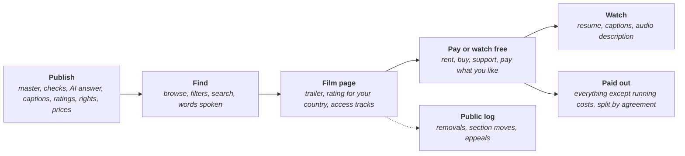

# Spare Movies: architecture map

*Stage: Mapping. Every choice below is open until an owner accepts a decision note. Researched on 2026-10-19; not legal advice. Sources are at the end, and anything not checked against a primary source is marked unverified.*

Spare Movies replaces Netflix, Prime Video, Disney+ and film rental stores. Filmmakers sell their films and series the way they choose, and viewers come to one place to watch them. It is free to use and free to join, with no member shares and no adverts. The only charge anywhere is running costs: the filmmakers keep everything else, and the running costs are shown on the open cost ledger. Filmmakers vote on Spare Movies' fees and rules; major changes go to a vote of members.

Spare Movies is for every country. Each country gets its own rules pack for money, tax, age ratings, rights rules and legal duties, so a new country is added as a pack, not a rewrite.

- The full feature map is [FEATURES.md](FEATURES.md) (machine-readable: [features.json](features.json)): 23 areas, 169 features and 336 parts, 120 of the features core.
- The clickable demo with sample data is [demo/index.html](demo/index.html).
- The work board is [STATUS.md](STATUS.md). It has no pieces yet; the pieces to open first are listed below.

## Goals

- Filmmakers choose how their work is sold.
- One place for people to find and watch it.
- Filmmakers keep everything except running costs, shown on the open cost ledger.
- Films are hard to copy and pass around without paying.
- Every film can be watched by people who are Deaf, hard of hearing, blind or have low vision.
- Practical and easy: press play and it starts; captions and audio description are one tap away.

## What it replaces

| Today | How it works for filmmakers now | Spare Movies instead |
| --- | --- | --- |
| Netflix, Disney+ | Subscription services that license or commission what they show. A filmmaker gets in only if the service picks the film | Any filmmaker who holds the rights can publish. Viewers pay per film, or later through a pass shared out by watch time |
| Prime Video | Prime Video Direct pays 50% of the purchase price, before tax, for rent and buy; subscription titles are paid per hour viewed from a rate card; payment is about 90 days after the sale ([agreement](https://videodirect.amazon.com/home/agreement), updated 1 December 2023) | Everything except running costs, paid out weekly |
| Film rental and download stores | Apple's store takes films only through aggregators and approved encoding houses. Vimeo On Demand let sellers keep 90% after transaction costs, but it shuts down on 20 November 2026. Aggregators such as Filmhub pass on 80% of what they receive | Rent or buy in one place, with the fee shown on every sale |

## The rules

| Rule | What it means in Spare Movies |
| --- | --- |
| At cost | The fee on each sale is the payment provider's charge, passed through, plus last period's running cost per sale and per hour delivered. It is published on the open cost ledger. No margin is added; any surplus lowers the next period's fee |
| Filmmakers keep the rest | Everything else goes to the filmmaker, and is split among the producers, cast and crew as they agree and sign |
| Free to use and join | Free films and trailers need no account. Joining is free, with no member shares |
| Filmmakers decide | Filmmakers vote on Spare Movies' fees and rules, one vote per person. Major changes go to a vote of members |
| Human and AI sections | Every film declares how AI was used, and the answer decides its section (below) |
| Only what the law requires is removed | Lawful films stay up. A film comes down only where the law requires it, and only in the countries whose law requires it. Every removal, block, section move and rating change goes in the public log with the rule or law behind it, and anyone acted on can appeal |
| No adverts, no tracking | No adverts, no selling data. What you watch is kept only for picking up where you left off, your lists and the pass share-out |
| Every country | Each country gets a rules pack. The demo switches between New Zealand, Australia, the United Kingdom, the United States, Canada and the European Union as examples |
| Built legally | Our own designs, names and code. Other companies are named only to say what we replace. No GPL or AGPL code in the core |

## Human and AI sections

The catalogue has two sections: **Human**, for films and shows people made themselves, and **AI**, for ones made with AI. Each viewer chooses to see one, the other, or both, and can change it at any time. Each household profile keeps its own choice.

- **Declared by the filmmaker:** every film and show says whether AI was used. The trailer and the poster answer separately. Accounts that are AI agents are labelled and can publish only in the AI section.
- **Checked, not assumed:** uploads are checked for content credentials (C2PA, an open standard for recording how media was made) and for AI-detection signals. Signals are hints for moderators, never automatic verdicts.
- **Fixable in the open:** members can flag a film in the wrong section; moderators move it with the reason in the public log, and the filmmaker can appeal.
- **Fair to filmmakers:** using AI isn't a penalty; it just goes in its own section, so human work isn't buried. Both sections use the same order rules and the same fee.
- **Where the line falls** is a published rule set by the filmmakers' vote (MOV-A5-F1-P3). Film raises cases a social feed does not: AI voices, AI dubbing, de-ageing an actor, generated shots. The draft rule in the demo: ordinary tools and captions made from speech do not count; an extra track such as an AI-voiced dub is labelled on its own and does not move the film. The method should follow Spare Social's design note for the same sections (piece M09), and the parts should move into the kit (see below).

## How it works

### Watching

Viewers browse plain lists whose order rule is shown above each one; nobody can pay to be placed higher. Filters cover what matters: free, rent or buy, captions, audio description, age rating, language, length and section. Search finds titles, people, genres and the words said in a film, using its captions. Only films the filmmaker holds the rights to in the viewer's country are listed, with that country's rating. The player picks up where the viewer stopped on another device, adjusts to the connection, and puts captions, audio description, audio language and quality one tap away. The viewer's choices follow them to every device.

### Publishing

One checklist takes a filmmaker from master file to release: a resumable upload (the open tus protocol, through the kit's file service), plain technical checks, artwork and trailer with image descriptions, the AI-use answer, captions in the film's main language and any audio description, ratings for each country, rights and release windows, and prices. On publishing, every size is encoded from the master, the master is kept in cold storage so it can be encoded again later, and a fingerprint is made so stolen uploads can be spotted.

### Paying filmmakers

| Way | Who sets it | What the filmmaker gets |
| --- | --- | --- |
| Rent | The filmmaker sets the price, and the start and finish windows within published limits | The price, less tax, the card charge, delivery for that viewing and the running-cost share |
| Buy to keep | The filmmaker sets the price; a keep-access promise says how long buyers keep it if the film is withdrawn (MOV-A6-F2-P3) | As for rent |
| Pay what you like, support | The filmmaker sets a minimum, which can be zero; viewers can add support on top of any price | Everything except the card charge, which the viewer can choose to cover |
| Free | The filmmaker | Nothing per view, with a support button; no adverts |
| Viewer pass (next) | Filmmakers' vote sets the monthly price; each filmmaker opts each film in | Pass money, less tax, card charge and running costs, shared out by watch time |

**Delivery costs cents, not dollars.** At the 3 GB an hour for HD that a large streaming service publishes as its ceiling, a 100-minute film is about 5 GB. Delivered by a network bought at cost, that is about US$0.025 to US$0.15 per viewing (Bunny's volume network at US$0.005 a GB; its standard network at US$0.01 a GB in Europe and North America and US$0.03 in Asia and Oceania). A service that bills by the minute, such as Cloudflare Stream at US$1 per 1,000 minutes delivered, comes to US$0.10. CloudFront's first paid tier comes to US$0.43 in North America and US$0.57 in Australia and New Zealand. On a small rental the card charge is the biggest cost, so the fee shape matters (open decision below). Card rates depend on the payment provider (piece K02); the demo uses a sample rate.

**Sharing out a viewer pass.** Both ways share by watch time; the difference is whose money is shared. Per viewer: each viewer's fee goes only to what that viewer watched (SoundCloud has paid this way since 2021). One pool: all fees are shared by each film's share of everyone's watch time (Spotify's way). A formal analysis finds the per-viewer way resists fake viewing, bribery and fake accounts, while a pool does not; a second paper argues pooled fraud is bounded when fraud tools are weak. No head-to-head real-world study was found. Fake viewing is a real cost: one US case involved more than US$10 million from bot streams on pooled services, and Spotify and Deezer have since added minimum play counts, fees on artificial streams and demonetisation. The demo shows both ways side by side; the decision stays open.

### Stopping copies

Every option starts the same way: each film is encrypted once with the Common Encryption standard (CENC, cbcs mode), so one set of files can work with any of the locked systems, and delivery links expire and work only for one session.

- **Locked playback (DRM).** Google's Widevine needs a licence agreement with Google; Google charges no fee and offers a cloud licence service. Apple gives FairPlay credentials only to the account holder of a content owner or licensee running a consumer streaming service; the Apple Developer Program costs US$99 a year. Microsoft's PlayReady server agreement has no licence fees or royalties; royalties apply to client devices. No open-source Widevine, FairPlay or PlayReady licence server was found, so locked playback means our own agreements or a paid vendor. Clear Key, the open option in the W3C standard, is not a lock.
- **Hidden watermark per viewer.** Two slightly different copies of each piece of the film are made, and each session gets its own pattern of them, so a leaked copy leads back to the account. The DASH Industry Forum's open specification, published by ETSI as TS 104 002 in 2023, standardises the signalling and delivery, not the watermark itself. No complete open-source version was found, and the field is held by a few vendors with patents; how heavily patented is unverified, so a patent search comes before any code.
- **No lock.** Encrypted delivery and expiring links only. Simplest and works everywhere; easiest to copy.
- **Fingerprints for stolen uploads**, whichever option is chosen. Meta's open video fingerprinting (TMK+PDQF and vPDQ, BSD-2-Clause) and the MIT-licensed audfprint are candidates. A match pauses publishing and goes to a person; nothing is removed or paid automatically.
- Nothing stops someone recording the screen as it plays, so no option is complete.

## The hard parts

**Film rights by territory.** A filmmaker may hold rights in some countries and not others, may have sold a window to a broadcaster, and may need to prove it when someone else claims the film. Spare Movies keeps a rights record per film (countries, ways of watching, dates, holdbacks), proof kept privately in the kit's document vault, and disputes decided on evidence with earnings held. In the EU, paid services must let subscribers who are only visiting another EU country use the service as at home (Portability Regulation 2017/1128, article 3), while the Geo-blocking Regulation 2018/302 leaves audiovisual services out, so licensing by country stays lawful. The country check works out where the viewer is at the moment of play and drops it.

**Age ratings by country.** Every country does this differently, and a small service may not have the same duties as a large one:

| Example | What applies to on-demand films |
| --- | --- |
| New Zealand | The labelling duty for on-demand services falls on providers named in Schedule 4 of the classification law (from 1 August 2021 for new content), and only they can ask the Chief Censor to approve a self-rating system. Others go to the Film and Video Labelling Body. The Classification Office says services not named must still show the classification of restricted films; the Department of Internal Affairs page sets no duty for them. The two official pages differ, so this needs a lawyer |
| Australia | The Minister has approved four classification tools, three run by streaming and rating companies and one for games, and reforms that started in March 2024 widened classification by accredited classifiers. Whether a small service must classify every film is unverified |
| United Kingdom | BBFC ratings are voluntary for on-demand films. A UK-based on-demand service must tell Ofcom before it starts and keep R18 material from under-18s. Since 1 April 2026, services with more than 500,000 UK users a month are Tier 1 and follow an Ofcom standards code |
| United States | MPA ratings and the TV guidelines are voluntary industry systems |
| Canada | Film classification is provincial. Whether provincial rules reach streaming is unverified |
| Germany (EU example) | Film platforms must show an age rating from the official process, a recognised self-regulation body or a recognised automated system, unless they can show fewer than 1 million German users |

Spare Movies keeps a ratings pack per country, never invents an official rating, shows any rating fee before the filmmaker applies, and hides films without a rating from young profiles. Ratings are shown as plain text in our own style; official label artwork is never copied.

**Video delivery cost.** Storage and delivery are the biggest running costs. Masters go to cold storage (Backblaze B2 lists US$6.95 a TB a month; Bunny Stream US$0.01 a GB a month), popular films stay in fast storage, and every gigabyte delivered is metered per film and country for the ledger. AV1 where devices play it and H.264 for reach keep sizes down (codec and patent study: KIT-A27-F8-P1, piece M03). Viewers sharing pieces of popular films with each other comes later (piece M06).

**Captions and audio description.** The EU's Accessibility Act has applied since 28 June 2025 to services that give access to audiovisual media: subtitles, audio description and sign language must reach the viewer complete, in step and under the viewer's control, and programme guides must be accessible. Microenterprises are exempt for services. In the UK, Tier 1 services must reach 40% subtitled, 5% audio-described and 2.5% signed after two years, rising to 80%, 10% and 5% after four. US caption rules for online video cover programmes first shown on US television with captions. Canada's regulator may set conditions on online services. No on-demand caption law was found for Australia or New Zealand (unverified). Spare Movies asks for captions in the film's main language before publishing, offers caption drafts from an openly licensed speech model that a person checks, and offers audio description as a recorded track or as timed text read by a synthetic voice, always marked.

**Fingerprinting stolen uploads.** The danger is someone uploading a film they did not make and collecting money for it. Fingerprints are made for every film and trailer; new uploads are matched against them; a match pauses publishing and goes to a person. False matches (shared archive footage, public domain clips, a licensed cut) are why a person always decides. Patent risk in perceptual hashing is unverified.

**Tax and who the seller is.** Several countries make the platform, not the filmmaker, responsible for tax on digital sales. Australia treats an electronic distribution platform operator as the supplier for GST. EU rules presume a platform taking part in a sale of electronic services is the supplier unless the filmmaker is clearly shown as the seller and the contracts say so. New Zealand lists films among remote services, with GST registration above NZ$60,000 of sales. The UK has no threshold for overseas suppliers of digital services. Canada has had a simplified GST/HST regime for overseas vendors and platforms since 1 July 2021. US states can make out-of-state sellers collect sales tax. So the seller-of-record decision (MOV-A6-F8-P1) and the tax packs go together, and selling across borders rests on kit parts now marked later (KIT-A3-F14, KIT-A4-F7).

**Music inside films.** A filmmaker who cleared the music for the film (the sync licence) may not have covered streaming it to the public: in the US that is a public performance, and in the UK making a work available on demand is communication to the public. Canada's collecting society lists an online audiovisual licence. Whether APRA AMCOS, PRS, ASCAP or BMI require a licence from Spare Movies itself, and what it would cost, is unverified (MOV-A11-F7-P2).

**Local content duties.** Large on-demand services face catalogue and investment rules: the EU requires 30% European works with prominence, with exemptions for low turnover (up to EUR 2 million) or low audience (under 1%); Canada requires 5% of revenue from online streamers with C$25 million or more a year (from a law firm's summary of the regulator's decision); Australia's 2025 law reaches services with more than 1 million Australian subscribers; Germany's film levy exempts on-demand services with up to EUR 500,000 of turnover from films. Spare Movies would start under these thresholds; the map tracks them so growth does not bring surprises (MOV-A22-F5-P4).

**Platform law.** US safe harbour needs a registered agent for copyright notices, renewed every three years, and a repeat infringer policy; content restored after a counter-notice comes back after 10 to 14 business days unless the claimant sues. Whether the EU's article 17 duties for content-sharing services apply to an at-cost, non-profit service of filmmaker-supplied films turns on "for profit-making purposes" and is unverified. The EU Digital Services Act asks hosts for a statement of reasons with every restriction; small enterprises are spared much of the platform section. The kit carries these duties (KIT-A10-F9, KIT-A18-F13); Spare Movies adds its own notices and registrations (MOV-A17-F4, MOV-A22-F5).

**App stores.** Phone and TV app stores have rules for selling films inside apps. Whether filmmakers can keep everything except running costs there depends on each store's rules in each country (MOV-A6-F10, piece K04).

**A catalogue worth switching for.** The first catalogue will be independent films, not studio titles. Filmmakers looking for a new home after Vimeo On Demand closes, festivals, film schools and libraries are the natural first users.

## What it uses from Spare Kit

Spare Movies depends on 187 kit parts by ID. The main ones:

| Kit area | Used for |
| --- | --- |
| Accounts and checks (KIT-A1, KIT-A2) | One Spareware login, household profiles, companies and collectives, age checks, identity and business checks before payouts |
| Payments, tax and the marketplace engine (KIT-A3, KIT-A4, KIT-A5) | Checkout, receipts, refunds, card disputes, payouts, regular payments for the pass, tax engines, orders for rentals and purchases |
| Search (KIT-A6) | The catalogue index and published order rules |
| Messaging (KIT-A8) | Release alerts, notification settings |
| Safety, disputes, voting (KIT-A10, KIT-A11, KIT-A12) | Reports, the public removal log, statements of reasons, legal notices, known illegal content matching, rights disputes, filmmakers' votes, moderator elections |
| Open cost ledger (KIT-A13) | Metering, fee setting, prices by use, hardship rule |
| Sync, storage and documents (KIT-A15, KIT-A25) | Operations with history, resumable uploads, storage at cost, the document vault for proof of rights, signed splits |
| API, AI, privacy, languages (KIT-A16 to KIT-A19) | Command API, MCP server, privacy duties, captions, accessibility, country packs |
| App shell, help, running it (KIT-A20 to KIT-A22) | Installable apps, store rules, help centre, status page, admin console, security reviews |
| Shared engines (KIT-A27, `engine-media`) | Decoding and encoding, captions and extra tracks, content credentials, speech recognition and synthetic voices |

**From `engine-media`** Spare Movies needs: technical analysis of masters, the encoding ladder, packaging into CMAF for HLS and DASH, loudness levelling, thumbnails, flash detection, and caption and audio description tracks.

**Candidates to move into the kit**, because Spare Social and Spare Music need them too: the Human and AI sections, fingerprinting of stolen uploads, a watch-time share-out engine for passes, rights by country and window, and encrypted delivery with a key service. Spare Music's map has the same open decisions on paying artists and stopping copies.

## Low level

- **Formats and protocols:** CMAF segments served as HLS and DASH; WebVTT and TTML (IMSC) captions; tus for uploads; C2PA content credentials; Common Encryption (cbcs) and the W3C Encrypted Media Extensions if locked playback is chosen.
- **Player:** our own controls on an openly licensed core: Shaka Player or hls.js (both Apache-2.0) with dash.js (BSD-3-Clause), and AndroidX Media3 (Apache-2.0) on Android (MOV-A18-F3-P2).
- **Packaging and encryption:** Shaka Packager (BSD-3-Clause), which encrypts with cbcs but includes no licence server.
- **Encoding:** FFmpeg built under the LGPL only. Building it with x264 or x265 makes the whole build GPL, so those are never in what we ship. AV1 encoders SVT-AV1 (BSD-3-Clause-Clear), rav1e and libaom (BSD-2-Clause) all ship the AOMedia Patent License 1.0; the dav1d decoder (BSD-2-Clause) ships no patent licence of its own. H.264 and HEVC patent pools are covered by the kit's codec study (KIT-A27-F8-P1).
- **Uploads:** tusd (MIT), through the kit's file service.
- **Content credentials:** c2pa-rs (MIT or Apache-2.0), through the kit.
- **Fingerprints:** ThreatExchange's TMK+PDQF and vPDQ (BSD-2-Clause); PDQ is BSD-3-Clause, but its C++ folder bundles a CeCILL-licensed file that we would not use.
- **Speech to text:** whisper.cpp (MIT), through the kit; the model weights' licence is still to be checked.
- **Crates**, added at the Design stage following the template: for example `movies-catalogue`, `movies-rights`, `movies-pipeline`, `movies-player`, `movies-pay`, `movies-protect` and `movies-api` (proposed names).

## What to learn from

Licences were read from each project's own licence file on 2026-10-19.

| Project | Licence | What to learn | How we may use it |
| --- | --- | --- | --- |
| PeerTube | AGPL-3.0 | HLS with peer-assisted delivery, transcoding jobs, copies between servers | **Learn from only.** Never copy its code |
| Jellyfin | GPL-2.0 (server), GPL-2.0-or-later (web client) | A media library model, choosing a stream per device, client apps for many TVs | **Learn from only** |
| Kodi | GPL-2.0-or-later (some files under other licences) | An interface driven by a TV remote, playback on many devices | **Learn from only** |
| MediaCMS | AGPL-3.0 | Video publishing workflows | **Learn from only** |
| Stremio | GPL-2.0 (web), GPL-3.0 (desktop shell) | Catalogue add-ins | **Learn from only** |
| VLC, mpv | VLC GPL-2.0-or-later (libVLC LGPL-2.1-or-later); mpv GPL-2.0-or-later by default | Robust playback, subtitle rendering | **Learn from only**, unless the licence piece (A14) agrees LGPL linking |
| Bento4 | GPL-2.0, or a paid licence | MP4 tools | **Learn from only** |
| GPAC | LGPL-2.1-or-later (a paid licence is also offered) | Packaging | Learn from; use only if LGPL is agreed |
| Chromaprint | MIT for its own code, LGPL-2.1 as a whole | Audio fingerprints | Learn from; use only if LGPL is agreed |
| Shaka Player, hls.js, Video.js, AndroidX Media3 | Apache-2.0 | Adaptive streaming players | May use, keeping the licence and credit |
| dash.js, Shaka Packager | BSD-3-Clause | DASH playback, packaging, encryption | May use |
| FFmpeg | LGPL-2.1-or-later by default; GPL with `--enable-gpl` | Decoding and encoding | May use an LGPL build only |
| dav1d, rav1e, libaom, SVT-AV1 | BSD family, three with the AOMedia Patent License 1.0 | AV1 | May use |
| ThreatExchange (TMK+PDQF, vPDQ) | BSD-2-Clause | Video fingerprints | May use, after the patent check |
| audfprint | MIT | Audio fingerprints | May use |
| c2pa-rs | MIT or Apache-2.0 | Content credentials | May use, through the kit |
| whisper, whisper.cpp | MIT | Speech to text | May use, through the kit |
| tusd, Owncast, WebTorrent | MIT | Resumable uploads; one-server live streams for premieres later; peer delivery | May use |
| p2p-media-loader | Apache-2.0 | Peer-assisted HLS and DASH | May use later |

**Ways of paying to learn from (no code):** Means TV, a worker-owned streaming co-op, shared its yearly profit 70% to full-time workers, 20% to contractors and 10% to the makers of its own shows, according to a 2020 report (unverified whether still current). SoundCloud's fan-powered royalties and Deezer's weighted model are the two best-known changes to pooled sharing.

## Open decisions

| Decision | Options | Lean |
| --- | --- | --- |
| How viewers pay | Each filmmaker sets their own way: buy to keep, rent, pay what you like, or free; or one subscription for everything; or both | To be decided. The map makes paying per film core and the viewer pass next, so filmmakers choose; an owner may move the pass to core |
| How a subscription is shared out | Each week, what comes in is shared out by views, so the most watched that week get the biggest share; or each viewer's fee goes only to the filmmakers that viewer watched | To be decided (MOV-A7-F2-P1). Both methods are mapped so a vote can choose |
| Stopping copies | Locked playback (DRM): Google's Widevine, Apple's FairPlay and Microsoft's PlayReady are closed systems and each needs an agreement with that company; or a hidden watermark in each copy, so a leaked copy leads back to the account it came from; or no lock. Nothing stops someone recording the screen as it plays, so no option is complete | To be decided (MOV-A16-F1-P1). Encrypted delivery and fingerprints are needed whichever is chosen |
| Fee shape | A fixed amount per sale; an amount per hour delivered; both | Research first (MOV-A6-F1-P3, piece K06) |
| Seller of record | The filmmaker; the co-op; different for different kinds of sale | Research first, with tax advice (MOV-A6-F8-P1, piece K01) |
| Launch countries | One country first; several at once | Research first: ratings, tax and local content rules decide it |
| Player core | Shaka Player; hls.js with dash.js | Research first (MOV-A18-F3-P2) |
| Codecs | AV1 and H.264; add HEVC for HDR | Research first (KIT-A27-F8-P1, piece M03) |
| Delivery | Delivery network bought at cost; co-op caches; viewers sharing pieces | Research first (MOV-A18-F4-P2, piece M06) |
| Where AI-assisted ends | AI voices, dubbing, de-ageing and generated shots, each in or out of the Human section | Filmmakers' vote (MOV-A5-F1-P3) |
| Keep-access promise | How long buyers keep a film its filmmaker withdraws, or a refund | Filmmakers' vote (MOV-A6-F2-P3) |
| Sexually explicit films | Allowed with age checks and kept out of store apps; ruled out | Vote with legal advice (MOV-A8-F3-P2) |
| TV | Web-based TV apps; platform apps; casting only | Research first (MOV-A19-F5-P1, MOV-A4-F8-P1) |

## Pieces to open first

Spare Movies has no work-board pieces yet. These research and decision parts gate core features and should become pieces first: stopping copies (MOV-A16-F1-P1); fingerprinting method and patents (MOV-A16-F2-P1); the ratings packs for the launch countries (MOV-A12-F1-P3); rights proof and disputes (MOV-A11-F1, MOV-A11-F6); seller of record and tax (MOV-A6-F8); local content duties, regulator notices and platform law (MOV-A22-F5, MOV-A17-F3-P1); music collecting societies (MOV-A11-F7-P2); and the access law for captions and audio description (MOV-A13-F6-P1). The viewer pass share-out (MOV-A7-F2-P1) follows.

## Sources

Delivery, protection and paying:

- Bunny CDN pricing: https://bunny.net/pricing/cdn/ and Bunny Stream pricing: https://bunny.net/docs/stream/pricing
- Cloudflare Stream pricing: https://developers.cloudflare.com/stream/pricing/
- Amazon CloudFront pricing: https://aws.amazon.com/cloudfront/pricing/pay-as-you-go/
- Backblaze B2 pricing: https://www.backblaze.com/cloud-storage/pricing
- Streaming data use per hour: https://help.netflix.com/en/node/87
- Widevine overview: https://developers.google.com/widevine/drm/overview
- FairPlay Streaming: https://developer.apple.com/streaming/fps/ and membership fee waivers: https://developer.apple.com/support/membership-fee-waiver/
- PlayReady licensing: https://www.microsoft.com/playready/licensing/faq/
- W3C Encrypted Media Extensions: https://www.w3.org/TR/encrypted-media-2/
- DASH-IF watermarking specification: https://dashif.org/news/watermarking-final
- Shaka Packager: https://github.com/shaka-project/shaka-packager
- Prime Video Direct agreement: https://videodirect.amazon.com/home/agreement
- Vimeo On Demand closing: https://help.vimeo.com/hc/en-us/articles/12427353166865
- Apple TV aggregators and encoding houses: https://itunespartner.apple.com/tv-movies/support/5407-encoding-houses-aggregators
- Filmhub revenue share: https://help.filmhub.com/en/articles/2663772-filmhub-revenue-share
- Means TV (2020 report): https://resources.platform.coop/resources/means-tv-inside-the-leftist-worker-owned-streaming-service
- Sharing out a pool, formal analysis: https://arxiv.org/html/2511.04465 and counter-view: https://arxiv.org/abs/2601.09573
- SoundCloud fan-powered royalties: https://www.hypebot.com/hypebot/2021/03/soundcloud-shifts-to-fan-powered-royalties-but-artists-must-pay-to-get-paid.html
- Deezer on fraudulent streams: https://newsroom-deezer.com/2026/01/deezer-confirms-demonetization-of-ai-music/
- Bot streams case: https://musicbusinessworldwide.com/this-us-musician-allegedly-generated-10m-using-bots-to-rack-up-fake-streams-of-ai-songs-he-could-face-decades-in-prison-for-wire-fraud-and-money-laundering
- Spotify royalty changes: https://musicbusinessworldwide.com/changes-to-spotifys-royalty-model-including-the-1000-annual-streams-royalty-policy-are-officially-live

Ratings, access and law:

- New Zealand on-demand classification: https://www.dia.govt.nz/Commercial-video-on-demand-classification and https://www.classificationoffice.govt.nz/resources/items/so-youve-launched-a-streaming-service-in-new-zealand/
- Australian classification tools: https://www.classification.gov.au/classification-ratings/classification-tools
- BBFC: https://www.bbfc.co.uk/what-we-do
- UK Communications Act 2003, sections 368BA and 368E: https://www.legislation.gov.uk/ukpga/2003/21/section/368BA and https://www.legislation.gov.uk/ukpga/2003/21/section/368E
- UK Tier 1 regulations 2026: https://www.legislation.gov.uk/uksi/2026/235/made and Media Act 2024, schedule 5: https://www.legislation.gov.uk/ukpga/2024/15/schedule/5
- MPA ratings: https://www.filmratings.com/History
- Germany, youth protection law section 14a: https://www.gesetze-im-internet.de/juschg/__14a.html
- EU Audiovisual Media Services Directive: https://publications.europa.eu/resource/cellar/dc60e4a5-f2e5-11e8-9982-01aa75ed71a1.0006.02/DOC_2 and guidelines on article 13: https://publications.europa.eu/resource/cellar/20706f62-c01f-11ea-855a-01aa75ed71a1.0006.02/DOC_2
- Canada streaming contributions: https://crtc.gc.ca/eng/archive/2024/2024-121.htm and https://www.blakes.com/insights/streaming-services-required-to-contribute-5-of-revenues-to-prescribed-funds/
- Australia streaming content law, Act No. 71 of 2025: https://www.legislation.gov.au/C2025A00071
- Germany film levy for on-demand services: https://www.ffa.de/filmabgabe-von-videoprogrammanbietern-videoabrufdiensten.html
- EU Portability Regulation: https://www.legislation.gov.uk/eur/2017/1128/article/3/adopted and Geo-blocking Regulation: https://publications.europa.eu/resource/cellar/058372dc-1def-11e8-ac73-01aa75ed71a1.0006.02/DOC_2
- European Accessibility Act: https://publications.europa.eu/resource/cellar/6eb3ceb5-8905-11e9-9369-01aa75ed71a1.0006.02/DOC_2
- US online caption rules, 47 CFR 79.4: https://www.law.cornell.edu/cfr/text/47/79.4
- Canada Broadcasting Act: https://www.laws-lois.justice.gc.ca/eng/acts/B-9.01/FullText.html
- US copyright safe harbour, 17 USC 512: https://www.law.cornell.edu/uscode/text/17/512 and https://www.copyright.gov/512/
- EU copyright directive, articles 2(6) and 17: https://publications.europa.eu/resource/cellar/214471fe-786e-11e9-9f05-01aa75ed71a1.0006.02/DOC_2
- EU Digital Services Act, articles 17, 19 and 24: https://www.eu-digital-services-act.com/Digital_Services_Act_Article_17.html
- US public performance, 17 USC 106: https://www.law.cornell.edu/uscode/text/17/106 and UK communication to the public, CDPA section 20: https://www.legislation.gov.uk/ukpga/1988/48/section/20
- SOCAN licences: https://www.socan.com/music-licensees/
- New Zealand GST on remote services: https://www.ird.govt.nz/gst/gst-for-overseas-businesses/supplying-remote-services-into-new-zealand
- Australia GST Act, section 84-55: https://www.legislation.gov.au/C2004A00446/latest/text
- UK VAT Notice 741A: https://www.gov.uk/government/publications/vat-notice-741a-place-of-supply-of-services/vat-notice-741a-place-of-supply-of-services
- EU VAT one-stop shop: https://vat-one-stop-shop.ec.europa.eu/one-stop-shop_en and Regulation 282/2011, article 9a: https://publications.europa.eu/resource/cellar/842df1fb-3e0c-11e3-a247-01aa75ed71a1.0006.02/DOC_2
- Canada GST/HST for digital economy businesses: https://www.canada.ca/en/revenue-agency/services/tax/businesses/topics/gst-hst-businesses/digital-economy.html
- US sales tax on out-of-state sellers: https://www.law.cornell.edu/supremecourt/text/17-494

Licences were read from each project's licence file, for example https://github.com/Chocobozzz/PeerTube, https://github.com/jellyfin/jellyfin, https://github.com/xbmc/xbmc, https://github.com/shaka-project/shaka-player, https://github.com/video-dev/hls.js, https://github.com/Dash-Industry-Forum/dash.js, https://github.com/FFmpeg/FFmpeg, https://gitlab.com/AOMediaCodec/SVT-AV1, https://github.com/xiph/rav1e, https://github.com/contentauth/c2pa-rs, https://github.com/facebook/ThreatExchange, https://github.com/acoustid/chromaprint, https://github.com/dpwe/audfprint, https://github.com/ggml-org/whisper.cpp and https://github.com/tus/tusd.
