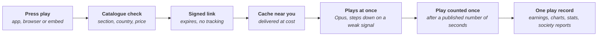
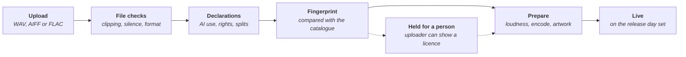
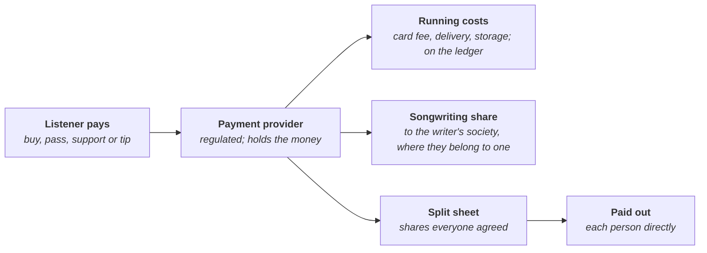

# Spare Music: architecture map

*Stage: Mapping. Every choice below is open until an owner accepts a decision note. Researched on 2026-10-19; not legal or tax advice. Anything marked (unverified) still needs checking against the primary source.*

One place to listen to music and to buy it straight from the artists, replacing Spotify, Apple Music, SoundCloud and Bandcamp. Like every Spareware app it is free software for everyone, built together with the spare weekly AI tokens contributors don't finish. Artists choose how their music is sold and keep everything except the running costs, shown on the open cost ledger. It is for every country: each country gets its own rights pack for its collecting societies, tax and law.

Everything to build is in [FEATURES.md](FEATURES.md) (22 areas, 175 features, 320 parts). A clickable demo with sample data is in [demo/index.html](demo/index.html).

## Goals

- Artists choose how their music is sold.
- One place for people to find and listen to it.
- Artists keep everything except running costs, shown on the open cost ledger.
- Music is hard to copy and pass around without paying.
- Practical and easy to use, for listeners every day and for artists on release day.

## What it replaces

| Service | What people use it for | What it keeps or how it pays (sourced) | Spare Music instead |
| --- | --- | --- | --- |
| Spotify | Streaming almost everything, by subscription or with adverts | Pays rights holders about two thirds of its music revenue, pooled and shared by each one's share of all plays ([Spotify, Jan 2026](https://newsroom.spotify.com/2026-01-28/2025-music-industry-payouts-whats-next-for-artists/)). Since April 2024 a track needs 1,000 plays in 12 months before it earns anything ([Spotify](https://artists.spotify.com/en/blog/modernizing-our-royalty-system)) | Every play earns from the first one. A pass, if members choose one, is shared by a rule they vote on. No adverts |
| Apple Music | Streaming by subscription | Reported around 2020 to pay about a cent a play and 52% of subscription revenue to rights holders (unverified: press coverage of a letter, with no date on the page) | The same at-cost rule as everything else |
| SoundCloud | Uploading and sharing, streaming | Since April 2021 pays some artists from each listener's own money ("fan-powered royalties"); who qualifies today is unverified | Each listener's pass could pay only the artists they played (an open decision below) |
| Bandcamp | Buying music and merch straight from artists | 15% of digital sales (10% after US$5,000 in 12 months), 10% of physical, plus payment fees of about 4 to 6% ([Bandcamp](https://get.bandcamp.help/hc/articles/23020694353047)). Since January 2026 it does not allow music made wholly or substantially by AI ([Bandcamp](https://blog.bandcamp.com/2026/01/13/keeping-bandcamp-human/)) | Running costs only. AI music is allowed, in its own section |

## The rules

1. **At cost.** The only charges are running costs: card and bank fees, storage and delivery, moderation, insurance, and licences the law requires. They are published each month on the open cost ledger, with no margin; any surplus lowers the next period's fee.
2. **Artists keep the rest.** Where someone else owns part of a track, such as the song in a cover, a sample or a co-writer's share, their share goes to them, directly or through their collecting society. Every play earns from the first one.
3. **Human and AI sections.** Two sections, and each listener chooses what they hear (below).
4. **Only legally required removals.** Spare Music removes only what the law requires, by published rules, in the open.
5. **Free to join, artists decide.** Spareware is free to join, with no member shares. Artists vote on Spare Music's fees and rules, listeners have a say on listener matters such as the pass, and major changes go to a vote of members.
6. **No adverts, no paid placement, no data sold.** Nobody can pay to be suggested, charted or placed higher.
7. **Built legally, or not at all.** See the [README](../../README.md). No GPL or AGPL code in the core.

| Spare Music does | Spare Music doesn't |
| --- | --- |
| Shows every new release from artists you follow, in time order, and suggests music only by rules it publishes | Rank music by a secret algorithm or sell placement |
| Lets you hide artists and tracks, skip explicit lyrics and choose Human, AI or both | Decide for you what you may hear beyond the law |
| Removes what the law requires: music that infringes copyright after a notice or a reviewed match, illegal material such as terrorist recordings or child abuse images in artwork, credible threats, and what a court orders down | Remove lawful music because it is unpopular, political or offensive to some |
| Has a person review every fingerprint match, a right of appeal, and a public log of every removal with the rule and the law behind it | Strike accounts automatically or moderate in secret |
| Runs at cost: no adverts, no selling data, no paid placement | Make money from attention |

## The parts

| Part | Replaces | What it does |
| --- | --- | --- |
| Listening | Streaming apps | Player, queue, gapless albums, even loudness, lossless, lyrics and credits, offline |
| Library and playlists | Streaming libraries | Everything bought or saved in one place, playlists anyone can share, history the listener controls |
| Finding music | Home pages ranked in secret | Search, new releases in time order, discovery and charts by published rules |
| Buying and supporting | Bandcamp | Buy to keep with no lock, pay what you like, pre-orders, monthly support, tips |
| Listening pass | Subscriptions | One monthly amount for streaming, if members choose to offer it, shared by a rule they vote on |
| Artist studio | Artist dashboards | Uploads, stats that protect listeners' privacy, earnings, payouts, supporters |
| Rights and splits | Distributors' split tools | Who owns the recording and the song, societies, covers, samples, splits paid to each person |
| Rights packs | Collecting society paperwork | Per country: which licences are held, how plays are reported and paid |
| Stopping copies | Closed matching systems | Fingerprints on upload, matches reviewed by people, notices, fake plays left out |
| Human and AI sections | Mixed catalogues | Separate sections for human-made and AI-made music; each listener picks |
| Moderation and the public log | Hidden moderation | Published rules, appeals, every removal logged in public |

## How listening works

- **Formats.** Streams use Opus, which is royalty-free; its reference library is BSD-3-Clause, and its patent licence ends for anyone who sues over Opus patents ([Opus licence](https://opus-codec.org/license/)). Lossless play and downloads use FLAC, whose libraries are BSD-style (its command-line tools are GPL and are not used). Other download formats follow the kit's codec and patent study (KIT-A27-F8-P1).
- **Loudness.** Measured once on upload by the published ITU-R BS.1770 method and EBU R 128, by track and by album, so playlists stay even and albums keep their quiet songs quiet.
- **Engine.** Decoding and playback live in the shared `engine-media`: Symphonia for decoding (MPL-2.0, pure Rust) and cpal for audio output (Apache-2.0), the same engine Spare Studio and Spare Social use.
- **Delivery.** Plain HTTP with signed links that expire, through caches near listeners, priced at cost. Storage and bandwidth are lines on the ledger.
- **Plays.** A play is recorded once, with only what payouts and fake-play checks need, then reduced to counts. One record feeds earnings, charts, artist stats and society reports, so they always agree.

## How uploading works

Every upload answers three things before it can go live: how AI was used, who owns the recording and the song (and whether it is a cover, uses samples or is out of copyright), and how the money is split. A match with someone else's recording holds the release for a person to review; it is never an automatic strike. Releases can also come from a distributor in DDEX's release format, or by script through the same commands.

## How artists are paid

- **Artists choose how they sell** each release: free, buy to keep, pay what you like, in the listening pass, or stream to own (each play costs a little more until the listener owns the track, the method the Resonate co-op used until it closed in 2024).
- **Before paying,** a listener sees the price, the running costs, any songwriting share sent to a society, any tax, and what reaches the artist.
- **Two copyrights in every track.** The recording belongs to whoever made it (often the artist); the song belongs to its writers and their publishers. When a writer belongs to a collecting society, the songwriting share is paid through that society, which takes its own costs (13.26% for APRA AMCOS in its 2025 financial year, about 10% for ASCAP in 2025 and 14.1% for GEMA in 2025, as each reports) and passes the rest on.
- **Splits are paid straight to each person** from the payout run, so nobody in the middle holds other people's money. Money for a track under dispute is held for that track only.
- **Tax.** In many countries a platform that sells digital music counts as the seller for GST or VAT (see the hard parts), so the co-op charges it and passes it on.

## How copies are stopped

- **Fingerprints.** Every upload is fingerprinted and compared with the catalogue and with reference fingerprints verified artists add. A close match holds the release for review by a trained person who hears both recordings and sees both rights declarations. False matches are expected: covers against originals, recordings of the same public-domain work, shared samples, silence and noise.
- **Methods to study** (licences read from the source, 2026-10-19): Chromaprint's own code is MIT but the project as a whole is LGPL-2.1 because it bundles FFmpeg code ([licence](https://github.com/acoustid/chromaprint/blob/master/LICENSE.md)); the AcoustID server is MIT, its data CC BY-SA 3.0 and its web service free only for non-commercial use ([AcoustID](https://acoustid.org/webservice)); audfprint and dejavu are MIT landmark methods; Panako and Olaf are AGPL, read only. The first landmark fingerprint patent (US 6,990,453) is listed as expired ([Google Patents](https://patents.google.com/patent/US6990453B2/en)); related and newer patents need a search before any method is chosen.
- **Copyright notices** follow each country's rules for hosts, with counter-notices, a published repeat-infringer policy and money held for the claimed track only until it is settled.
- **Fake plays.** Deezer said about 7% of plays in 2022 were fraudulent, and that up to 70% of plays of fully AI-made tracks were (June 2025) ([Deezer](https://newsroom-deezer.com/2025/06/deezer-launches-worlds-first-ai-tagging-system-for-music-streaming/)). Fake plays earn nothing and count for nothing. If the pass is shared by each listener's own plays, a bot account can only move the money its own pass paid, which removes most of the reward for play farms.
- **Copy protection** is an open decision (below). Watermarks are one option: Meta's AudioSeal is MIT for its code and, per its README, its weights ([AudioSeal](https://github.com/facebookresearch/audioseal)); companies such as Digimarc and Verance hold watermarking patents, so a patent search comes first (freedom to operate unverified).

## Human and AI sections

The catalogue has two sections: **Human**, for music people made themselves, and **AI**, for music made with AI. Each listener chooses to hear one, the other, or both, and can change it at any time.

- **Declared by the artist:** every track says whether AI was used and for which parts (music, vocals, lyrics, artwork, mixing or mastering). Accounts that are AI agents are labelled and can publish only in the AI section.
- **Checked, not assumed:** uploads are checked for content credentials (C2PA, an open standard for recording how media was made; the c2pa-rs library, MIT or Apache-2.0, lists MP3, WAV, FLAC and M4A) and for AI-detection signals. Signals are hints for moderators, never automatic verdicts.
- **Fixable in the open:** members can flag a track in the wrong section; moderators move it with the reason in the public log, and the artist can appeal.
- **Real voices need consent:** an AI copy of a real singer's voice appears only with that singer's consent, and comes down when they or their estate ask.
- **Fair to artists:** using AI isn't a penalty; it just goes in its own section, so human work isn't buried. This matters: Deezer reported that fully AI-made tracks passed half of its daily uploads in June 2026 ([TechCrunch](https://techcrunch.com/2026/07/21/music-streamer-deezer-says-more-than-50-of-daily-uploads-are-ai-generated/)).

## The hard parts

### Music licensing and rights

Every track has two copyrights: the **recording** and the **song**. Artists who upload their own recordings license the recording themselves; for an on-demand service no society licence is needed for a recording the artist owns (confirmed for New Zealand, Australia, the United Kingdom and the United States; Canada by the scope of its tariff; Germany unverified). The **song** is the hard part: in most countries songwriters who join a collecting society assign their rights to it, so even an artist's own song may need the society's licence before Spare Music can stream or sell it.

| Example country | Songs: performing right | Songs: mechanical right | Recordings on demand | Licences for a small service | A member's own song needs the society's licence? |
| --- | --- | --- | --- | --- | --- |
| New Zealand | APRA | AMCOS | Licensed by the owner; Recorded Music NZ has no role in streaming ([RMNZ](https://recordedmusic.co.nz/licences/direct-licensing)) | APRA AMCOS online licences (NZ terms unverified) | Yes: members assign their performing rights; "Licence Back" lets a member license chosen works directly |
| Australia | APRA | AMCOS | Licensed by the owner; PPCA covers only non-interactive services ([PPCA](https://ppca.com.au/music-licensing/online-and-digital-licensing)) | Online Mini Licence, A$275 to A$1,100 a year for services earning under A$25,000 per activity, not covering playlist-style streaming ([APRA AMCOS](https://www.apraamcos.com.au/music-licences/select-a-licence/online-mini-licence)) | Yes, as for New Zealand; AMCOS also allows opting out by category |
| United Kingdom | PRS for Music | MCPS | Licensed by the owner; PPL's webcast licence excludes on-demand | Licences for small online services by revenue band (PRS documents give different thresholds; to be checked) | Yes: PRS takes an assignment of the performing right, including communication to the public |
| United States | ASCAP, BMI, SESAC, GMR | The MLC blanket licence ([17 USC 115](https://www.law.cornell.edu/uscode/text/17/115)) | Licensed by the owner; SoundExchange's statutory licence is only for non-interactive services | The blanket licence: 15.3% of service revenue for streaming in 2026, 13.1 cents a download | No for ASCAP and BMI, which license without exclusivity, so writers can license directly; SESAC and GMR unverified |
| Canada | SOCAN | CMRRA (online through CSI) | Licensed by the owner; Re:Sound's Tariff 8 covers only non-interactive streams | SOCAN Tariff 22.A is still pending for 2019 to 2029 ([Copyright Board](https://www.cb-cda.gc.ca/en/cases-tariffs/ongoing-cases/pending)) | Yes: members assign their performing rights to SOCAN |
| European Union (example: Germany) | GEMA | GEMA | Licensed by the owner (unverified) | GEMA tariffs VR-OD 7 to 10; ICE Licensr for services in several countries ([GEMA](https://www.gema.de/en/musicusers/music-use-internet)) | Yes: GEMA holds members' rights as trustee; its free licence is for non-commercial use only |

So the first research piece for each launch country is what licence an at-cost service for independent artists needs, what it costs, and who carries that cost (MUS-A8-F1-P2, MUS-A8-F3-P2). The lean is that a licence's cost is carried by the plays and sales of the songs it covers, not by artists who own all their rights and belong to no society.

### Collecting societies differ by country

Each society has its own licences, rates, reporting formats, periods and matching rules, and the EU has hubs that license many countries at once. Spare Music keeps one **rights pack** per country (like the kit's country packs), reports plays and sales per song in DDEX's sales report format where a society takes it, and matches songs by ISWC and writer numbers. Reporting without a large staff is a real risk.

### Royalties for covers and samples

- **Covers** need a licence for the song. In the United States anyone may record a cover of a song already released there under the compulsory licence, which digital services take through The MLC; an arrangement may not change the basic melody. Elsewhere covers come under the AMCOS, MCPS, CMRRA or GEMA licences; CMRRA licenses covers only as written. Spare Music allows a cover where the country's licence covers it, or where the artist uploads proof of their own licence.
- **Samples** need the agreement of both the recording owner and the song owner. No compulsory licence covers samples in the United States; none was found in the other five, but that is unverified. Every sample is declared with proof.
- **DJ mixes and remixes** need rights for every track used, so they come later.

### Fingerprinting to stop stolen uploads

Without it, anyone can upload someone else's album and take its earnings. The method has to be accurate with noise, edits and re-recordings, licensed for the core, clear of patents and cheap enough at scale. Matches go to people, so the number of matches people can review each week sets how fast uploads can grow. See [How copies are stopped](#how-copies-are-stopped).

### What each country asks of a host

- **New Zealand:** the Copyright Act 1994, sections 92B to 92E: a host is protected if it removes infringing material as soon as possible once it knows or has reason to believe it infringes.
- **Australia:** the safe harbour covers carriage services and some institutions, not commercial platforms (later reform unverified), so Spare Music would carry more risk there.
- **United Kingdom:** the hosting defence in regulation 19 of the Electronic Commerce Regulations 2002; the UK has not adopted the EU's Article 17.
- **United States:** DMCA section 512: a registered agent, prompt removal, counter-notices restored after 10 to 14 business days, and a repeat-infringer policy.
- **Canada:** notice and notice: forward the notice and keep records for six months.
- **European Union:** Article 17 of the Copyright in the Digital Single Market Directive makes content-sharing services that organise and promote uploads for profit try to get licences and keep notified works off, with lighter duties for services under three years old and under 10 million euro turnover. Whether an at-cost, artist-run service counts is unverified. The Digital Services Act adds notices and statements of reasons for all hosts.

### App stores

Apple's rule for "reader" apps lets music apps give access to music bought elsewhere, with an entitlement to link out ([Apple](https://developer.apple.com/support/reader-apps/)). In the United States apps have been able to link to web purchases since May 2025; an appeals court in December 2025 allowed Apple a cost-based commission, with the rate sent back to the lower court, and the Supreme Court agreed in June 2026 to hear Apple's appeal on contempt. Google has run external-link and alternative billing programmes in the United States since December 2025. Elsewhere the rules differ by country. Artists must keep everything except running costs on phones too, so Spare Music sells on the web, links out where allowed, and never hides a store's cut in an artist's price (MUS-A9-F7).

### Tax on digital music

A platform that sells digital music is often the seller for tax: New Zealand's remote services rules for marketplaces (15% GST), Australia's electronic distribution platform rules (10% GST), the EU's rule that a platform taking part in an electronic service is presumed to be its supplier (Article 9a of Regulation 282/2011, with the One Stop Shop), and Canada's digital platform operator rules since July 2021 (5% GST, or HST such as 13% in Ontario). In the United Kingdom digital music is an electronically supplied service at 20% VAT; whether a platform is the deemed supplier there is unverified. In the United States sales tax on digital music differs by state. The kit's tax rules per country are marked later and must move up before sales open in a second country.

### Getting artists and listeners

Listeners expect all music; the big labels' catalogues will not be there at first. Spare Music starts with independent artists who own their rights, gives labels one published at-cost licence, connects to existing music players through an open API, and lets listeners play their own files beside it.

### Cost of lossless music

Lossless masters are large and are kept twice; delivery grows with every listener. Both are measured and published per artist and per listener before any free allowance is set (MUS-A16-F4-P4).

## What it uses from Spare Kit

Accounts (one Spareware login), ID checks (verified artists), payments and payouts (buying, regular payments for the pass and monthly support, tips, payout runs, refunds), tax (the tax engine, statements and income reporting), messaging (release alerts, the artist's mailing list), trust (reports, the public removal log, statements of reasons, appeals, copyright notices), member voting (fees, rules, moderators), the open cost ledger (fee setting, prices by use, free allowances), sync and storage (uploads, storage at cost, durable timers), country packs, plugins and the MCP server. Records and merch later use the marketplace engine (`kit-market`). Audio uses the shared `engine-media` (audio engine, decoding and encoding, content credentials, captions), and booklets use `engine-pdf`.

Candidate kit parts that could move down from Spare Music, because other programs need them too: audio fingerprinting (Spare Social and Spare Movies), split payouts (Spare Social's revenue splits), rights packs and society reporting (Spare Movies, and music in Spare Social).

## Low level

- **Core:** Rust, like every Spareware program, compiled native and to WebAssembly. The catalogue (artists, releases, tracks, credits, rights, splits) is a store of operations on `kit-ops`, so every change has history and undo, and the same commands serve the app, scripts and AI agents.
- **Identifiers:** ISRC for recordings, UPC or EAN for releases, ISWC for songs and IPI numbers for writers. DDEX's standards (the ERN release format and the DSR sales report format) need DDEX's free implementation licence; whether each operator of an open-source app needs its own is unverified ([DDEX](https://kb.ddex.net/general-implementation-guidance/licensing-the-standards)).
- **Open data:** MusicBrainz's core data is CC0 and can be used to suggest codes and credits; its supplementary data is CC BY-NC-SA and is not used, and commercial users are expected to choose a supporter tier ([MetaBrainz](https://metabrainz.org/supporters/account-type)).
- **Existing players:** an API compatible with the OpenSubsonic specification, whose repository is Apache-2.0 ([licence](https://github.com/opensubsonic/open-subsonic-api/blob/main/LICENSE); the site's "all rights reserved" footer is to be checked). Subsonic's own documentation is all rights reserved and is not used.
- **Federation (later):** releases and posts over ActivityPub, the W3C standard Funkwhale uses for music libraries and channels. Designed from the specification, not from Funkwhale's AGPL code.
- **Open formats:** bought music downloads as FLAC and other cleared formats with full tags; playlists export as M3U and XSPF; artists can take their masters, splits, statements and fan list anywhere.

## What to learn from

Licences were read from each project's own licence file on 2026-10-19. GPL and AGPL projects are read to learn how they work; their code is never copied.

| Project | What it is | Licence | How we use it |
| --- | --- | --- | --- |
| [Funkwhale](https://dev.funkwhale.audio/funkwhale/funkwhale) | Federated music server (Python, Django) | AGPL-3.0 | Read only: how libraries and channels federate over ActivityPub |
| [Navidrome](https://github.com/navidrome/navidrome) | Personal music server in Go with the Subsonic API | GPL-3.0 | Read only |
| [Ampache](https://github.com/ampache/ampache) | Long-running music server in PHP | AGPL-3.0-or-later | Read only: catalogue and API design |
| [MusicBrainz](https://github.com/metabrainz/musicbrainz-server) | Open music database | Server GPL-2.0-or-later; core data CC0; supplementary data CC BY-NC-SA 3.0 | Core data usable; code read only |
| [ListenBrainz](https://github.com/metabrainz/listenbrainz-server) | Open listening history | Server GPL-2.0-or-later; data dumps CC0 | Data usable; code read only |
| [Resonate](https://github.com/resonatecoop) | Co-op stream-to-own service, 2017 to 2024, now closed | Mostly GPL-3.0; some MPL-2.0 and MIT | Learn the model and what a music co-op found hard; read only |
| [Mirlo](https://github.com/funmusicplace/mirlo) | Open store for artists, much like Bandcamp | AGPL-3.0-or-later | Read only |
| Faircamp | Static site generator for artists, in Rust | AGPL-3.0-or-later | Read only: artist-owned pages |
| [OpenSubsonic](https://github.com/opensubsonic/open-subsonic-api) | Open API for music players | Apache-2.0 (repository) | Implement from the specification |
| [Chromaprint](https://github.com/acoustid/chromaprint), [AcoustID server](https://github.com/acoustid/acoustid-server) | Audio fingerprints and their index | LGPL-2.1 as a whole (own code MIT); server MIT; data CC BY-SA 3.0 | Study; decide whether Chromaprint can be linked |
| audfprint, [dejavu](https://github.com/worldveil/dejavu) | Landmark fingerprinting | MIT | Usable after a patent check |
| Panako, Olaf | Fingerprinting | AGPL-3.0 | Read only |
| [Symphonia](https://crates.io/crates/symphonia), [cpal](https://github.com/RustAudio/cpal), [rodio](https://github.com/RustAudio/rodio) | Rust audio decoding and output | MPL-2.0; Apache-2.0; MIT or Apache-2.0 | Usable in the core, through `engine-media` |
| [Opus](https://github.com/xiph/opus), [FLAC](https://github.com/xiph/flac) | Codecs | BSD-3-Clause; Xiph BSD-style (command-line tools GPL) | Libraries usable; tools not |
| [c2pa-rs](https://github.com/contentauth/c2pa-rs) | Content credentials | MIT or Apache-2.0 | Usable, through the kit |
| [AudioSeal](https://github.com/facebookresearch/audioseal), [WavMark](https://github.com/wavmark/wavmark) | Audio watermarking | MIT (WavMark's weights terms unverified) | Study, after a patent search |

## Open decisions

| Decision | Options | Lean |
| --- | --- | --- |
| How listeners pay | Each musician sets their own way: buy to keep, rent, pay what you like, or free; or one subscription for everything; or both | To be decided |
| How a subscription is shared out | Each week, what comes in is shared out by plays, so the most played that week get the biggest share (Spotify pools its money and splits it by share of all plays); or each listener's fee goes only to the musicians that listener played (SoundCloud's "fan-powered royalties") | To be decided |
| Stopping copies | Locked playback (DRM): Google's Widevine, Apple's FairPlay and Microsoft's PlayReady are closed systems and each needs an agreement with that company; or a hidden watermark in each copy, so a leaked copy leads back to the account it came from; or no lock, like Bandcamp's downloads. Nothing stops someone recording the sound as it plays, so no option is complete | To be decided |
| First catalogue | Independent artists who own their rights; also label catalogues on one published at-cost licence | Independent artists first; research first |
| Songwriting licences | A society licence in each country; direct licences from writers who can give them (United States writers, APRA's Licence Back); both | Research first, country by country |
| Covers and samples at launch | Covers where a licence covers them and samples with proof; neither at first | Research first |
| Fingerprinting method | Chromaprint (LGPL-2.1 as a whole); a landmark method such as audfprint (MIT); our own | Research first, with a patent search |
| Streaming formats | Opus and FLAC; add AAC or MP3 for older devices | Opus and FLAC, pending the kit's codec study |
| First countries | Any set of the six example countries, or others | Research first: licences, tax and host duties together |
| Federation | ActivityPub from the start; later | Later |

The work board is [STATUS.md](STATUS.md).
