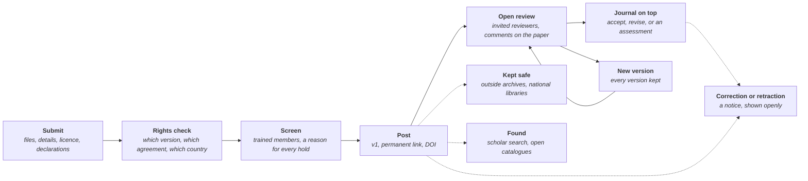

# Spare Research: architecture map

*Stage: Mapping. Every choice below is open until an owner accepts a decision note. Researched on 2026-10-19; anything not confirmed from a primary source is marked.*

Research that is free to read and free to publish, with open peer review and permanent links for citing. Researchers post their papers, trained members screen them, reviewers review them in the open, and editors gather the papers they accept into journals that sit on top. Spare Research is for researchers anywhere in the world. It is free to use, the only charge is running costs, and major changes go to a vote of members. Like every Spareware app it must be practical and easy to use: posting a paper should take minutes, and reading one should need no account at all.

The full list of what to build is [FEATURES.md](FEATURES.md) (22 areas, 193 features, 290 parts), with the same map as data in [features.json](features.json). A clickable demo with sample data is in [demo/index.html](demo/index.html).

## What it replaces

Much research is publicly funded and peer-reviewed by researchers for free, yet a lot of it sits behind journal paywalls, and publishing it openly often costs the authors thousands in fees. Other organisations' names appear here only to say what we replace or work with.

| What researchers face now | What Spare Research does |
| --- | --- |
| Paywalls: readers or their libraries pay subscriptions or a charge per article | Free to read for anyone, with no account, no sign-in wall and no tracking |
| Fees to publish openly, often thousands per paper | Free to post and to review; running costs (servers, storage, DOIs, preservation) are shown on the open cost ledger and covered as members decide |
| Reviews kept private; reviewers work for free with no credit | Reviews published with the paper, with their own DOIs, credited on the reviewer's profile and ORCID record |
| Months before anyone can read the work | Posted in days, after a quick screening that is clearly labelled as not peer review |
| Authors often sign their copyright away | Authors keep their copyright and choose an open licence |
| Corrections and retractions hard to find | Every version kept, and every correction and retraction shown openly in one public log |

## The rules

1. **Free to read.** Every paper, file and published review is public. An account is needed only to submit, review, follow or comment.
2. **Free to publish.** No fee to post or to be reviewed. The only costs are running costs, shown on the open cost ledger.
3. **Only what authors may share.** Spare Research hosts the authors' own work, papers under open licences and the versions publishers allow authors to post. It never hosts copies of paywalled papers.
4. **Screening is not peer review.** Every page says in words what a paper has had: screened only, under review, reviewed, accepted by a journal, corrected or retracted.
5. **Review in the open.** Reviews are published with the paper. Whether reviewers are named is an open decision.
6. **An honest, permanent record.** Every version is kept. Nothing is silently changed or deleted. Corrections, expressions of concern, retractions and withdrawals are notices linked to what they change, and files come down only for a legal reason or a serious risk to people, leaving a page that says why.
7. **People author, review and decide.** AI agents can search, read and draft through the same commands as people, but they cannot be authors or reviewers, make declarations, post, vote or decide. Every paper declares its AI use.
8. **Signals are hints.** Checks for copied text, paper mills, image reuse and generated text help trained people; they never decide on their own.
9. **Open data and open formats.** Metadata is CC0. Full text is kept as JATS XML. Records flow out over open protocols (OAI-PMH, COAR Notify) and to open catalogues.
10. **International.** Rights, legal deposit, ethics approval, funder policies and ISSN centres differ by country, so each country gets its own rules pack. New Zealand is the first worked example, not the only country.
11. **Built legally, or not at all.** See the README. No GPL or AGPL code in the core, and no publisher's or preprint server's interface is imitated.

## How a paper moves

## The parts

| Part | What it does | Feature map areas |
| --- | --- | --- |
| Accounts and profiles | One Spareware login, a researcher profile with a proven ORCID iD and ROR affiliations, reading with no account | RES-A1 |
| Search and following | Full-text search with plain filters, browsing by field, follows, feeds, OAI-PMH, human and AI sections | RES-A2 |
| Reading | The paper page, a reflowing web view built from JATS, the PDF, maths, figures, linked references, private counts | RES-A3 |
| Submitting | Upload in common formats, conversion to JATS, details and authors, licence, declarations, posting | RES-A4 |
| Rights | Plain guidance on versions, publisher policy lookup, country rules packs, the rights declaration, embargoes, takedowns | RES-A5 |
| Screening | Quick checks by trained members before posting, with reasons and appeals | RES-A6 |
| Peer review | Requests, reviewer finding with conflict checks, reviews pinned to the paper, published reviews with DOIs | RES-A7 |
| Journals on top | Journals run by editors over posted papers: queue, decisions or assessments, policies, protected names | RES-A8 |
| The record | Versions, corrections, expressions of concern, retractions, withdrawals and one public log | RES-A9 |
| Citing | Permanent IDs, DOIs, citation styles and exports, references linked and shared openly | RES-A10 |
| Data and code | Datasets with DOIs, code archived with SWHIDs, previews, care with personal and Indigenous data | RES-A11 |
| Dashboards | My papers, my reviews, tasks, messages with editors, the editor's queue | RES-A12 |
| Integrity | Concerns from anyone, an integrity panel, paper mill and fake reviewer signals | RES-A13 |
| Preservation | Archive packages, outside archives, legal deposit, fixity checks, bulk exports and mirrors | RES-A14 |
| Indexing | Scholar search readiness, open catalogues, metadata checks, journal directories, subject indexes | RES-A15 |
| Commands and agents | Command API, MCP server, people-only actions, webhooks, fair bulk access | RES-A16 |
| Everyone, everywhere | Accessibility, languages and scripts, country rules packs, apps on every device | RES-A17, RES-A18 |
| Running costs and members' say | No fees, research costs on the ledger, who pays for DOIs, votes on the rules | RES-A19 |
| Safety and law | Reports, moderation in the open, privacy in a permanent record, defamation in reviews, sanctions | RES-A20 |
| Moving in and out | Author and journal exports, past papers from ORCID | RES-A21 |
| Conferences (later) | Calls for papers, bidding, discussion and bulk decisions | RES-A22 |

## What it uses from the shared kit

Spare Research is a thin layer of research rules on the kit. It never depends on another program.

| Kit part | What Spare Research uses it for |
| --- | --- |
| Accounts (KIT-A1) | One login, roles per app (reader, author, reviewer, editor, screener), organisations for journals and institutions |
| Search (KIT-A6) | The one search service, published ranking rules, saved searches |
| Messaging (KIT-A8) | Invites, reminders, digests, paper message threads, and anchored comments for reviews pinned to the text |
| Safety and moderation (KIT-A10) | The one review queue for screening and concerns, reports, the public removal log, copyright notices, fraud signals |
| Disputes and appeals (KIT-A11) | Panel selection and workspaces for the integrity panel, appeals against screening decisions |
| Member voting (KIT-A12) | Who can publish, the review identity rule, screening rules and DOI fees changed only by vote; elections for screeners and panels |
| Open cost ledger (KIT-A13) | Research costs each month, cost per paper, the free storage allowance, funding from institutions shown openly |
| Sync, history and storage (KIT-A15) | Permanent IDs, every change an operation, version history, file uploads, previews, durable timers for embargoes and due dates |
| Plugins and API (KIT-A16) | Command API, SDKs, webhooks, bulk copy limits |
| AI access (KIT-A17) | MCP server, people-only actions, agent labels, guards against hidden instructions in paper text |
| Privacy (KIT-A18) | Data export, collection notices, sensitive details rules, Māori data principles in the New Zealand example |
| Languages and countries (KIT-A19) | Translation framework, country packs, accessible components, light mode |
| Public pages (KIT-A28) | Fast server-rendered paper and journal pages that web search can find |
| Shared engines (KIT-A27) | PDF reading and writing, tagged and archival PDF, page recovery, text shaping, office file reading |

## Its own parts

### Submitting

**High level:** a short flow that saves as it goes: files, details and authors, licence, rights check, declarations, a final check, then post. Co-authors are told and confirm. A web version is made automatically for the author to check.

**Low level:** uploads go through the kit's file service. PDFs are checked for real text and embedded fonts. LaTeX is built in a locked-down sandbox with no network, as a separate service so TeX's many licences stay out of the core. Every upload is converted to JATS XML, the one source for the reading view, search and archive copies. Which converter is a research question: Pandoc is GPL-2.0-or-later, so it may only run as a separate tool or be learned from. References are pulled out with an openly licensed extractor such as GROBID (Apache-2.0), run as its own service. Authors carry ORCID iDs, ROR affiliations and their part in the work from the CRediT roles.

### The rights check

**High level:** a few plain questions before posting: who wrote it, has it been accepted or published, which version is this, was an agreement signed, is any figure someone else's. The answers lead to post now, post on a date, or do not post. The author then makes a recorded declaration, as a person, never an agent.

**Low level:** three sources feed the answer. The publisher's policy, looked up in Jisc's Open Policy Finder where its terms allow. Any funder policy, such as a rights retention statement. And the country's own law from its rules pack: some countries give authors a legal right to share publicly funded work after a period, which contracts cannot override. Embargoes are durable timers. Uploads that look like a publisher's typeset version are held for a screener.

### Screening

**High level:** trained members check each paper before it goes live: research, not advertising; in a listed field; complete; readable; lawful; careful with people in the data. A health paper carries a plain notice that it is not yet reviewed. Every hold or decline has a reason and can be appealed.

**Low level:** screening runs in the kit's one review queue with published target times. Checks for copied text and paper mill signals are hints shown to the screener. Studies on people or animals must state ethics approval, and clinical trials a registry number. This follows what preprint servers do: arXiv's moderators check form, topic fit and the right to license, and arXiv says moderation "is not a peer-review process"; bioRxiv and medRxiv screen for non-scientific content, health risk, dual use and plagiarism.

### Peer review

**High level:** the authors or a journal ask for review. Reviewers are suggested from their fields and past papers, with conflicts left out. Reviewers comment on the exact lines of the web view and fill in a short form. Reviews, the authors' reply and the editor's assessment are published together with the version they refer to, and each review gets its own DOI.

**Low level:** reviews pinned to text use the kit's anchored comments. Conflict checks use co-authorship, shared institutions (ROR) and declarations. Reviewer identity is checked because the common fake review trick is an author suggesting a real researcher's name with an email address the author controls; an ORCID iD alone is not proof, so journal reviewers also need an institutional email or a record of papers. Reviews from other open review services arrive over COAR Notify, a protocol on the W3C Linked Data Notifications standard. Review identity (named, anonymous to the public but known to the editor, or private) is an open decision.

### Journals on top

**High level:** a group of editors runs a journal as a list of papers they reviewed and accepted, over papers already posted, like the overlay journals that sit on arXiv. A journal sets its scope, editors, review model and policies, and gets its own page and feeds. Some journals accept or decline; others publish an assessment of how important the work is and how strong its evidence is, with no accept or reject, as eLife does.

**Low level:** a journal is an organisation on the kit's model with its own roles. New journal names are checked against existing titles and ISSNs, so nobody passes a journal off as another. Policy pages come from templates covering what directories of open journals ask for. An existing journal can move in through other systems' published export formats and OAI-PMH, with its DOIs moved through the DOI agency's own transfer process.

### Versions and corrections

**High level:** every version (v1, v2 and on) is kept for good with its date and a note on what changed. The permanent link always leads to the latest, and each version has its own link. Corrections, expressions of concern and retractions are notices with their own pages, linked both ways to what they change. A retracted paper stays readable with a clear banner and the reason. An author's own retraction for an honest error says so plainly.

**Low level:** the retraction process follows COPE's retraction guidelines, updated in 2025, and NISO's recommended practice for retractions: the notice must explain the actual problem and be free to read. Updates go to the DOI agency as update metadata, which Crossref shows through Crossmark at no extra fee, so other services show them too. Withdrawing a preprint adds a withdrawal notice as the newest version and keeps the earlier versions, as arXiv does. Readers who saved or followed a paper are told when it changes.

### Citing and permanent IDs

**High level:** every paper, version, review and dataset has a permanent link that never breaks, and a DOI. A cite box gives the citation in common styles with a copy button, plus BibTeX, RIS and CSL-JSON.

**Low level:** our own permanent IDs come from the kit's permanent IDs and resolve even if pages or servers move. DOIs come from a registration agency (open decision below). Metadata carries ORCID iDs, ROR IDs (CC0), funder IDs and grant numbers. Citation styles come from the open Citation Style Language styles (CC BY-SA 3.0, credited as their README asks), formatted by a processor whose licence suits the core, such as hayagriva (MIT or Apache-2.0); citeproc-js is CPAL or AGPL, so it stays out. References are matched to DOIs and deposited openly, so citation data stays free. ARK identifiers are free to get and are a possible backup.

### Discovery and search

**High level:** one search box over titles, abstracts, full text, authors and references, with plain filters (field, date, reviewed or not, has data, has code, licence, language). Field pages show what is new. People follow authors, fields and journals and get new papers by email, in the app or as a feed. A pasted DOI or ORCID iD goes straight to the paper or person.

**Low level:** papers are declared to the kit's one search service, with ranking rules anyone can read and no paid placement. Every record is served over OAI-PMH, the open protocol archives use to harvest each other, and as Atom feeds. Open catalogues such as OpenAlex (CC0 data) add papers held elsewhere, later.

### Data and code with papers

**High level:** authors upload data with the paper or link to where it already lives, and link their code at a tagged version. Readers preview tables, images and notebooks in the browser. Every paper has a data availability statement.

**Low level:** datasets get their own DOIs and DataCite-style metadata; a free allowance per paper is set by vote, with storage at cost above it. Code is archived by Software Heritage, which gives a permanent SWHID (ISO/IEC 18670, published 2025). Data about people must have identifying details removed and consent recorded, or be held under controlled access. Indigenous data follows the CARE principles and each country's own principles; in the New Zealand example that means the kit's Māori data principles, with Local Contexts labels shown on the data.

### The reading experience

**High level:** a calm paper page with the title, authors, status in words, abstract, licence, versions, files, reviews and how to cite. The full text reads as a web page that reflows on a phone, with a contents list, figures and tables that open large, maths that screen readers can speak and references that link out and show if they were retracted. The PDF is there too, with the permanent link stamped on each page.

**Low level:** the reading view is rendered from JATS and built to WCAG 2.2 AA on the kit's components. Maths is MathML with the TeX source copyable. Pages carry the citation meta tags scholar search engines read, schema.org data and Signposting links. Reads and downloads are counted in totals only, with no tracking.

## Human and AI sections

Every paper declares its AI use: none, help with language or code, or text or results generated by AI. Papers generated by AI go in an **AI** section, and papers people wrote go in the **Human** section. Each reader chooses to see one, the other, or both.

- **Declared by the authors:** the AI use statement is part of every submission and shown on the paper.
- **Checked, not assumed:** detectors for generated text are often wrong, so their signals are hints for screeners, and the authors are always heard.
- **Fixable in the open:** anyone can flag a paper in the wrong section; moderators move it with the reason in the public log, and the authors can appeal.
- **People review:** sending a review is a people-only action. Reviewers declare any AI help and never paste an unpublished paper into an outside AI tool.

## The hard parts

### Rights and existing publisher agreements

Most researchers have signed publishing agreements. Many allow the preprint and often the accepted manuscript to be posted, sometimes after an embargo, but rarely the published version unless it is openly licensed.

- **Publisher policies:** Jisc's Open Policy Finder lists them, but its data is under CC BY-NC-ND 4.0 and its API needs a key; Jisc was moving to a new API in 2026. We need Jisc's written confirmation that a non-profit may show its data before building on it (*unverified*).
- **Country law:** some countries give a legal right to share that contracts cannot override. Germany and Austria: the accepted manuscript of at least half publicly funded work, after 12 months, not for commercial use. France: the accepted manuscript after at most 6 months, 12 in the humanities and social sciences (*statute not read, from a guide to the law*). Belgium: 6 months, 12 in the humanities. The Netherlands: short works funded with Dutch public money, after a "reasonable period", which universities treat as 6 months. New Zealand: no such right found (*unverified*); its government's open research policy asks for open access, or the accepted manuscript in a repository within 12 months, for some funding (*unverified against the policy text*).
- **Funders:** rights retention strategies, such as cOAlition S's, have authors apply a CC BY licence to the accepted manuscript before submission, so the funder's earlier condition wins over a later publisher agreement.
- **Our answer:** the rights check, a recorded declaration by a person, a screener's look at anything that seems typeset by a publisher, and tombstone pages when a valid complaint takes files down.

### Review quality and fraud

- **Paper mills** sell fake papers and authorships. Public methods exist to learn from, such as the Problematic Paper Screener, which flags "tortured phrases" (odd stand-ins for standard terms) and generated text. Shared publisher tools such as the STM Integrity Hub do not publish who may join or what it costs (*unverified*).
- **Fake reviewers:** the usual trick is a real name with an email the author controls. Suggested reviewers are checked before invites.
- **Image checks** are mostly commercial services; no open equivalent was found, so this part starts from the kit's reused photo checks and is sized large.
- **Review quality:** structured forms, a reviewer guide and course, editors seeing every review before it is published, and conduct rules against personal attacks.
- **Signals are hints:** no automatic verdicts, ever. An integrity panel of trained members hears the authors and publishes its outcome.

### DOI costs

DOIs cost money every year, and the cost grows with every paper. Fees as published on 2026-10-19:

| Agency | Yearly | Each DOI |
| --- | --- | --- |
| Crossref | USD 200 for publishing expenses up to USD 1,000, USD 275 up to USD 1 million | 2026: preprint USD 0.25, first review of a paper USD 0.25 (further reviews free), journal article USD 1, component USD 0.06. From 1 January 2027: preprint and first review USD 0.20, article USD 0.95 |
| DataCite | EUR 2,000 membership plus an infrastructure fee of EUR 200 to 700 | No fee for each DOI; the infrastructure fee covers 100,000 DOIs a year, with higher bands above that |

A rough guide, assuming one DOI for each paper and one for its first review at Crossref's 2027 fees: 1,000 papers a year cost about USD 675; 10,000 about USD 4,300; 100,000 about USD 40,300. DataCite stays near EUR 2,200 to 2,700 up to 100,000 DOIs a year. Crossref adds review content types, update metadata shown through Crossmark at no extra fee, and the Retraction Watch data (CC0); arXiv registers its DOIs with DataCite (*unverified*). Crossref's GEM programme waives fees for members in some lower-income countries, which matters if local groups run journals there. Crossref's Similarity Check for copied text costs extra. Whether every version gets its own DOI changes these numbers (open decision).

### Long-term preservation

Papers must outlive any one server, and the co-op itself.

- **Outside archives:** CLOCKSS is a dark archive run on LOCKSS technology with copies at 12 institutions, released openly if a publisher stops; publishers pay a fee by revenue plus a charge per item. Portico (part of the non-profit ITHAKA) also charges publishers by revenue; its current fees are *unverified*. PKP's free Preservation Network takes only journals running OJS, so it is not open to us. LOCKSS software is BSD-3-Clause, so we could also run a network with partner libraries.
- **National libraries:** legal deposit duties differ by country and go in each rules pack. In the New Zealand example the National Library harvests online documents under a 2006 notice and publishers help when asked (*to confirm against the Act*).
- **Code:** Software Heritage archives code on request.
- **Our own part:** open archive packages (files, JATS, metadata, checksums), regular fixity checks, bulk exports anyone can mirror, and a closing plan that points DOIs at archive copies.

### Indexing

Researchers find papers through scholar search engines, open catalogues and their library.

- **Scholar search engines:** their published inclusion guidelines ask for citation meta tags (title, at least one author and a date are required), the full text or whole abstract visible with no sign-in, one page per paper and a link to the PDF. New papers take weeks to appear.
- **Open catalogues** harvest DOI metadata and OAI-PMH.
- **Directories of open journals:** DOAJ is free but asks for an ISSN, at least five research articles a year, more than a year of publishing or at least ten articles, a clear licence, and at least two independent reviewers per article. Journals on top must be able to meet that.
- **Subject indexes:** PubMed Central asks for an ISSN, at least 25 peer-reviewed articles, a two-year record in life sciences publishing and full-text XML. Keeping JATS for every paper helps here.
- **Commercial citation indexes** have their own criteria; later.

### Getting researchers to come

Careers are often judged by journal names. Spare Research makes posting and reviewing quick, gives reviewers credit, links to ORCID, lets known groups of editors run journals on top, and works with existing preprint servers and review services rather than against them.

### Health research

Unreviewed clinical work can mislead. Health papers carry a plain notice that they are not yet reviewed and should not guide treatment, and screeners can hold them for a closer look.

## Where the code will go

Proposed folders, made only when Spare Research reaches the Design stage. Anything another program also needs moves into the kit or an engine.

| Folder | What it builds | Feature map areas |
| --- | --- | --- |
| `crates/research-core` | Papers, versions, metadata, permanent IDs and the JATS store | RES-A3, RES-A9, RES-A10 |
| `crates/research-submit` | Submission flow, uploads, conversion to JATS, declarations | RES-A4 |
| `crates/research-rights` | Rights check, policy lookup, rights rules packs, embargoes, takedowns | RES-A5 |
| `crates/research-screen` | Screening rules and queue, integrity signals and the integrity panel | RES-A6, RES-A13 |
| `crates/research-review` | Review requests, reviewer finding, reviews, publication of reviews | RES-A7 |
| `crates/research-journals` | Journals on top, editorial queue, decisions, conferences later | RES-A8, RES-A22 |
| `crates/research-cite` | DOIs, citation styles, references, open metadata | RES-A10, RES-A15 |
| `crates/research-data` | Datasets, code links, previews, controlled access | RES-A11 |
| `crates/research-preserve` | Archive packages, deposits, fixity, bulk exports | RES-A14, RES-A21 |
| `crates/research-app` | Search screens, reading view, dashboards, apps on every device | RES-A1, RES-A2, RES-A12, RES-A17, RES-A18 |

The command schemas, MCP server, costs and legal parts (RES-A16, RES-A19, RES-A20) sit in each folder beside the parts they cover.

## Learn from and work with

Licences were read from each project's own repository on 2026-10-19. "Learn from only" means reading how a project solves a problem and writing our own code in our own words, never copying it. Working with an outside service means using its published API on its terms.

| Project | What it is | Licence | How we can use it |
| --- | --- | --- | --- |
| arXiv | Free preprints for physics, maths, computing and more; an independent non-profit since July 2026 | Its code (arxiv-browse, arxiv-base) is MIT | Learn from its policies: endorsement (tightened in January 2026, so an institutional email alone no longer qualifies), moderation that is not peer review, withdrawals that keep earlier versions. Its MIT code could be reused with credit, but we build on the kit |
| bioRxiv and medRxiv (openRxiv) | Preprints in the life and health sciences, run by the non-profit openRxiv since 2025 | No platform code found; reported as proprietary | Learn from their published screening rules and health notices only |
| Open Journal Systems and Open Preprint Systems (PKP) | The most used open journal and preprint software | GPL-3.0 | Learn from only |
| Janeway | Journals, preprints and proceedings | AGPL-3.0 | Learn from only |
| Zenodo and InvenioRDM | Research data archive at CERN, built on InvenioRDM | Zenodo GPL-3.0; InvenioRDM MIT | Learn from Zenodo; InvenioRDM possible reuse with credit; link datasets already in Zenodo by DOI |
| OpenReview | Review platform for conferences and journals | Web interface AGPL-3.0; Python client MIT; the API server is not published | Learn from only, for conferences (later) |
| PREreview, Sciety, Kotahi, eLife's Enhanced Preprints | Open review and preprint evaluation tools | MIT (Kotahi also BSD-3-Clause for one part) | Learn from, possible reuse with credit; exchange reviews over COAR Notify |
| Peer Community In, Review Commons | Free recommendation and review of preprints | Services | Work with over COAR Notify; learn from their models |
| eLife's reviewed preprints, F1000Research | Publish, then review in the open; assessments without accept or reject; named reviewers with review DOIs | Proprietary platforms | Learn from their published models only, never their interfaces or wording |
| Crossref | DOIs, update metadata (Crossmark, no extra fee), the Retraction Watch data (CC0) | Paid membership | Work with |
| DataCite | DOIs, mostly for data | Paid membership, no fee for each DOI | Work with |
| ORCID | Researcher IDs | Free for researchers; public API for non-commercial use; member API about USD 4,775 a year for a non-profit; its own code is under an MIT-style licence that excludes its branding | Work with |
| ROR | Open registry of research organisations | CC0 data | Work with |
| OpenAlex, OpenCitations | Open catalogues of research and citations | OpenAlex data CC0; its API has a free daily allowance and charges for heavy use | Work with |
| Jisc Open Policy Finder (formerly Sherpa Romeo) | What each publisher lets authors share | Data CC BY-NC-ND 4.0; API key needed | Work with only once Jisc confirms in writing |
| Software Heritage | Archive of source code with SWHIDs | Service; SWHID is ISO/IEC 18670 | Work with |
| CLOCKSS, Portico, LOCKSS | Long-term preservation archives | Services; LOCKSS software BSD-3-Clause | Work with; LOCKSS possible reuse |
| DOAJ | Directory of open journals | Free to apply | Help journals apply |
| GROBID | Pulls references and structure from PDFs | Apache-2.0 | Possible reuse as a separate service |
| CERMINE | Reference extraction | AGPL-3.0, dormant | Learn from only |
| pdf.js | PDF viewer | Apache-2.0 | Possible reuse, as the kit's PDF engine decides |
| hayagriva; citeproc-rs; citeproc-js | Citation processors | MIT or Apache-2.0; MPL-2.0 (archived); CPAL or AGPL | hayagriva possible reuse; citeproc-rs only under MPL terms; citeproc-js learn from only |
| Citation Style Language styles | Thousands of citation styles | CC BY-SA 3.0 | Use as data with credit, keeping the share-alike licence |
| Pandoc | Document converter | GPL-2.0-or-later | Separate tool or learn from only |
| Texture, Typst | JATS editor; typesetting | MIT; Apache-2.0 | Learn from; possible reuse with credit |
| Hypothesis | Web annotation | BSD-2-Clause | Learn from for notes on papers |
| DSpace, EPrints | Institutional repositories | BSD-3-Clause; LGPL-3.0 | Deposit into them over SWORD and COAR Notify |
| JATS, OAI-PMH, COAR Notify, Signposting | Open standards | JATS tag sets free to use; OAI-PMH spec CC BY-SA 3.0; COAR Notify built on a W3C standard; Signposting states no licence | Follow the published specifications |

## Open decisions

| Decision | Options | Lean |
| --- | --- | --- |
| Peer review | Reviews published with reviewers' names; published anonymously; kept private, as most journals do now; or each journal chooses from these | To be decided |
| Paying for DOIs | Crossref charges a yearly membership and a fee for each DOI (USD 0.25 a preprint in 2026, USD 0.20 from 2027); DataCite charges a yearly fee and nothing for each DOI: covered as a running cost, or paid by each journal | To be decided |
| Who can publish | Anyone with an account; researchers with an ORCID iD; endorsement by someone already publishing, as arXiv does (tightened in 2026) | To be decided |
| DOI agency | Crossref; DataCite; both (papers and reviews at one, data at the other) | Research first |
| DOIs for versions | One DOI for each version; one DOI for the paper that leads to the latest | Research first |
| First release | A preprint server with open reviews; journals on top as well | Research first |
| Preservation | CLOCKSS; Portico; a LOCKSS network with partner libraries; more than one | Research first |
| Conversion to JATS | Which open converters, run how, to what quality | Research first |

The work board is [STATUS.md](STATUS.md).
